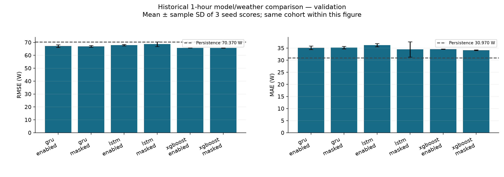
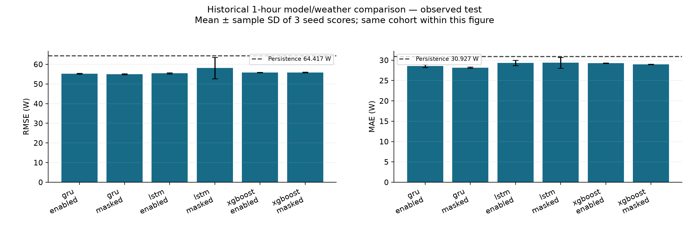
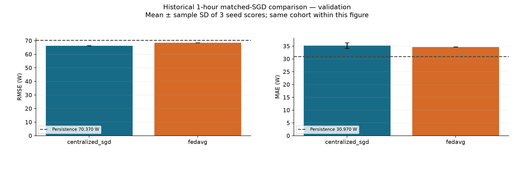
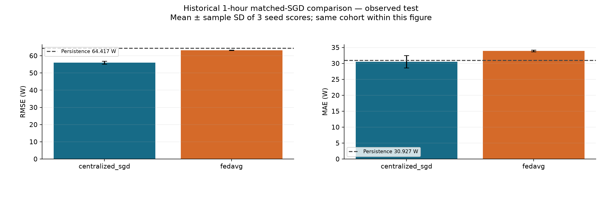
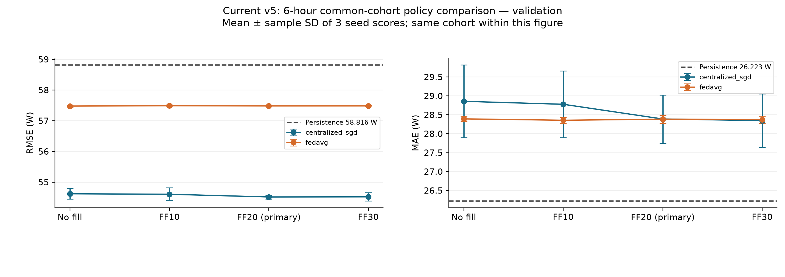
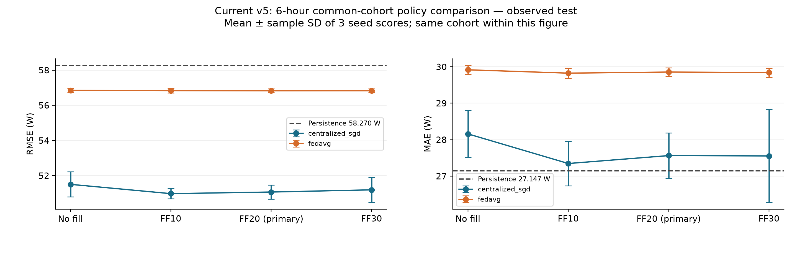
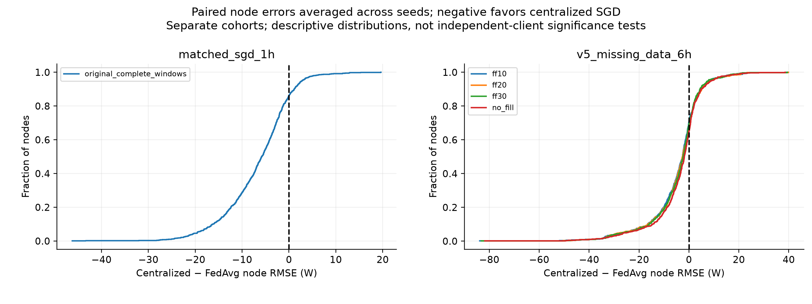

# Complete Results Report: Reproducible M100 Node-Level Power Forecasting

M.Tech major project · Evidence inspected 5 November 2026 · Additive analysis version 1

## Abstract

This report consolidates 48 completed main fits: 18 historical LSTM/GRU/XGBoost fits, six historical matched-SGD/FedAvg fits, and 24 current missing-data fits. The historical common test cohort contains 75,566 windows across 979 nodes with one-hour history. The current v5 cohort contains 6,590 windows across 570 nodes with six-hour history. Historical matched centralized SGD obtains RMSE 56.016953 ± 0.852660 W; FedAvg obtains 63.231179 ± 0.125510 W. In v5, the lowest observed mean test RMSE is centralized SGD/ff10 at 50.976723 ± 0.284497 W; the lowest FedAvg mean is ff20 at 56.830222 ± 0.114482 W. These are separate panels, not a controlled history-length comparison. All ± values are sample SDs of three scores on the same dataset. The test period has already been observed and is not untouched confirmatory data.

No model was trained, initialized, deserialized or invoked to prepare this report. Calculations use existing JSON/CSV artifacts, saved prediction vectors and frozen reference arrays. New charts visualize those saved results; they are not new evaluations or model forecasts.

## 1. Scope, experiment families and compatibility

| Cohort | History h | Split | Windows | Evaluated nodes | Distinct origins | First accepted UTC origin | Last accepted UTC origin |
| --- | --- | --- | --- | --- | --- | --- | --- |
| Historical v1 and matched v2/v3 | 1 | val | 199670 | 979 | 369 | 2022-02-11T07:10:00.000000000 | 2022-02-17T18:00:00.000000000 |
| Historical v1 and matched v2/v3 | 1 | test | 75566 | 979 | 94 | 2022-02-20T23:30:00.000000000 | 2022-02-28T01:00:00.000000000 |
| Current v5 missing-data | 6 | val | 31448 | 929 | 235 | 2022-02-11T07:10:00.000000000 | 2022-02-17T12:30:00.000000000 |
| Current v5 missing-data | 6 | test | 6590 | 570 | 17 | 2022-02-24T20:20:00.000000000 | 2022-02-24T23:00:00.000000000 |

All primary forecasts predict `next_horizon_mean_node_it_power_kw`: the mean of six observed future ten-minute power bins, subsequently reported in watts. They do not predict instantaneous power at exactly +60 minutes. Histories comprise 6 or 36 completed ten-minute bins; no 24-hour forecasting fit is present in the inspected main result directories. The v4 history stage contains coverage audits, not a completed 1/6/24-hour model comparison.

The common calendar grid is January–February 2022. Training ends at 2022-02-11 07:10 UTC; validation ends at 2022-02-20 03:30 UTC; test ends at 2022-03-01 00:00 UTC, exclusive. Target intervals remain inside their split; causal history may reach into the preceding split. Accepted windows have gaps and unequal node coverage.

The 979 client identifiers represent monitored compute nodes in one facility. Simulated clients must not be described as 979 independent physical data centers. The v5 test cohort evaluates only 570 of those known nodes; absent nodes are not assigned zero error.

The historical v1 neural comparison uses Adam, whereas the v2/v3 and v5 matched comparisons use SGD with learning rate 0.01, no momentum or weight decay. The historical Adam/boosting panel is not an optimizer- or budget-matched FL control. Within matched panels, architecture, seed initialization, SGD settings, selected clients and exposures are paired; centralized SGD continues through ordered client batches while FedAvg averages client states. Matching nominal settings does not make their optimization trajectories identical.

V5 changes the native training pools through no fill, FF10, FF20 and FF30 while preserving a per-client no-fill reference sample budget. Native training pools are respectively 2,310,256; 2,996,160; 3,459,118; and 3,867,660 windows. Training samples differ by policy; the final common validation/test inputs use the no-fill view, unchanged fourteen-channel representation, original training scalers, and outdoor-weather masking. This measures access to enlarged training pools under a fixed exposure budget, not an isolated numerical-imputation effect.

### Experiment inventory

| Scope | Recorded completion status | Run directories |
| --- | --- | --- |
| legacy | completed | 5 |
| main | completed | 48 |
| pilot | completed | 8 |

The full directory-level inventory, including five legacy runs and eight engineering pilots, is in [experiment_inventory.csv](experiment_inventory.csv). Pilots and legacy outputs are excluded from the three-seed main comparison. Partial historical evaluation attempts are not substituted for completed authoritative evaluations.

## 2. Metrics and aggregation

For residual errors eᵢ in W, pooled MAE = mean(|eᵢ|) and pooled RMSE = sqrt(mean(eᵢ²)). Persistence repeats the last completed ten-minute input power bin for the next-hour mean target. Every model is paired with persistence on the same ordered windows, targets and node identities. Inverse target scaling and multiplication by 1,000 produce W metrics.

Macro-node MAE and macro-node RMSE are arithmetic means of the corresponding node errors with equal weight per evaluated node. Pooled metrics weight windows; pooled RMSE equals the square root of the sample-weighted mean of squared node RMSEs, not the average node RMSE. Missing nodes never contribute artificial zeroes.

Across seeds 42, 43 and 44, mean = sum(score)/3 and sample SD = sqrt(sum((score−mean)²)/2). No prediction ensemble is formed. Seeds are stochastic repeats on the same cohort, not independent datasets; SD is neither a confidence interval nor a significance test. Overlapping target intervals and shared facility conditions further limit independence assumptions.

Percentage reduction = 100 × (reference error − model error) / reference error. Positive favors the model; negative indicates deterioration. Centralized−FedAvg and filled−no-fill differences below are signed W errors: negative favors the left method/policy. Test rankings are descriptive and do not select a new checkpoint, seed or hyperparameter.

Macro RMSE missing from older overall JSON files is explicitly derived from the existing per-node errors or saved predictions. Historical FedAvg validation has no saved model per-node validation metrics/prediction archive; its macro model metrics remain unavailable. No missing score is imputed.

## 3. Historical LSTM, GRU and XGBoost: one-hour history

### Selected validation results

| Method | Weather | Policy | RMSE W, mean ± SD | MAE W, mean ± SD | Macro RMSE W | Macro MAE W | RMSE reduction vs persistence % | MAE reduction vs persistence % |
| --- | --- | --- | --- | --- | --- | --- | --- | --- |
| gru | enabled | original_complete_windows | 67.185367 ± 0.983054 | 35.168094 ± 0.742172 | 62.974201 ± 0.916154 | 35.207656 ± 0.740104 | 4.525204 | -13.555860 |
| gru | masked | original_complete_windows | 66.997287 ± 0.653132 | 35.222350 ± 0.533272 | 62.772207 ± 0.673194 | 35.260667 ± 0.538981 | 4.792478 | -13.731048 |
| lstm | enabled | original_complete_windows | 67.889101 ± 0.549971 | 36.226204 ± 0.640739 | 63.704174 ± 0.497974 | 36.270107 ± 0.623396 | 3.525151 | -16.972439 |
| lstm | masked | original_complete_windows | 68.713460 ± 1.841751 | 34.500385 ± 3.144929 | 64.252118 ± 1.408260 | 34.528937 ± 3.169327 | 2.353684 | -11.399862 |
| xgboost | enabled | original_complete_windows | 65.739473 ± 0.040511 | 34.592474 ± 0.072188 | 61.473849 ± 0.040721 | 34.642636 ± 0.073176 | 6.579914 | -11.697212 |
| xgboost | masked | original_complete_windows | 65.683152 ± 0.039594 | 34.144695 ± 0.164631 | 61.373141 ± 0.010686 | 34.193055 ± 0.166870 | 6.659950 | -10.251360 |

The dashed line is the matching persistence score. Error bars show three-seed sample SD, not population uncertainty.

### Observed-period test results

| Method | Weather | Policy | RMSE W, mean ± SD | MAE W, mean ± SD | Macro RMSE W | Macro MAE W | RMSE reduction vs persistence % | MAE reduction vs persistence % |
| --- | --- | --- | --- | --- | --- | --- | --- | --- |
| gru | enabled | original_complete_windows | 55.183035 ± 0.231463 | 28.568199 ± 0.362530 | 45.847276 ± 0.322097 | 28.334446 ± 0.361619 | 14.335274 | 7.626705 |
| gru | masked | original_complete_windows | 54.948072 ± 0.270550 | 28.180762 ± 0.158161 | 45.691790 ± 0.052889 | 27.945529 ± 0.135342 | 14.700026 | 8.879456 |
| lstm | enabled | original_complete_windows | 55.407224 ± 0.327728 | 29.321507 ± 0.642224 | 46.182391 ± 0.427580 | 29.066201 ± 0.633877 | 13.987249 | 5.190935 |
| lstm | masked | original_complete_windows | 58.138304 ± 5.438532 | 29.385822 ± 1.337011 | 48.570642 ± 4.565330 | 29.150613 ± 1.349503 | 9.747590 | 4.982978 |
| xgboost | enabled | original_complete_windows | 55.832598 ± 0.082389 | 29.263634 ± 0.061560 | 46.823244 ± 0.110797 | 29.000447 ± 0.058519 | 13.326909 | 5.378063 |
| xgboost | masked | original_complete_windows | 55.865893 ± 0.204960 | 28.971343 ± 0.071682 | 46.735297 ± 0.173729 | 28.707230 ± 0.074270 | 13.275223 | 6.323166 |

The dashed line is the matching persistence score. Error bars show three-seed sample SD, not population uncertainty.

The lowest observed mean test RMSE in this six-configuration panel is gru/masked (54.948072 W); the highest is lstm/masked (58.138304 W). This historical comparison includes both outdoor-weather enabled and masked variants. Masked channels are standardized outdoor temperature and humidity; indoor inlet temperature remains present. XGBoost consumes lagged numerical channels plus a categorical node ID; it is a centralized historical baseline, not a federated algorithm.

One historical selection is a material qualification: `lstm_masked_seed44` selected **persistence at epoch 0**, not a learned recurrent correction. Its test RMSE is 64.417452 W versus physical persistence 64.417454 W; the difference is −0.000001370395 W. Its MAE difference is −0.000000914772 W. Those differences reflect the distinct floating-point persistence representations and are not meaningful learned-model gains. The configuration remains included transparently in the three-seed summary, and this fallback helps explain LSTM/masked's large SD. `selected_candidate` is recorded in the CSVs. Strict numerical seed/node win counts have no practical-equivalence threshold and can count such tiny differences; they must not be described as proof that every seed learned to outperform persistence.

## 4. Historical matched FedAvg versus centralized SGD: one-hour history

### Selected validation results

| Method | Weather | Policy | RMSE W, mean ± SD | MAE W, mean ± SD | Macro RMSE W | Macro MAE W | RMSE reduction vs persistence % | MAE reduction vs persistence % |
| --- | --- | --- | --- | --- | --- | --- | --- | --- |
| centralized_sgd | masked | original_complete_windows | 66.304353 ± 0.109368 | 35.243666 ± 1.117134 | 62.300346 ± 0.189606 | 35.328458 ± 1.114433 | 5.777181 | -13.799876 |
| fedavg | masked | original_complete_windows | 68.522209 ± 0.034782 | 34.671543 ± 0.030599 | — | — | 2.625464 | -11.952523 |

The dashed line is the matching persistence score. Error bars show three-seed sample SD, not population uncertainty.

### Observed-period test results

| Method | Weather | Policy | RMSE W, mean ± SD | MAE W, mean ± SD | Macro RMSE W | Macro MAE W | RMSE reduction vs persistence % | MAE reduction vs persistence % |
| --- | --- | --- | --- | --- | --- | --- | --- | --- |
| centralized_sgd | masked | original_complete_windows | 56.016953 ± 0.852660 | 30.516738 ± 1.941197 | 47.425109 ± 1.375685 | 30.219473 ± 1.956693 | 13.040722 | 1.326241 |
| fedavg | masked | original_complete_windows | 63.231179 ± 0.125510 | 33.924637 ± 0.285604 | 54.160553 ± 0.200632 | 33.647441 ± 0.292585 | 1.841543 | -9.692966 |

The dashed line is the matching persistence score. Error bars show three-seed sample SD, not population uncertainty.

Centralized SGD has lower pooled test RMSE in 3/3 paired seeds and lower MAE in 3/3. Its mean RMSE difference is -7.214226 W (centralized minus FedAvg). This measured comparison does not show that FedAvg outperforms centralized SGD. During validation, the mean MAE ordering differs from the RMSE ordering; both criteria must be reported.

## 5. Current v5 missing-data comparison: six-hour history

### Selected validation results

| Method | Weather | Policy | RMSE W, mean ± SD | MAE W, mean ± SD | Macro RMSE W | Macro MAE W | RMSE reduction vs persistence % | MAE reduction vs persistence % |
| --- | --- | --- | --- | --- | --- | --- | --- | --- |
| centralized_sgd | masked | ff10 | 54.606525 ± 0.209234 | 28.777520 ± 0.879752 | 40.949861 ± 0.580038 | 28.266256 ± 0.811901 | 7.156673 | -9.740610 |
| centralized_sgd | masked | ff20 | 54.518210 ± 0.061989 | 28.388805 ± 0.637700 | 40.703845 ± 0.239894 | 27.952280 ± 0.528661 | 7.306828 | -8.258279 |
| centralized_sgd | masked | ff30 | 54.522187 ± 0.133695 | 28.345993 ± 0.708325 | 40.682406 ± 0.439434 | 27.930239 ± 0.680244 | 7.300066 | -8.095019 |
| centralized_sgd | masked | no_fill | 54.621876 ± 0.173156 | 28.855858 ± 0.960509 | 41.007340 ± 0.485271 | 28.396341 ± 0.855826 | 7.130572 | -10.039345 |
| fedavg | masked | ff10 | 57.488773 ± 0.031995 | 28.355756 ± 0.083545 | 42.425384 ± 0.062593 | 27.939918 ± 0.081452 | 2.256204 | -8.132248 |
| fedavg | masked | ff20 | 57.481809 ± 0.029749 | 28.383459 ± 0.101892 | 42.439892 ± 0.072646 | 27.966865 ± 0.099884 | 2.268044 | -8.237893 |
| fedavg | masked | ff30 | 57.482679 ± 0.027183 | 28.374780 ± 0.093646 | 42.436575 ± 0.066720 | 27.959613 ± 0.091792 | 2.266566 | -8.204793 |
| fedavg | masked | no_fill | 57.477502 ± 0.028745 | 28.391863 ± 0.071644 | 42.440168 ± 0.052475 | 27.972156 ± 0.071055 | 2.275368 | -8.269941 |

The dashed line is the matching persistence score. Error bars show three-seed sample SD, not population uncertainty.

### Observed-period test results

| Method | Weather | Policy | RMSE W, mean ± SD | MAE W, mean ± SD | Macro RMSE W | Macro MAE W | RMSE reduction vs persistence % | MAE reduction vs persistence % |
| --- | --- | --- | --- | --- | --- | --- | --- | --- |
| centralized_sgd | masked | ff10 | 50.976723 ± 0.284497 | 27.346591 ± 0.608253 | 33.509248 ± 0.538621 | 27.699122 ± 0.514053 | 12.516062 | -0.734945 |
| centralized_sgd | masked | ff20 | 51.068241 ± 0.394274 | 27.563574 ± 0.620546 | 33.751581 ± 0.719665 | 27.946217 ± 0.676370 | 12.359002 | -1.534231 |
| centralized_sgd | masked | ff30 | 51.193037 ± 0.714977 | 27.554376 ± 1.274690 | 33.770566 ± 1.299014 | 27.939118 ± 1.228663 | 12.144834 | -1.500350 |
| centralized_sgd | masked | no_fill | 51.505102 ± 0.711372 | 28.158903 ± 0.641842 | 34.517427 ± 0.859535 | 28.613076 ± 0.679865 | 11.609282 | -3.727208 |
| fedavg | masked | ff10 | 56.834380 ± 0.120754 | 29.825478 ± 0.139497 | 38.199012 ± 0.165195 | 30.513532 ± 0.148999 | 2.463416 | -9.866267 |
| fedavg | masked | ff20 | 56.830222 ± 0.114482 | 29.855553 ± 0.117770 | 38.221018 ± 0.151260 | 30.539473 ± 0.136266 | 2.470551 | -9.977053 |
| fedavg | masked | ff30 | 56.831318 ± 0.115181 | 29.841830 ± 0.123997 | 38.210663 ± 0.157839 | 30.527036 ± 0.143763 | 2.468671 | -9.926504 |
| fedavg | masked | no_fill | 56.851084 ± 0.111688 | 29.916955 ± 0.119912 | 38.283325 ± 0.143628 | 30.601173 ± 0.132157 | 2.434749 | -10.203234 |

The dashed line is the matching persistence score. Error bars show three-seed sample SD, not population uncertainty.

For centralized_sgd, descriptive test-RMSE best is ff10 (50.976723 ± 0.284497 W), worst is no_fill (51.505102 W), and descriptive MAE best is ff10 (27.346591 W). The best-RMSE configuration's MAE reduction versus persistence is -0.734945%; its RMSE reduction is 12.516062%.

For fedavg, descriptive test-RMSE best is ff20 (56.830222 ± 0.114482 W), worst is no_fill (56.851084 W), and descriptive MAE best is ff10 (29.825478 W). The best-RMSE configuration's MAE reduction versus persistence is -9.977053%; its RMSE reduction is 2.470551%.

FF20 versus no-fill was the predeclared primary contrast; FF10 and FF30 are sensitivity comparisons. A lower observed FF10 test mean does not retroactively change the primary hypothesis or authorize test-based retuning. The FedAvg policy differences are small in W; report their paired seed differences rather than asserting a proven improvement from the rounded ranking.

### Direct research answers

- **Does FedAvg outperform matched centralized SGD?** No measured pooled test advantage is found here. Centralized SGD has lower test RMSE and MAE in all three historical paired seeds and all twelve paired v5 method/policy/seed comparisons. This is conditional on these protocols and cohorts; it is not a universal ranking of learning paradigms.
- **Which v5 policy is best?** Descriptively, centralized SGD/FF10 has the lowest mean test RMSE and MAE among the learned v5 configurations. Within FedAvg, FF20 has the lowest mean RMSE, while FF10 has the lowest mean MAE. FF20 remains the predeclared primary comparison, and the test ranking does not authorize retuning.
- **Are changes consistent?** For centralized SGD, FF10 and FF20 lower pooled test RMSE and MAE relative to no-fill in all three paired seeds; FF30 lowers RMSE in three and MAE in two. All FedAvg fill policies lower both pooled errors versus no-fill in all three seeds, but the RMSE changes are only about 0.017–0.021 W. Repeated sign agreement on one dataset is not evidence of independent-data statistical significance.
- **Does the best learned v5 method beat persistence on both criteria?** No. Centralized SGD/FF10 lowers mean RMSE by 12.516062% but increases mean MAE by 0.734945%. Its MAE beats persistence in two of three seeds; one worse seed makes the mean worse. The distinction between RMSE and MAE must remain visible.
- **Did six-hour history improve forecasting?** This report cannot establish that. One-hour and v5 six-hour results have different accepted cohorts and training protocols.

## 6. Paired method and policy differences

| Panel | Split | Left minus right | Left method | Left policy | Mean ΔRMSE W | SD ΔRMSE W | Seeds with lower RMSE /3 | Mean ΔMAE W | Seeds with lower MAE /3 |
| --- | --- | --- | --- | --- | --- | --- | --- | --- | --- |
| matched_sgd_1h | test | centralized_sgd minus fedavg | centralized_sgd | original_complete_windows | -7.214226 | 0.973540 | 3 | -3.407899 | 3 |
| matched_sgd_1h | val | centralized_sgd minus fedavg | centralized_sgd | original_complete_windows | -2.217855 | 0.134535 | 3 | 0.572123 | 1 |
| v1_adam_boosting_1h | test | masked minus enabled | gru | original_complete_windows | -0.234964 | 0.072812 | 3 | -0.387437 | 2 |
| v1_adam_boosting_1h | test | masked minus enabled | lstm | original_complete_windows | 2.731080 | 5.111033 | 2 | 0.064315 | 2 |
| v1_adam_boosting_1h | test | masked minus enabled | xgboost | original_complete_windows | 0.033294 | 0.260319 | 2 | -0.292291 | 3 |
| v1_adam_boosting_1h | val | masked minus enabled | gru | original_complete_windows | -0.188080 | 0.335770 | 2 | 0.054256 | 2 |
| v1_adam_boosting_1h | val | masked minus enabled | lstm | original_complete_windows | 0.824359 | 1.291803 | 1 | -1.725820 | 2 |
| v1_adam_boosting_1h | val | masked minus enabled | xgboost | original_complete_windows | -0.056321 | 0.039590 | 3 | -0.447778 | 3 |
| v5_missing_data_6h | test | centralized_sgd minus fedavg | centralized_sgd | ff10 | -5.857657 | 0.342371 | 3 | -2.478887 | 3 |
| v5_missing_data_6h | test | centralized_sgd minus fedavg | centralized_sgd | ff20 | -5.761981 | 0.453053 | 3 | -2.291979 | 3 |
| v5_missing_data_6h | test | centralized_sgd minus fedavg | centralized_sgd | ff30 | -5.638281 | 0.707113 | 3 | -2.287454 | 3 |
| v5_missing_data_6h | test | centralized_sgd minus fedavg | centralized_sgd | no_fill | -5.345982 | 0.756688 | 3 | -1.758052 | 3 |
| v5_missing_data_6h | test | ff10 minus no_fill | centralized_sgd | ff10 | -0.528379 | 0.426994 | 3 | -0.812312 | 3 |
| v5_missing_data_6h | test | ff10 minus no_fill | fedavg | ff10 | -0.016704 | 0.009074 | 3 | -0.091477 | 3 |
| v5_missing_data_6h | test | ff20 minus no_fill | centralized_sgd | ff20 | -0.436861 | 0.318911 | 3 | -0.595329 | 3 |
| v5_missing_data_6h | test | ff20 minus no_fill | fedavg | ff20 | -0.020862 | 0.002917 | 3 | -0.061401 | 3 |
| v5_missing_data_6h | test | ff30 minus no_fill | centralized_sgd | ff30 | -0.312065 | 0.375334 | 3 | -0.604527 | 2 |
| v5_missing_data_6h | test | ff30 minus no_fill | fedavg | ff30 | -0.019766 | 0.005412 | 3 | -0.075124 | 3 |
| v5_missing_data_6h | val | centralized_sgd minus fedavg | centralized_sgd | ff10 | -2.882248 | 0.208037 | 3 | 0.421764 | 1 |
| v5_missing_data_6h | val | centralized_sgd minus fedavg | centralized_sgd | ff20 | -2.963600 | 0.068038 | 3 | 0.005346 | 1 |
| v5_missing_data_6h | val | centralized_sgd minus fedavg | centralized_sgd | ff30 | -2.960492 | 0.130791 | 3 | -0.028786 | 1 |
| v5_missing_data_6h | val | centralized_sgd minus fedavg | centralized_sgd | no_fill | -2.855626 | 0.158389 | 3 | 0.463995 | 1 |
| v5_missing_data_6h | val | ff10 minus no_fill | centralized_sgd | ff10 | -0.015351 | 0.095786 | 2 | -0.078338 | 2 |
| v5_missing_data_6h | val | ff10 minus no_fill | fedavg | ff10 | 0.011271 | 0.003359 | 0 | -0.036107 | 3 |
| v5_missing_data_6h | val | ff20 minus no_fill | centralized_sgd | ff20 | -0.103666 | 0.121696 | 3 | -0.467053 | 3 |
| v5_missing_data_6h | val | ff20 minus no_fill | fedavg | ff20 | 0.004307 | 0.003176 | 0 | -0.008404 | 2 |
| v5_missing_data_6h | val | ff30 minus no_fill | centralized_sgd | ff30 | -0.099689 | 0.056228 | 3 | -0.509865 | 3 |
| v5_missing_data_6h | val | ff30 minus no_fill | fedavg | ff30 | 0.005177 | 0.004199 | 0 | -0.017084 | 2 |

See [paired_seed_differences.csv](paired_seed_differences.csv) for every paired seed and exact source paths. The paired SD describes optimization variation on the same dataset; no independent-dataset inference is made. Validation and test are distinct periods and are not pooled together.

## 7. Persistence and node-level consistency

| Cohort | Split | Windows | Nodes | Persistence MAE W | Persistence RMSE W | Macro MAE W | Macro RMSE W |
| --- | --- | --- | --- | --- | --- | --- | --- |
| historical_1h | val | 199670 | 979 | 30.969863 | 70.369741 | 30.967863 | 65.287033 |
| historical_1h | test | 75566 | 979 | 30.926903 | 64.417454 | 30.703514 | 53.842224 |
| v5_6h | val | 31448 | 929 | 26.223219 | 58.815777 | 26.005299 | 41.807662 |
| v5_6h | test | 6590 | 570 | 27.147075 | 58.269808 | 28.272739 | 36.276867 |

Persistence is deterministic and has no fitted seed. Repetition of its identical scores across three model seeds does not create three independent baseline experiments.

| Panel | Method | Weather | Policy | Nodes | Nodes beating persistence by mean RMSE | Nodes beating persistence in all seeds: RMSE | Nodes beating persistence by mean MAE | Nodes beating persistence in all seeds: MAE |
| --- | --- | --- | --- | --- | --- | --- | --- | --- |
| matched_sgd_1h | centralized_sgd | masked | original_complete_windows | 979 | 810 | 702 | 571 | 409 |
| matched_sgd_1h | fedavg | masked | original_complete_windows | 979 | 569 | 532 | 257 | 227 |
| v1_adam_boosting_1h | gru | enabled | original_complete_windows | 979 | 800 | 731 | 670 | 559 |
| v1_adam_boosting_1h | gru | masked | original_complete_windows | 979 | 806 | 739 | 693 | 577 |
| v1_adam_boosting_1h | lstm | enabled | original_complete_windows | 979 | 788 | 713 | 628 | 512 |
| v1_adam_boosting_1h | lstm | masked | original_complete_windows | 979 | 811 | 688 | 677 | 526 |
| v1_adam_boosting_1h | xgboost | enabled | original_complete_windows | 979 | 805 | 785 | 639 | 600 |
| v1_adam_boosting_1h | xgboost | masked | original_complete_windows | 979 | 818 | 791 | 654 | 630 |
| v5_missing_data_6h | centralized_sgd | masked | ff10 | 570 | 317 | 273 | 290 | 245 |
| v5_missing_data_6h | centralized_sgd | masked | ff20 | 570 | 321 | 275 | 290 | 248 |
| v5_missing_data_6h | centralized_sgd | masked | ff30 | 570 | 312 | 253 | 279 | 217 |
| v5_missing_data_6h | centralized_sgd | masked | no_fill | 570 | 300 | 234 | 268 | 198 |
| v5_missing_data_6h | fedavg | masked | ff10 | 570 | 218 | 175 | 227 | 180 |
| v5_missing_data_6h | fedavg | masked | ff20 | 570 | 220 | 175 | 228 | 184 |
| v5_missing_data_6h | fedavg | masked | ff30 | 570 | 219 | 177 | 227 | 184 |
| v5_missing_data_6h | fedavg | masked | no_fill | 570 | 220 | 179 | 225 | 182 |

| Panel | Policy | Nodes | Central lower mean node RMSE | Central lower node RMSE all seeds | FedAvg lower mean node RMSE | Central lower mean node MAE | Central lower node MAE all seeds |
| --- | --- | --- | --- | --- | --- | --- | --- |
| matched_sgd_1h | original_complete_windows | 979 | 843 | 701 | 136 | 788 | 542 |
| v5_missing_data_6h | ff10 | 570 | 402 | 303 | 168 | 380 | 274 |
| v5_missing_data_6h | ff20 | 570 | 384 | 295 | 186 | 362 | 269 |
| v5_missing_data_6h | ff30 | 570 | 394 | 269 | 176 | 367 | 241 |
| v5_missing_data_6h | no_fill | 570 | 371 | 241 | 199 | 340 | 211 |

All evaluated nodes are retained in these descriptive analyses. Per-node test metrics and counts are supplied in [per_node_test_metrics.csv](per_node_test_metrics.csv); paired deltas are in [per_node_paired_differences.csv](per_node_paired_differences.csv). Equal-node results may disagree with pooled rankings because coverage and squared-error weighting differ. In v5, individual nodes have only 1–17 accepted test windows, so a node-specific ranking can be especially unstable.

## 8. Seed-wise main results and selected checkpoints

### v1_adam_boosting_1h

| Method | Weather | Policy | Seed | Split | Selected | Index unit | Completed | MAE W | RMSE W | Macro MAE W | Macro RMSE W |
| --- | --- | --- | --- | --- | --- | --- | --- | --- | --- | --- | --- |
| gru | enabled | original_complete_windows | 42 | val | 1 | epoch | 6 | 35.659693 | 67.984934 | 35.695746 | 63.620997 |
| gru | enabled | original_complete_windows | 42 | test | 1 | epoch | 6 | 28.156911 | 55.011254 | 27.922784 | 45.479282 |
| gru | enabled | original_complete_windows | 43 | val | 1 | epoch | 6 | 34.314374 | 66.087791 | 34.356092 | 61.925835 |
| gru | enabled | original_complete_windows | 43 | test | 1 | epoch | 6 | 28.841368 | 55.091602 | 28.600851 | 46.077980 |
| gru | enabled | original_complete_windows | 44 | val | 1 | epoch | 6 | 35.530216 | 67.483375 | 35.571130 | 63.375771 |
| gru | enabled | original_complete_windows | 44 | test | 1 | epoch | 6 | 28.706319 | 55.446249 | 28.479703 | 45.984565 |
| gru | masked | original_complete_windows | 42 | val | 1 | epoch | 6 | 35.628960 | 67.485249 | 35.673982 | 63.224927 |
| gru | masked | original_complete_windows | 42 | test | 1 | epoch | 6 | 28.248251 | 54.811640 | 28.004560 | 45.686981 |
| gru | masked | original_complete_windows | 43 | val | 1 | epoch | 6 | 34.618569 | 66.255309 | 34.651047 | 61.998606 |
| gru | masked | original_complete_windows | 43 | test | 1 | epoch | 6 | 28.293984 | 54.772900 | 28.041329 | 45.641470 |
| gru | masked | original_complete_windows | 44 | val | 1 | epoch | 6 | 35.419521 | 67.251303 | 35.456973 | 63.093089 |
| gru | masked | original_complete_windows | 44 | test | 1 | epoch | 6 | 28.000052 | 55.259675 | 27.790698 | 45.746919 |
| lstm | enabled | original_complete_windows | 42 | val | 1 | epoch | 6 | 35.606910 | 67.991607 | 35.659531 | 63.746722 |
| lstm | enabled | original_complete_windows | 42 | test | 1 | epoch | 6 | 29.217566 | 55.224928 | 28.989290 | 45.974986 |
| lstm | enabled | original_complete_windows | 43 | val | 1 | epoch | 6 | 36.185276 | 67.295089 | 36.245214 | 63.186290 |
| lstm | enabled | original_complete_windows | 43 | test | 1 | epoch | 6 | 28.737594 | 55.211175 | 28.474288 | 45.898071 |
| lstm | enabled | original_complete_windows | 44 | val | 1 | epoch | 6 | 36.886426 | 68.380608 | 36.905578 | 64.179509 |
| lstm | enabled | original_complete_windows | 44 | test | 1 | epoch | 6 | 30.009362 | 55.785569 | 29.735024 | 46.674117 |
| lstm | masked | original_complete_windows | 42 | val | 1 | epoch | 6 | 37.001944 | 69.040568 | 37.040015 | 64.820900 |
| lstm | masked | original_complete_windows | 42 | test | 1 | epoch | 6 | 28.695302 | 54.915906 | 28.486116 | 45.942993 |
| lstm | masked | original_complete_windows | 43 | val | 1 | epoch | 6 | 35.529348 | 66.730072 | 35.578935 | 62.648424 |
| lstm | masked | original_complete_windows | 43 | test | 1 | epoch | 6 | 28.535262 | 55.081555 | 28.262209 | 45.926710 |
| lstm | masked | original_complete_windows | 44 | val | 0 | epoch | 5 | 30.969862 | 70.369740 | 30.967862 | 65.287032 |
| lstm | masked | original_complete_windows | 44 | test | 0 | epoch | 5 | 30.926902 | 64.417452 | 30.703513 | 53.842223 |
| xgboost | enabled | original_complete_windows | 42 | val | 83 | boosting_trees | 113 | 34.627846 | 65.742399 | 34.680033 | 61.472299 |
| xgboost | enabled | original_complete_windows | 42 | test | 83 | boosting_trees | 113 | 29.198010 | 55.765834 | 28.938737 | 46.724825 |
| xgboost | enabled | original_complete_windows | 43 | val | 82 | boosting_trees | 112 | 34.640153 | 65.778442 | 34.689557 | 61.515323 |
| xgboost | enabled | original_complete_windows | 43 | test | 82 | boosting_trees | 112 | 29.272789 | 55.807288 | 29.007463 | 46.801663 |
| xgboost | enabled | original_complete_windows | 44 | val | 79 | boosting_trees | 109 | 34.509422 | 65.697578 | 34.558319 | 61.433925 |
| xgboost | enabled | original_complete_windows | 44 | test | 79 | boosting_trees | 109 | 29.320105 | 55.924673 | 29.055142 | 46.943244 |
| xgboost | masked | original_complete_windows | 42 | val | 64 | boosting_trees | 94 | 33.954661 | 65.723819 | 34.000450 | 61.377126 |
| xgboost | masked | original_complete_windows | 42 | test | 64 | boosting_trees | 94 | 29.050962 | 56.098673 | 28.790192 | 46.935515 |
| xgboost | masked | original_complete_windows | 43 | val | 83 | boosting_trees | 113 | 34.244019 | 65.680909 | 34.294154 | 61.381261 |
| xgboost | masked | original_complete_windows | 43 | test | 83 | boosting_trees | 113 | 28.951127 | 55.712508 | 28.684567 | 46.624400 |
| xgboost | masked | original_complete_windows | 44 | val | 87 | boosting_trees | 117 | 34.235406 | 65.644727 | 34.284561 | 61.361035 |
| xgboost | masked | original_complete_windows | 44 | test | 87 | boosting_trees | 117 | 28.911941 | 55.786498 | 28.646932 | 46.645975 |

### matched_sgd_1h

| Method | Weather | Policy | Seed | Split | Selected | Index unit | Completed | MAE W | RMSE W | Macro MAE W | Macro RMSE W |
| --- | --- | --- | --- | --- | --- | --- | --- | --- | --- | --- | --- |
| fedavg | masked | original_complete_windows | 42 | val | 200 | round | 200 | 34.636938 | 68.489285 | — | — |
| fedavg | masked | original_complete_windows | 42 | test | 200 | round | 200 | 33.681455 | 63.107024 | 33.398568 | 53.979963 |
| fedavg | masked | original_complete_windows | 43 | val | 200 | round | 200 | 34.695020 | 68.518750 | — | — |
| fedavg | masked | original_complete_windows | 43 | test | 200 | round | 200 | 34.239143 | 63.358001 | 33.969747 | 54.376521 |
| fedavg | masked | original_complete_windows | 44 | val | 200 | round | 200 | 34.682672 | 68.558591 | — | — |
| fedavg | masked | original_complete_windows | 44 | test | 200 | round | 200 | 33.853313 | 63.228511 | 33.574008 | 54.125175 |
| centralized_sgd | masked | original_complete_windows | 42 | val | 190 | block | 200 | 36.492287 | 66.426516 | 36.573391 | 62.516602 |
| centralized_sgd | masked | original_complete_windows | 42 | test | 190 | block | 200 | 32.757930 | 56.970821 | 32.478648 | 49.004674 |
| centralized_sgd | masked | original_complete_windows | 43 | val | 190 | block | 200 | 34.899886 | 66.215547 | 34.988068 | 62.221807 |
| centralized_sgd | masked | original_complete_windows | 43 | test | 190 | block | 200 | 29.428369 | 55.328756 | 29.117089 | 46.489592 |
| centralized_sgd | masked | original_complete_windows | 44 | val | 180 | block | 200 | 34.338824 | 66.270997 | 34.423915 | 62.162628 |
| centralized_sgd | masked | original_complete_windows | 44 | test | 180 | block | 200 | 29.363914 | 55.751282 | 29.062681 | 46.781061 |

### v5_missing_data_6h

| Method | Weather | Policy | Seed | Split | Selected | Index unit | Completed | MAE W | RMSE W | Macro MAE W | Macro RMSE W |
| --- | --- | --- | --- | --- | --- | --- | --- | --- | --- | --- | --- |
| fedavg | masked | no_fill | 42 | val | 200 | round | 200 | 28.440794 | 57.477218 | 28.026714 | 42.477573 |
| fedavg | masked | no_fill | 42 | test | 200 | round | 200 | 29.788375 | 56.722340 | 30.458044 | 38.121588 |
| fedavg | masked | no_fill | 43 | val | 200 | round | 200 | 28.309629 | 57.448900 | 27.891807 | 42.380182 |
| fedavg | masked | no_fill | 43 | test | 200 | round | 200 | 30.025736 | 56.908903 | 30.718574 | 38.395974 |
| fedavg | masked | no_fill | 44 | val | 200 | round | 200 | 28.425167 | 57.506388 | 27.997947 | 42.462748 |
| fedavg | masked | no_fill | 44 | test | 200 | round | 200 | 29.936753 | 56.922009 | 30.626903 | 38.332411 |
| fedavg | masked | ff10 | 42 | val | 190 | round | 200 | 28.395944 | 57.489488 | 27.983926 | 42.455483 |
| fedavg | masked | ff10 | 42 | test | 190 | round | 200 | 29.667016 | 56.695215 | 30.344578 | 38.009193 |
| fedavg | masked | ff10 | 43 | val | 200 | round | 200 | 28.259712 | 57.456426 | 27.845928 | 42.353428 |
| fedavg | masked | ff10 | 43 | test | 200 | round | 200 | 29.929742 | 56.896467 | 30.626146 | 38.310232 |
| fedavg | masked | ff10 | 44 | val | 200 | round | 200 | 28.411612 | 57.520405 | 27.989899 | 42.467241 |
| fedavg | masked | ff10 | 44 | test | 200 | round | 200 | 29.879676 | 56.911459 | 30.569871 | 38.277610 |
| fedavg | masked | ff20 | 42 | val | 200 | round | 200 | 28.458038 | 57.485052 | 28.044309 | 42.492422 |
| fedavg | masked | ff20 | 42 | test | 200 | round | 200 | 29.720249 | 56.698203 | 30.383476 | 38.046663 |
| fedavg | masked | ff20 | 43 | val | 200 | round | 200 | 28.267363 | 57.450572 | 27.854125 | 42.356989 |
| fedavg | masked | ff20 | 43 | test | 200 | round | 200 | 29.935011 | 56.890363 | 30.635273 | 38.317138 |
| fedavg | masked | ff20 | 44 | val | 200 | round | 200 | 28.424977 | 57.509804 | 28.002161 | 42.470264 |
| fedavg | masked | ff20 | 44 | test | 200 | round | 200 | 29.911399 | 56.902101 | 30.599671 | 38.299251 |
| fedavg | masked | ff30 | 42 | val | 200 | round | 200 | 28.448890 | 57.486779 | 28.037250 | 42.489288 |
| fedavg | masked | ff30 | 42 | test | 200 | round | 200 | 29.700067 | 56.698351 | 30.363133 | 38.029158 |
| fedavg | masked | ff30 | 43 | val | 200 | round | 200 | 28.269532 | 57.453678 | 27.858304 | 42.361560 |
| fedavg | masked | ff30 | 43 | test | 200 | round | 200 | 29.930102 | 56.895238 | 30.631784 | 38.315737 |
| fedavg | masked | ff30 | 44 | val | 200 | round | 200 | 28.405917 | 57.507579 | 27.983284 | 42.458876 |
| fedavg | masked | ff30 | 44 | test | 200 | round | 200 | 29.895322 | 56.900365 | 30.586191 | 38.287095 |
| centralized_sgd | masked | no_fill | 42 | val | 180 | block | 200 | 27.747907 | 54.457292 | 27.410490 | 40.447218 |
| centralized_sgd | masked | no_fill | 42 | test | 180 | block | 200 | 28.128654 | 51.829355 | 28.783889 | 34.697092 |
| centralized_sgd | masked | no_fill | 43 | val | 170 | block | 200 | 29.453557 | 54.605846 | 28.948520 | 41.273776 |
| centralized_sgd | masked | no_fill | 43 | test | 170 | block | 200 | 27.532720 | 50.689374 | 27.864093 | 33.582260 |
| centralized_sgd | masked | no_fill | 44 | val | 110 | block | 200 | 29.366109 | 54.802490 | 28.830013 | 41.301025 |
| centralized_sgd | masked | no_fill | 44 | test | 110 | block | 200 | 28.815335 | 51.996576 | 29.191245 | 35.272929 |
| centralized_sgd | masked | ff10 | 42 | val | 180 | block | 200 | 27.766134 | 54.367067 | 27.332373 | 40.283113 |
| centralized_sgd | masked | ff10 | 42 | test | 180 | block | 200 | 27.120979 | 51.099615 | 27.589735 | 33.416144 |
| centralized_sgd | masked | ff10 | 43 | val | 190 | block | 200 | 29.200827 | 54.698433 | 28.661925 | 41.228197 |
| centralized_sgd | masked | ff10 | 43 | test | 190 | block | 200 | 26.883380 | 50.651436 | 27.248567 | 33.023247 |
| centralized_sgd | masked | ff10 | 44 | val | 180 | block | 200 | 29.365599 | 54.754074 | 28.804469 | 41.338274 |
| centralized_sgd | masked | ff10 | 44 | test | 180 | block | 200 | 28.035415 | 51.179117 | 28.259066 | 34.088351 |
| centralized_sgd | masked | ff20 | 42 | val | 190 | block | 200 | 27.689710 | 54.447156 | 27.369452 | 40.430180 |
| centralized_sgd | masked | ff20 | 42 | test | 190 | block | 200 | 28.083662 | 51.274396 | 28.571236 | 34.372637 |
| centralized_sgd | masked | ff20 | 43 | val | 170 | block | 200 | 28.938629 | 54.546238 | 28.400908 | 40.877821 |
| centralized_sgd | masked | ff20 | 43 | test | 170 | block | 200 | 26.876670 | 50.613628 | 27.228134 | 32.962895 |
| centralized_sgd | masked | ff20 | 44 | val | 180 | block | 200 | 28.538076 | 54.561234 | 28.086479 | 40.803533 |
| centralized_sgd | masked | ff20 | 44 | test | 180 | block | 200 | 27.730389 | 51.316700 | 28.039282 | 33.919211 |
| centralized_sgd | masked | ff30 | 42 | val | 180 | block | 200 | 27.532280 | 54.376639 | 27.148647 | 40.211683 |
| centralized_sgd | masked | ff30 | 42 | test | 180 | block | 200 | 27.016093 | 51.088680 | 27.513769 | 33.363575 |
| centralized_sgd | masked | ff30 | 43 | val | 170 | block | 200 | 28.824458 | 54.550397 | 28.253451 | 40.753705 |
| centralized_sgd | masked | ff30 | 43 | test | 170 | block | 200 | 26.637127 | 50.535973 | 26.979649 | 32.723780 |
| centralized_sgd | masked | ff30 | 44 | val | 180 | block | 200 | 28.681242 | 54.639526 | 28.388618 | 41.081831 |
| centralized_sgd | masked | ff30 | 44 | test | 180 | block | 200 | 29.009909 | 51.954457 | 29.323937 | 35.224344 |

All 200-index main SGD runs completed their cap, but validation selected earlier exports where indicated. Full completed exposure matching does not imply equal selected-checkpoint exposure. V1 neural runs may early-stop before the requested epoch cap. XGBoost selection indices denote tree counts, not zero-based Python iteration indices. No seed is chosen because of its test score.

## 9. Recorded training duration and resource caveats

| Panel | Method | Weather | Policy | Seed | Recorded wall seconds | Sum committed round/block compute seconds | Example exposures | Optimizer steps |
| --- | --- | --- | --- | --- | --- | --- | --- | --- |
| v1_adam_boosting_1h | gru | enabled | original_complete_windows | 42 | 182.361556 | — | — | — |
| v1_adam_boosting_1h | gru | enabled | original_complete_windows | 43 | 178.829607 | — | — | — |
| v1_adam_boosting_1h | gru | enabled | original_complete_windows | 44 | 183.025939 | — | — | — |
| v1_adam_boosting_1h | gru | masked | original_complete_windows | 42 | 187.071691 | — | — | — |
| v1_adam_boosting_1h | gru | masked | original_complete_windows | 43 | 187.485897 | — | — | — |
| v1_adam_boosting_1h | gru | masked | original_complete_windows | 44 | 191.207044 | — | — | — |
| v1_adam_boosting_1h | lstm | enabled | original_complete_windows | 42 | 520.620049 | — | — | — |
| v1_adam_boosting_1h | lstm | enabled | original_complete_windows | 43 | 374.022288 | — | — | — |
| v1_adam_boosting_1h | lstm | enabled | original_complete_windows | 44 | 194.127397 | — | — | — |
| v1_adam_boosting_1h | lstm | masked | original_complete_windows | 42 | 197.351281 | — | — | — |
| v1_adam_boosting_1h | lstm | masked | original_complete_windows | 43 | 189.595015 | — | — | — |
| v1_adam_boosting_1h | lstm | masked | original_complete_windows | 44 | 165.015284 | — | — | — |
| v1_adam_boosting_1h | xgboost | enabled | original_complete_windows | 42 | 18.879586 | — | — | — |
| v1_adam_boosting_1h | xgboost | enabled | original_complete_windows | 43 | 19.724042 | — | — | — |
| v1_adam_boosting_1h | xgboost | enabled | original_complete_windows | 44 | 18.830631 | — | — | — |
| v1_adam_boosting_1h | xgboost | masked | original_complete_windows | 42 | 19.580210 | — | — | — |
| v1_adam_boosting_1h | xgboost | masked | original_complete_windows | 43 | 20.481020 | — | — | — |
| v1_adam_boosting_1h | xgboost | masked | original_complete_windows | 44 | 20.031606 | — | — | — |
| matched_sgd_1h | fedavg | masked | original_complete_windows | 42 | 1995.593911 | 1979.959012 | 90220299 | 186208 |
| matched_sgd_1h | fedavg | masked | original_complete_windows | 43 | 2279.887309 | 2267.882559 | 90210631 | 186192 |
| matched_sgd_1h | fedavg | masked | original_complete_windows | 44 | 3403.080437 | 3381.769127 | 90221096 | 186254 |
| matched_sgd_1h | centralized_sgd | masked | original_complete_windows | 42 | 19693.509340 | 19661.619520 | 90220299 | 186208 |
| matched_sgd_1h | centralized_sgd | masked | original_complete_windows | 43 | 979.946098 | 955.109762 | 90210631 | 186192 |
| matched_sgd_1h | centralized_sgd | masked | original_complete_windows | 44 | 960.633798 | 938.870677 | 90221096 | 186254 |
| v5_missing_data_6h | fedavg | masked | no_fill | 42 | 11967.878839 | 11929.214525 | 46268600 | 100038 |
| v5_missing_data_6h | fedavg | masked | no_fill | 43 | 7817.534629 | 7785.109043 | 46238350 | 100014 |
| v5_missing_data_6h | fedavg | masked | no_fill | 44 | 4473.618790 | 4436.972963 | 46275837 | 100074 |
| v5_missing_data_6h | fedavg | masked | ff10 | 42 | 4182.735558 | 4141.278029 | 46268600 | 100038 |
| v5_missing_data_6h | fedavg | masked | ff10 | 43 | 4996.235421 | 4949.801769 | 46238350 | 100014 |
| v5_missing_data_6h | fedavg | masked | ff10 | 44 | 12119.249972 | 12081.274329 | 46275837 | 100074 |
| v5_missing_data_6h | fedavg | masked | ff20 | 42 | 9610.678391 | 9561.094268 | 46268600 | 100038 |
| v5_missing_data_6h | fedavg | masked | ff20 | 43 | 5979.093692 | 5941.557577 | 46238350 | 100014 |
| v5_missing_data_6h | fedavg | masked | ff20 | 44 | 4286.012306 | 4244.544062 | 46275837 | 100074 |
| v5_missing_data_6h | fedavg | masked | ff30 | 42 | 4026.085713 | 3992.330064 | 46268600 | 100038 |
| v5_missing_data_6h | fedavg | masked | ff30 | 43 | 4184.431852 | 4151.402358 | 46238350 | 100014 |
| v5_missing_data_6h | fedavg | masked | ff30 | 44 | 4168.769345 | 4123.539975 | 46275837 | 100074 |
| v5_missing_data_6h | centralized_sgd | masked | no_fill | 42 | 9834.185322 | 9792.948637 | 46268600 | 100038 |
| v5_missing_data_6h | centralized_sgd | masked | no_fill | 43 | 7663.505664 | 7630.922658 | 46238350 | 100014 |
| v5_missing_data_6h | centralized_sgd | masked | no_fill | 44 | 4707.432777 | 4676.071721 | 46275837 | 100074 |
| v5_missing_data_6h | centralized_sgd | masked | ff10 | 42 | 2399.531542 | 2351.899209 | 46268600 | 100038 |
| v5_missing_data_6h | centralized_sgd | masked | ff10 | 43 | 2434.663323 | 2392.138897 | 46238350 | 100014 |
| v5_missing_data_6h | centralized_sgd | masked | ff10 | 44 | 10374.935455 | 10330.777350 | 46275837 | 100074 |
| v5_missing_data_6h | centralized_sgd | masked | ff20 | 42 | 1466.806248 | 1422.619969 | 46268600 | 100038 |
| v5_missing_data_6h | centralized_sgd | masked | ff20 | 43 | 9322.784126 | 9279.523915 | 46238350 | 100014 |
| v5_missing_data_6h | centralized_sgd | masked | ff20 | 44 | 5348.123866 | 5314.742033 | 46275837 | 100074 |
| v5_missing_data_6h | centralized_sgd | masked | ff30 | 42 | 3862.666137 | 3825.427937 | 46268600 | 100038 |
| v5_missing_data_6h | centralized_sgd | masked | ff30 | 43 | 3655.327788 | 3622.354841 | 46238350 | 100014 |
| v5_missing_data_6h | centralized_sgd | masked | ff30 | 44 | 3665.569524 | 3629.490221 | 46275837 | 100074 |

Wall times are reported as saved. V5 `invocation_wall_seconds` starts after loading/verification and may cover only the last resumed invocation. The sum of committed round durations omits checkpoint serialization and other overhead and is not a replacement wall-time measurement. Historical resource scopes also vary. Hardware contention, cache state and concurrent workload are not controlled, so these numbers do not establish speedup, energy efficiency, kWh savings or a deployment cost model. Legacy runs without authoritative timing summaries remain blank rather than being timed from file timestamps.

## 10. Legacy runs and engineering pilots

| Run family | Method | Policy | Seed | Split | Windows | Selected | MAE W | RMSE W | Metric status |
| --- | --- | --- | --- | --- | --- | --- | --- | --- | --- |
| legacy_gpu1_test | lstm | legacy_preparation | 42 | test | 75566 | 1 | 27.934199 | 54.883981 | saved kW scores multiplied by 1000; reconciled with saved kW predictions |
| legacy_gpu1_test | lstm | legacy_preparation | 42 | val | 199670 | 1 | 35.185530 | 66.923864 | derived W errors = saved standardized errors times saved training target SD times 1000; model node identity not reconstructed |
| legacy_m100 | lstm | legacy_preparation | 42 | test | 87 | 10 | 35.485082 | 48.079340 | saved kW scores multiplied by 1000; reconciled with saved kW predictions |
| legacy_m100 | lstm | legacy_preparation | 42 | val | 265 | 10 | 23.735255 | 33.762583 | derived W errors = saved standardized errors times saved training target SD times 1000; model node identity not reconstructed |
| legacy_m100_all_nodes | lstm | legacy_preparation | 42 | test | 75566 | 1 | 27.934199 | 54.883981 | saved kW scores multiplied by 1000; reconciled with saved kW predictions |
| legacy_m100_all_nodes | lstm | legacy_preparation | 42 | val | 199670 | 1 | 35.185530 | 66.923864 | derived W errors = saved standardized errors times saved training target SD times 1000; model node identity not reconstructed |
| legacy_m100_january | lstm | legacy_preparation | 42 | test | 606 | 10 | 29.553954 | 44.059720 | saved kW scores multiplied by 1000; reconciled with saved kW predictions |
| legacy_m100_january | lstm | legacy_preparation | 42 | val | 556 | 10 | 55.968762 | 88.162181 | derived W errors = saved standardized errors times saved training target SD times 1000; model node identity not reconstructed |
| legacy_m100_run01 | lstm | legacy_preparation | 42 | test | 87 | 10 | 35.485301 | 48.079790 | saved kW scores multiplied by 1000; reconciled with saved kW predictions |
| legacy_m100_run01 | lstm | legacy_preparation | 42 | val | 265 | 10 | 23.735011 | 33.762280 | derived W errors = saved standardized errors times saved training target SD times 1000; model node identity not reconstructed |
| v1_pilots_1h | gru | engineering_pilot | 42 | val | 199670 | 1 | 33.980899 | 68.013368 | saved pooled metrics reconciled with predictions; missing macro metrics derived from per-node errors |
| v1_pilots_1h | xgboost | engineering_pilot | 42 | val | 199670 | 83 | 34.627846 | 65.742399 | saved pooled metrics reconciled with predictions; missing macro metrics derived from per-node errors |
| v2_fedavg_pilot_1h | fedavg | engineering_pilot | 42 | val | 199670 | 3 | 30.951991 | 70.164219 | saved metrics |
| v3_centralized_sgd_pilot_1h | centralized_sgd | engineering_pilot | 42 | val | 199670 | 3 | 34.694844 | 68.520196 | saved pooled metrics reconciled with predictions; missing macro metrics derived from per-node errors |
| v5_pilot_6h | centralized_sgd | ff20 | 42 | val | 31448 | 3 | 28.683040 | 57.420306 | saved metrics |
| v5_pilot_6h | centralized_sgd | ff20 | 42 | val | 31448 | 3 | 28.683040 | 57.420306 | saved metrics |
| v5_pilot_6h | fedavg | ff20 | 42 | val | 31448 | 3 | 26.200119 | 58.720050 | saved metrics |
| v5_pilot_6h | fedavg | ff20 | 42 | val | 31448 | 3 | 26.200119 | 58.720050 | saved metrics |

Legacy kW test metrics are multiplied by 1,000 and reconciled against their saved test predictions. Legacy standardized validation errors are multiplied by the saved training target SD and 1,000; original scaled values remain in the CSV. These derived physical errors are not silently substituted for differently defined cohorts. The repeated `m100_all_nodes`/`gpu1_test` outputs have identical test predictions and must not be counted as independent replications. Engineering smoke fits are validation-only and have reduced budgets or duplicate seed/protocol settings; none is ranked as a completed primary comparison.

## 11. Missing information, reconciliations and limitations

| Type | Finding | Original source |
| --- | --- | --- |
| missing_metric | No saved model per-node validation metrics/predictions; macro model metrics remain blank. | output/experiments/v2_fedavg/main/gru_masked_seed42b/rounds/0200/receipt.json |
| missing_metric | No saved model per-node validation metrics/predictions; macro model metrics remain blank. | output/experiments/v2_fedavg/main/gru_masked_seed43/rounds/0200/receipt.json |
| missing_metric | No saved model per-node validation metrics/predictions; macro model metrics remain blank. | output/experiments/v2_fedavg/main/gru_masked_seed44/rounds/0200/receipt.json |
| historical_scope | Historical uncontrolled run; excluded from three-seed main rankings. No training duration was inferred from timestamps. | output/gpu1_test/results/test_summary.json |
| historical_scope | Historical uncontrolled run; excluded from three-seed main rankings. No training duration was inferred from timestamps. | output/m100/results/test_summary.json |
| historical_scope | Historical uncontrolled run; excluded from three-seed main rankings. No training duration was inferred from timestamps. | output/m100_all_nodes/results/test_summary.json |
| historical_scope | Historical uncontrolled run; excluded from three-seed main rankings. No training duration was inferred from timestamps. | output/m100_january/results/test_summary.json |
| historical_scope | Historical uncontrolled run; excluded from three-seed main rankings. No training duration was inferred from timestamps. | output/m100_run01/results/test_summary.json |
| duplicate_historical_predictions | m100_all_nodes and gpu1_test have exactly equal reported test metrics; do not treat them as independent seeds or datasets. Their saved prediction vectors are compared below. | — |

An additional legacy discrepancy is disclosed: `output/m100/results/summary.json` and the last entry of its `history.json` differ slightly in final-epoch validation scores. The summary matches the saved validation predictions, so it is used without changing either historical file. V5 validation is checked against selected and round receipts plus saved node metrics; no absent validation prediction vector is invented.

The historical test metrics in the final v3 comparison and original v2/v3 evaluations reconcile with the newly extracted saved prediction errors. The historical FedAvg provenance is `v2_fedavg/test_evaluation/v1_retry1`, with seed42 trained in `gru_masked_seed42b`; an earlier incomplete `v1` evaluation is not authoritative. Old `fit_completed.json` fields such as `test_evaluated:false` describe the fit-stage receipt and do not negate later completed test artifacts. Likewise, v5 training completion `test_inference_executed:false` describes training, not the status of its later test evaluation.

No conflicting primary metric was found in the saved metric/prediction reconciliation. Missing fields and scope limitations are retained in the CSV rather than filled with estimates.

Historical v2/v3 evaluation receipts explicitly omit `.matplotlib` font caches; analysis uses that documented inventory scope and never rewrites receipts. All other recorded artifact hashes are checked. Documentation prepared before later stages may say test evaluation had not occurred; completed receipts and saved results take precedence without editing those historical documents.

The test period has already been observed in previous project stages. These are descriptive development-benchmark results, not untouched confirmatory evidence. Three seeds are not independent datasets; overlapping windows, a single facility, short calendar coverage, retrospective completeness filtering and sparse v5 test coverage limit generalization. No unseen-data-center or independent-client significance claim follows.

FedAvg does not show an advantage over the matched centralized control in the measured pooled test comparisons; node-level exceptions and validation MAE trade-offs remain relevant. The report does not establish a universal ranking of federated and centralized learning. Lower RMSE can coexist with higher MAE because squared loss emphasizes larger errors. Neither metric is an energy-saving percentage or an accuracy/classification rate.

No energy controller, intervention, measured energy reduction, cooling saving, PUE improvement or carbon-emission prediction is established. Clients are simulated in a centrally accessible environment with pooled training scalers. Differential privacy, secure aggregation and formal privacy guarantees were not implemented or demonstrated by these results.

Absolute one-hour and six-hour errors must not be interpreted as evidence that longer histories improve forecasting: both the accepted cohort and training exposure protocol changed. A future history study needs matched node/origin target identities across 1, 6 and 24 hours, coverage auditing, fixed split/scaler definitions, matched budgets and prospectively reserved independent confirmatory data where available.

## 12. Provenance, verification and generated files

Analysis reconciled 77 saved prediction archives and checked 30 complete main SGD ledgers without loading checkpoints into a model. Maximum numeric reconciliation difference is 1.71e-13 W (comparison tolerance 1e-8 W). Source files and SHA-256 values are listed in [sources.csv](sources.csv); every metric has a source/derivation entry in [metric_provenance.csv](metric_provenance.csv). Counts include repeated checks of the same original file where separate receipts bind it.

Existing sources, configurations, results and checkpoints are read-only inputs. Preservation covers every pre-existing regular file outside `.git`, `.venv` and `__pycache__`, comparing SHA-256, byte size, permission mode and mtime; access times are excluded. The full original-file baseline is preserved in [preservation_inventory.json](preservation_inventory.json). The final [verification.json](verification.json) records before/after results and analysis-only checks. [generated_files.json](generated_files.json) inventories all report outputs except itself; it does not replace any historical receipt.

### Direct result-source index

| ID | Repository-relative source | Link |
| --- | --- | --- |
| S00127 | output/experiments/v1/comparison/gru_enabled_seed42/test/metrics.json | [original](../../output/experiments/v1/comparison/gru_enabled_seed42/test/metrics.json) |
| S00120 | output/experiments/v1/comparison/gru_enabled_seed42/validation/metrics.json | [original](../../output/experiments/v1/comparison/gru_enabled_seed42/validation/metrics.json) |
| S00154 | output/experiments/v1/comparison/gru_enabled_seed43/test/metrics.json | [original](../../output/experiments/v1/comparison/gru_enabled_seed43/test/metrics.json) |
| S00147 | output/experiments/v1/comparison/gru_enabled_seed43/validation/metrics.json | [original](../../output/experiments/v1/comparison/gru_enabled_seed43/validation/metrics.json) |
| S00181 | output/experiments/v1/comparison/gru_enabled_seed44/test/metrics.json | [original](../../output/experiments/v1/comparison/gru_enabled_seed44/test/metrics.json) |
| S00174 | output/experiments/v1/comparison/gru_enabled_seed44/validation/metrics.json | [original](../../output/experiments/v1/comparison/gru_enabled_seed44/validation/metrics.json) |
| S00208 | output/experiments/v1/comparison/gru_masked_seed42/test/metrics.json | [original](../../output/experiments/v1/comparison/gru_masked_seed42/test/metrics.json) |
| S00201 | output/experiments/v1/comparison/gru_masked_seed42/validation/metrics.json | [original](../../output/experiments/v1/comparison/gru_masked_seed42/validation/metrics.json) |
| S00235 | output/experiments/v1/comparison/gru_masked_seed43/test/metrics.json | [original](../../output/experiments/v1/comparison/gru_masked_seed43/test/metrics.json) |
| S00228 | output/experiments/v1/comparison/gru_masked_seed43/validation/metrics.json | [original](../../output/experiments/v1/comparison/gru_masked_seed43/validation/metrics.json) |
| S00262 | output/experiments/v1/comparison/gru_masked_seed44/test/metrics.json | [original](../../output/experiments/v1/comparison/gru_masked_seed44/test/metrics.json) |
| S00255 | output/experiments/v1/comparison/gru_masked_seed44/validation/metrics.json | [original](../../output/experiments/v1/comparison/gru_masked_seed44/validation/metrics.json) |
| S00289 | output/experiments/v1/comparison/lstm_enabled_seed42/test/metrics.json | [original](../../output/experiments/v1/comparison/lstm_enabled_seed42/test/metrics.json) |
| S00282 | output/experiments/v1/comparison/lstm_enabled_seed42/validation/metrics.json | [original](../../output/experiments/v1/comparison/lstm_enabled_seed42/validation/metrics.json) |
| S00316 | output/experiments/v1/comparison/lstm_enabled_seed43/test/metrics.json | [original](../../output/experiments/v1/comparison/lstm_enabled_seed43/test/metrics.json) |
| S00309 | output/experiments/v1/comparison/lstm_enabled_seed43/validation/metrics.json | [original](../../output/experiments/v1/comparison/lstm_enabled_seed43/validation/metrics.json) |
| S00343 | output/experiments/v1/comparison/lstm_enabled_seed44/test/metrics.json | [original](../../output/experiments/v1/comparison/lstm_enabled_seed44/test/metrics.json) |
| S00336 | output/experiments/v1/comparison/lstm_enabled_seed44/validation/metrics.json | [original](../../output/experiments/v1/comparison/lstm_enabled_seed44/validation/metrics.json) |
| S00370 | output/experiments/v1/comparison/lstm_masked_seed42/test/metrics.json | [original](../../output/experiments/v1/comparison/lstm_masked_seed42/test/metrics.json) |
| S00363 | output/experiments/v1/comparison/lstm_masked_seed42/validation/metrics.json | [original](../../output/experiments/v1/comparison/lstm_masked_seed42/validation/metrics.json) |
| S00397 | output/experiments/v1/comparison/lstm_masked_seed43/test/metrics.json | [original](../../output/experiments/v1/comparison/lstm_masked_seed43/test/metrics.json) |
| S00390 | output/experiments/v1/comparison/lstm_masked_seed43/validation/metrics.json | [original](../../output/experiments/v1/comparison/lstm_masked_seed43/validation/metrics.json) |
| S00424 | output/experiments/v1/comparison/lstm_masked_seed44/test/metrics.json | [original](../../output/experiments/v1/comparison/lstm_masked_seed44/test/metrics.json) |
| S00417 | output/experiments/v1/comparison/lstm_masked_seed44/validation/metrics.json | [original](../../output/experiments/v1/comparison/lstm_masked_seed44/validation/metrics.json) |
| S00453 | output/experiments/v1/comparison/xgboost_enabled_seed42/test/metrics.json | [original](../../output/experiments/v1/comparison/xgboost_enabled_seed42/test/metrics.json) |
| S00445 | output/experiments/v1/comparison/xgboost_enabled_seed42/validation/metrics.json | [original](../../output/experiments/v1/comparison/xgboost_enabled_seed42/validation/metrics.json) |
| S00482 | output/experiments/v1/comparison/xgboost_enabled_seed43/test/metrics.json | [original](../../output/experiments/v1/comparison/xgboost_enabled_seed43/test/metrics.json) |
| S00474 | output/experiments/v1/comparison/xgboost_enabled_seed43/validation/metrics.json | [original](../../output/experiments/v1/comparison/xgboost_enabled_seed43/validation/metrics.json) |
| S00511 | output/experiments/v1/comparison/xgboost_enabled_seed44/test/metrics.json | [original](../../output/experiments/v1/comparison/xgboost_enabled_seed44/test/metrics.json) |
| S00503 | output/experiments/v1/comparison/xgboost_enabled_seed44/validation/metrics.json | [original](../../output/experiments/v1/comparison/xgboost_enabled_seed44/validation/metrics.json) |
| S00540 | output/experiments/v1/comparison/xgboost_masked_seed42/test/metrics.json | [original](../../output/experiments/v1/comparison/xgboost_masked_seed42/test/metrics.json) |
| S00532 | output/experiments/v1/comparison/xgboost_masked_seed42/validation/metrics.json | [original](../../output/experiments/v1/comparison/xgboost_masked_seed42/validation/metrics.json) |
| S00569 | output/experiments/v1/comparison/xgboost_masked_seed43/test/metrics.json | [original](../../output/experiments/v1/comparison/xgboost_masked_seed43/test/metrics.json) |
| S00561 | output/experiments/v1/comparison/xgboost_masked_seed43/validation/metrics.json | [original](../../output/experiments/v1/comparison/xgboost_masked_seed43/validation/metrics.json) |
| S00598 | output/experiments/v1/comparison/xgboost_masked_seed44/test/metrics.json | [original](../../output/experiments/v1/comparison/xgboost_masked_seed44/test/metrics.json) |
| S00590 | output/experiments/v1/comparison/xgboost_masked_seed44/validation/metrics.json | [original](../../output/experiments/v1/comparison/xgboost_masked_seed44/validation/metrics.json) |
| S18797 | output/experiments/v1/pilots/gru_smoke_seed42/validation/metrics.json | [original](../../output/experiments/v1/pilots/gru_smoke_seed42/validation/metrics.json) |
| S18818 | output/experiments/v1/pilots/xgboost_100_seed42/validation/metrics.json | [original](../../output/experiments/v1/pilots/xgboost_100_seed42/validation/metrics.json) |
| S01063 | output/experiments/v2_fedavg/main/gru_masked_seed42b/rounds/0200/receipt.json | [original](../../output/experiments/v2_fedavg/main/gru_masked_seed42b/rounds/0200/receipt.json) |
| S01481 | output/experiments/v2_fedavg/main/gru_masked_seed43/rounds/0200/receipt.json | [original](../../output/experiments/v2_fedavg/main/gru_masked_seed43/rounds/0200/receipt.json) |
| S01899 | output/experiments/v2_fedavg/main/gru_masked_seed44/rounds/0200/receipt.json | [original](../../output/experiments/v2_fedavg/main/gru_masked_seed44/rounds/0200/receipt.json) |
| S18826 | output/experiments/v2_fedavg/pilots/gru_smoke_seed42_stage2/rounds/0003/receipt.json | [original](../../output/experiments/v2_fedavg/pilots/gru_smoke_seed42_stage2/rounds/0003/receipt.json) |
| S00610 | output/experiments/v2_fedavg/test_evaluation/v1_retry1/seed42/metrics.json | [original](../../output/experiments/v2_fedavg/test_evaluation/v1_retry1/seed42/metrics.json) |
| S00618 | output/experiments/v2_fedavg/test_evaluation/v1_retry1/seed43/metrics.json | [original](../../output/experiments/v2_fedavg/test_evaluation/v1_retry1/seed43/metrics.json) |
| S00626 | output/experiments/v2_fedavg/test_evaluation/v1_retry1/seed44/metrics.json | [original](../../output/experiments/v2_fedavg/test_evaluation/v1_retry1/seed44/metrics.json) |
| S01972 | output/experiments/v3_centralized_sgd/main/gru_masked_seed42_schedule_matched/final/validation/metrics.json | [original](../../output/experiments/v3_centralized_sgd/main/gru_masked_seed42_schedule_matched/final/validation/metrics.json) |
| S02398 | output/experiments/v3_centralized_sgd/main/gru_masked_seed43_schedule_matched/final/validation/metrics.json | [original](../../output/experiments/v3_centralized_sgd/main/gru_masked_seed43_schedule_matched/final/validation/metrics.json) |
| S02824 | output/experiments/v3_centralized_sgd/main/gru_masked_seed44_schedule_matched/final/validation/metrics.json | [original](../../output/experiments/v3_centralized_sgd/main/gru_masked_seed44_schedule_matched/final/validation/metrics.json) |
| S18830 | output/experiments/v3_centralized_sgd/pilots/gru_masked_seed42_smoke_v1/final/validation/metrics.json | [original](../../output/experiments/v3_centralized_sgd/pilots/gru_masked_seed42_smoke_v1/final/validation/metrics.json) |
| S01911 | output/experiments/v3_centralized_sgd/test_evaluation/v1/seed42/metrics.json | [original](../../output/experiments/v3_centralized_sgd/test_evaluation/v1/seed42/metrics.json) |
| S01919 | output/experiments/v3_centralized_sgd/test_evaluation/v1/seed43/metrics.json | [original](../../output/experiments/v3_centralized_sgd/test_evaluation/v1/seed43/metrics.json) |
| S01927 | output/experiments/v3_centralized_sgd/test_evaluation/v1/seed44/metrics.json | [original](../../output/experiments/v3_centralized_sgd/test_evaluation/v1/seed44/metrics.json) |
| S12974 | output/experiments/v5_missing_data/model_comparison/v1/full_runs/centralized_ff10_seed42_v1/selected/receipt.json | [original](../../output/experiments/v5_missing_data/model_comparison/v1/full_runs/centralized_ff10_seed42_v1/selected/receipt.json) |
| S13616 | output/experiments/v5_missing_data/model_comparison/v1/full_runs/centralized_ff10_seed43_v1/selected/receipt.json | [original](../../output/experiments/v5_missing_data/model_comparison/v1/full_runs/centralized_ff10_seed43_v1/selected/receipt.json) |
| S14900 | output/experiments/v5_missing_data/model_comparison/v1/full_runs/centralized_ff20_seed42_v1/selected/receipt.json | [original](../../output/experiments/v5_missing_data/model_comparison/v1/full_runs/centralized_ff20_seed42_v1/selected/receipt.json) |
| S14258 | output/experiments/v5_missing_data/model_comparison/v1/full_runs/centralized_sgd_ff10_seed44_v1/selected/receipt.json | [original](../../output/experiments/v5_missing_data/model_comparison/v1/full_runs/centralized_sgd_ff10_seed44_v1/selected/receipt.json) |
| S15542 | output/experiments/v5_missing_data/model_comparison/v1/full_runs/centralized_sgd_ff20_seed43_v1/selected/receipt.json | [original](../../output/experiments/v5_missing_data/model_comparison/v1/full_runs/centralized_sgd_ff20_seed43_v1/selected/receipt.json) |
| S16184 | output/experiments/v5_missing_data/model_comparison/v1/full_runs/centralized_sgd_ff20_seed44_v1/selected/receipt.json | [original](../../output/experiments/v5_missing_data/model_comparison/v1/full_runs/centralized_sgd_ff20_seed44_v1/selected/receipt.json) |
| S16826 | output/experiments/v5_missing_data/model_comparison/v1/full_runs/centralized_sgd_ff30_seed42_v1/selected/receipt.json | [original](../../output/experiments/v5_missing_data/model_comparison/v1/full_runs/centralized_sgd_ff30_seed42_v1/selected/receipt.json) |
| S17468 | output/experiments/v5_missing_data/model_comparison/v1/full_runs/centralized_sgd_ff30_seed43_v1/selected/receipt.json | [original](../../output/experiments/v5_missing_data/model_comparison/v1/full_runs/centralized_sgd_ff30_seed43_v1/selected/receipt.json) |
| S18110 | output/experiments/v5_missing_data/model_comparison/v1/full_runs/centralized_sgd_ff30_seed44_v1/selected/receipt.json | [original](../../output/experiments/v5_missing_data/model_comparison/v1/full_runs/centralized_sgd_ff30_seed44_v1/selected/receipt.json) |
| S11048 | output/experiments/v5_missing_data/model_comparison/v1/full_runs/centralized_sgd_none_seed42_v1/selected/receipt.json | [original](../../output/experiments/v5_missing_data/model_comparison/v1/full_runs/centralized_sgd_none_seed42_v1/selected/receipt.json) |
| S11690 | output/experiments/v5_missing_data/model_comparison/v1/full_runs/centralized_sgd_none_seed43_v1/selected/receipt.json | [original](../../output/experiments/v5_missing_data/model_comparison/v1/full_runs/centralized_sgd_none_seed43_v1/selected/receipt.json) |
| S12332 | output/experiments/v5_missing_data/model_comparison/v1/full_runs/centralized_sgd_none_seed44_v1/selected/receipt.json | [original](../../output/experiments/v5_missing_data/model_comparison/v1/full_runs/centralized_sgd_none_seed44_v1/selected/receipt.json) |
| S05270 | output/experiments/v5_missing_data/model_comparison/v1/full_runs/fedavg_ff10_seed42_v1/selected/receipt.json | [original](../../output/experiments/v5_missing_data/model_comparison/v1/full_runs/fedavg_ff10_seed42_v1/selected/receipt.json) |
| S05912 | output/experiments/v5_missing_data/model_comparison/v1/full_runs/fedavg_ff10_seed43_v1/selected/receipt.json | [original](../../output/experiments/v5_missing_data/model_comparison/v1/full_runs/fedavg_ff10_seed43_v1/selected/receipt.json) |
| S06554 | output/experiments/v5_missing_data/model_comparison/v1/full_runs/fedavg_ff10_seed44_v1/selected/receipt.json | [original](../../output/experiments/v5_missing_data/model_comparison/v1/full_runs/fedavg_ff10_seed44_v1/selected/receipt.json) |
| S07196 | output/experiments/v5_missing_data/model_comparison/v1/full_runs/fedavg_ff20_seed42_v1/selected/receipt.json | [original](../../output/experiments/v5_missing_data/model_comparison/v1/full_runs/fedavg_ff20_seed42_v1/selected/receipt.json) |
| S07838 | output/experiments/v5_missing_data/model_comparison/v1/full_runs/fedavg_ff20_seed43_v1/selected/receipt.json | [original](../../output/experiments/v5_missing_data/model_comparison/v1/full_runs/fedavg_ff20_seed43_v1/selected/receipt.json) |
| S08480 | output/experiments/v5_missing_data/model_comparison/v1/full_runs/fedavg_ff20_seed44_v1/selected/receipt.json | [original](../../output/experiments/v5_missing_data/model_comparison/v1/full_runs/fedavg_ff20_seed44_v1/selected/receipt.json) |
| S09122 | output/experiments/v5_missing_data/model_comparison/v1/full_runs/fedavg_ff30_seed42_v1/selected/receipt.json | [original](../../output/experiments/v5_missing_data/model_comparison/v1/full_runs/fedavg_ff30_seed42_v1/selected/receipt.json) |
| S09764 | output/experiments/v5_missing_data/model_comparison/v1/full_runs/fedavg_ff30_seed43_v1/selected/receipt.json | [original](../../output/experiments/v5_missing_data/model_comparison/v1/full_runs/fedavg_ff30_seed43_v1/selected/receipt.json) |
| S10406 | output/experiments/v5_missing_data/model_comparison/v1/full_runs/fedavg_ff30_seed44_v1/selected/receipt.json | [original](../../output/experiments/v5_missing_data/model_comparison/v1/full_runs/fedavg_ff30_seed44_v1/selected/receipt.json) |
| S03344 | output/experiments/v5_missing_data/model_comparison/v1/full_runs/fedavg_none_seed42_v1/selected/receipt.json | [original](../../output/experiments/v5_missing_data/model_comparison/v1/full_runs/fedavg_none_seed42_v1/selected/receipt.json) |
| S03986 | output/experiments/v5_missing_data/model_comparison/v1/full_runs/fedavg_none_seed43_v1/selected/receipt.json | [original](../../output/experiments/v5_missing_data/model_comparison/v1/full_runs/fedavg_none_seed43_v1/selected/receipt.json) |
| S04628 | output/experiments/v5_missing_data/model_comparison/v1/full_runs/fedavg_none_seed44_v1/selected/receipt.json | [original](../../output/experiments/v5_missing_data/model_comparison/v1/full_runs/fedavg_none_seed44_v1/selected/receipt.json) |
| S18835 | output/experiments/v5_missing_data/model_comparison/v1/pilots/centralized_ff20_seed42_gpu0_v1/selected/receipt.json | [original](../../output/experiments/v5_missing_data/model_comparison/v1/pilots/centralized_ff20_seed42_gpu0_v1/selected/receipt.json) |
| S18838 | output/experiments/v5_missing_data/model_comparison/v1/pilots/centralized_ff20_seed42_v1/selected/receipt.json | [original](../../output/experiments/v5_missing_data/model_comparison/v1/pilots/centralized_ff20_seed42_v1/selected/receipt.json) |
| S18841 | output/experiments/v5_missing_data/model_comparison/v1/pilots/fedavg_ff20_seed42_gpu0_v1/selected/receipt.json | [original](../../output/experiments/v5_missing_data/model_comparison/v1/pilots/fedavg_ff20_seed42_gpu0_v1/selected/receipt.json) |
| S18844 | output/experiments/v5_missing_data/model_comparison/v1/pilots/fedavg_ff20_seed42_v1/selected/receipt.json | [original](../../output/experiments/v5_missing_data/model_comparison/v1/pilots/fedavg_ff20_seed42_v1/selected/receipt.json) |
| S03230 | output/experiments/v5_missing_data/model_comparison/v1/test_evaluation/v2/centralized_sgd_ff10_seed42/metrics.json | [original](../../output/experiments/v5_missing_data/model_comparison/v1/test_evaluation/v2/centralized_sgd_ff10_seed42/metrics.json) |
| S03233 | output/experiments/v5_missing_data/model_comparison/v1/test_evaluation/v2/centralized_sgd_ff10_seed43/metrics.json | [original](../../output/experiments/v5_missing_data/model_comparison/v1/test_evaluation/v2/centralized_sgd_ff10_seed43/metrics.json) |
| S03236 | output/experiments/v5_missing_data/model_comparison/v1/test_evaluation/v2/centralized_sgd_ff10_seed44/metrics.json | [original](../../output/experiments/v5_missing_data/model_comparison/v1/test_evaluation/v2/centralized_sgd_ff10_seed44/metrics.json) |
| S03239 | output/experiments/v5_missing_data/model_comparison/v1/test_evaluation/v2/centralized_sgd_ff20_seed42/metrics.json | [original](../../output/experiments/v5_missing_data/model_comparison/v1/test_evaluation/v2/centralized_sgd_ff20_seed42/metrics.json) |
| S03242 | output/experiments/v5_missing_data/model_comparison/v1/test_evaluation/v2/centralized_sgd_ff20_seed43/metrics.json | [original](../../output/experiments/v5_missing_data/model_comparison/v1/test_evaluation/v2/centralized_sgd_ff20_seed43/metrics.json) |
| S03245 | output/experiments/v5_missing_data/model_comparison/v1/test_evaluation/v2/centralized_sgd_ff20_seed44/metrics.json | [original](../../output/experiments/v5_missing_data/model_comparison/v1/test_evaluation/v2/centralized_sgd_ff20_seed44/metrics.json) |
| S03248 | output/experiments/v5_missing_data/model_comparison/v1/test_evaluation/v2/centralized_sgd_ff30_seed42/metrics.json | [original](../../output/experiments/v5_missing_data/model_comparison/v1/test_evaluation/v2/centralized_sgd_ff30_seed42/metrics.json) |
| S03251 | output/experiments/v5_missing_data/model_comparison/v1/test_evaluation/v2/centralized_sgd_ff30_seed43/metrics.json | [original](../../output/experiments/v5_missing_data/model_comparison/v1/test_evaluation/v2/centralized_sgd_ff30_seed43/metrics.json) |
| S03254 | output/experiments/v5_missing_data/model_comparison/v1/test_evaluation/v2/centralized_sgd_ff30_seed44/metrics.json | [original](../../output/experiments/v5_missing_data/model_comparison/v1/test_evaluation/v2/centralized_sgd_ff30_seed44/metrics.json) |
| S03257 | output/experiments/v5_missing_data/model_comparison/v1/test_evaluation/v2/centralized_sgd_no_fill_seed42/metrics.json | [original](../../output/experiments/v5_missing_data/model_comparison/v1/test_evaluation/v2/centralized_sgd_no_fill_seed42/metrics.json) |
| S03260 | output/experiments/v5_missing_data/model_comparison/v1/test_evaluation/v2/centralized_sgd_no_fill_seed43/metrics.json | [original](../../output/experiments/v5_missing_data/model_comparison/v1/test_evaluation/v2/centralized_sgd_no_fill_seed43/metrics.json) |
| S03263 | output/experiments/v5_missing_data/model_comparison/v1/test_evaluation/v2/centralized_sgd_no_fill_seed44/metrics.json | [original](../../output/experiments/v5_missing_data/model_comparison/v1/test_evaluation/v2/centralized_sgd_no_fill_seed44/metrics.json) |
| S03266 | output/experiments/v5_missing_data/model_comparison/v1/test_evaluation/v2/fedavg_ff10_seed42/metrics.json | [original](../../output/experiments/v5_missing_data/model_comparison/v1/test_evaluation/v2/fedavg_ff10_seed42/metrics.json) |
| S03269 | output/experiments/v5_missing_data/model_comparison/v1/test_evaluation/v2/fedavg_ff10_seed43/metrics.json | [original](../../output/experiments/v5_missing_data/model_comparison/v1/test_evaluation/v2/fedavg_ff10_seed43/metrics.json) |
| S03272 | output/experiments/v5_missing_data/model_comparison/v1/test_evaluation/v2/fedavg_ff10_seed44/metrics.json | [original](../../output/experiments/v5_missing_data/model_comparison/v1/test_evaluation/v2/fedavg_ff10_seed44/metrics.json) |
| S03275 | output/experiments/v5_missing_data/model_comparison/v1/test_evaluation/v2/fedavg_ff20_seed42/metrics.json | [original](../../output/experiments/v5_missing_data/model_comparison/v1/test_evaluation/v2/fedavg_ff20_seed42/metrics.json) |
| S03278 | output/experiments/v5_missing_data/model_comparison/v1/test_evaluation/v2/fedavg_ff20_seed43/metrics.json | [original](../../output/experiments/v5_missing_data/model_comparison/v1/test_evaluation/v2/fedavg_ff20_seed43/metrics.json) |
| S03281 | output/experiments/v5_missing_data/model_comparison/v1/test_evaluation/v2/fedavg_ff20_seed44/metrics.json | [original](../../output/experiments/v5_missing_data/model_comparison/v1/test_evaluation/v2/fedavg_ff20_seed44/metrics.json) |
| S03284 | output/experiments/v5_missing_data/model_comparison/v1/test_evaluation/v2/fedavg_ff30_seed42/metrics.json | [original](../../output/experiments/v5_missing_data/model_comparison/v1/test_evaluation/v2/fedavg_ff30_seed42/metrics.json) |
| S03287 | output/experiments/v5_missing_data/model_comparison/v1/test_evaluation/v2/fedavg_ff30_seed43/metrics.json | [original](../../output/experiments/v5_missing_data/model_comparison/v1/test_evaluation/v2/fedavg_ff30_seed43/metrics.json) |
| S03290 | output/experiments/v5_missing_data/model_comparison/v1/test_evaluation/v2/fedavg_ff30_seed44/metrics.json | [original](../../output/experiments/v5_missing_data/model_comparison/v1/test_evaluation/v2/fedavg_ff30_seed44/metrics.json) |
| S03293 | output/experiments/v5_missing_data/model_comparison/v1/test_evaluation/v2/fedavg_no_fill_seed42/metrics.json | [original](../../output/experiments/v5_missing_data/model_comparison/v1/test_evaluation/v2/fedavg_no_fill_seed42/metrics.json) |
| S03296 | output/experiments/v5_missing_data/model_comparison/v1/test_evaluation/v2/fedavg_no_fill_seed43/metrics.json | [original](../../output/experiments/v5_missing_data/model_comparison/v1/test_evaluation/v2/fedavg_no_fill_seed43/metrics.json) |
| S03299 | output/experiments/v5_missing_data/model_comparison/v1/test_evaluation/v2/fedavg_no_fill_seed44/metrics.json | [original](../../output/experiments/v5_missing_data/model_comparison/v1/test_evaluation/v2/fedavg_no_fill_seed44/metrics.json) |
| S18751 | output/gpu1_test/results/summary.json | [original](../../output/gpu1_test/results/summary.json) |
| S18750 | output/gpu1_test/results/test_summary.json | [original](../../output/gpu1_test/results/test_summary.json) |
| S18757 | output/m100/results/summary.json | [original](../../output/m100/results/summary.json) |
| S18756 | output/m100/results/test_summary.json | [original](../../output/m100/results/test_summary.json) |
| S18763 | output/m100_all_nodes/results/summary.json | [original](../../output/m100_all_nodes/results/summary.json) |
| S18762 | output/m100_all_nodes/results/test_summary.json | [original](../../output/m100_all_nodes/results/test_summary.json) |
| S18769 | output/m100_january/results/summary.json | [original](../../output/m100_january/results/summary.json) |
| S18768 | output/m100_january/results/test_summary.json | [original](../../output/m100_january/results/test_summary.json) |
| S18775 | output/m100_run01/results/summary.json | [original](../../output/m100_run01/results/summary.json) |
| S18774 | output/m100_run01/results/test_summary.json | [original](../../output/m100_run01/results/test_summary.json) |

### Output guide

- `seed_wise_results.csv`: every extracted main, legacy and pilot score; missing fields are blank.
- `model_comparison.csv`, `fedavg_vs_centralized.csv`, `missing_data_policy_comparison.csv`: separate compatible main panels.
- `grouped_results.csv`: validation/test means and sample SD for all primary configurations.
- `persistence_comparison.csv`: model reductions and counts of seeds beating persistence.
- `paired_seed_differences.csv`, `paired_comparison_summary.csv`: signed paired differences and consistency.
- `per_node_test_metrics.csv`, `per_node_paired_differences.csv`, `node_consistency.csv`: node distributions and consistency.
- `training_durations.csv`, `configuration_rankings.csv`, `experiment_inventory.csv`, `missing_and_conflicting_results.csv`: scope, timing, descriptive ranks and gaps.
- PNG figures: separate cohort/split panels and paired node-error distributions.
- `sources.csv`, `metric_provenance.csv`, `verification.json`, `generated_files.json`: audit trail.
