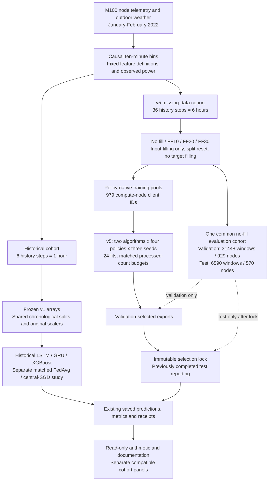
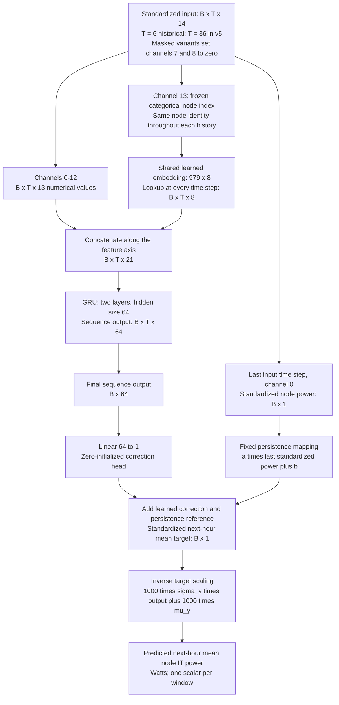
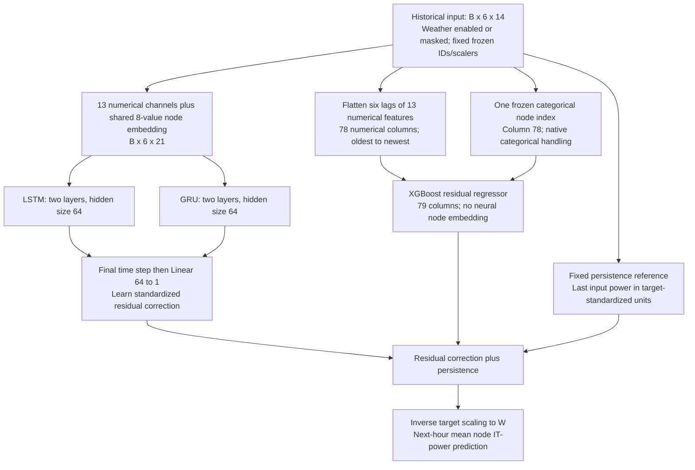
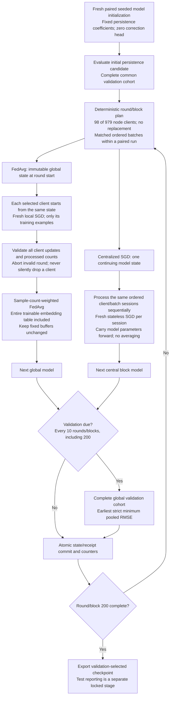
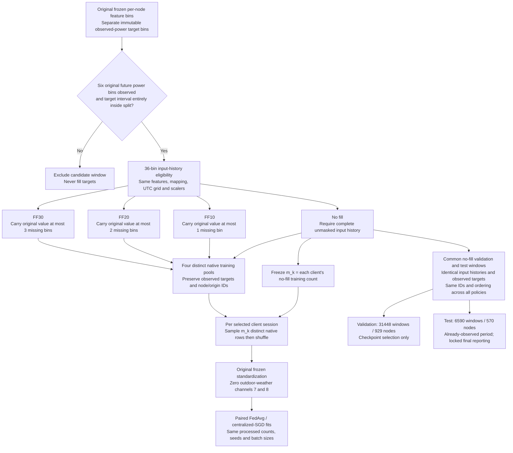
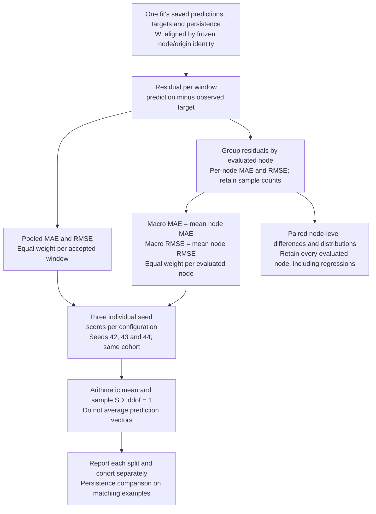
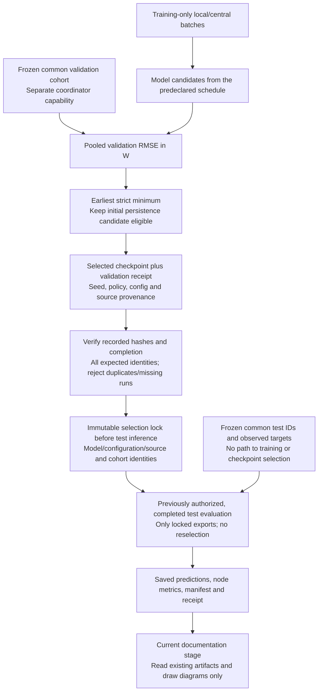

# Model Architecture and Experiment Flowcharts

Documentation version 2. Diagrams describe inspected existing code; they are not newly executed experiments. The previous report and all experiment artifacts remain unchanged.

## Data and experiment flow

This describes the completed project workflow, not a command to rerun it. A target is always the next six observed ten-minute power bins. The historical and v5 panels have different accepted cohorts and protocols; their scores are not a controlled history-length comparison. Clients are compute nodes, not independent data centers. The v5 test origins occur on one already-observed evening.

Evidence:

- [src/multinode.py](../../src/multinode.py) — `weighted_bins/node_windows/prepare_multinode`

- [src/experiment_data.py](../../src/experiment_data.py) — `freeze`

- [src/v5_missing_data/build_training_cohorts.py](../../src/v5_missing_data/build_training_cohorts.py)

- [src/v5_missing_data/training_data.py](../../src/v5_missing_data/training_data.py) — `CohortContext/SplitData`

## Shared residual-GRU model architecture

B denotes batch size and T history steps. Node identity occupies one stored channel; its eight embedding values replace that channel inside the model. a = sigma_x,power / sigma_y and b = (mu_x,power - mu_y) / sigma_y. baseline_coefficients is a fixed buffer. The zero-initialized head makes the initial candidate mathematically persistence, subject to recorded float32 rounding. This is the GRU used in the matched FedAvg/central-SGD studies; the historical LSTM shares the wrapper but uses an LSTM recurrent module. No model was instantiated to draw this diagram.

Evidence:

- [src/model.py](../../src/model.py) — `SequenceRegressor.__init__/forward`

- [src/experiment_models.py](../../src/experiment_models.py) — `neural_model`

- [src/federated_rounds.py](../../src/federated_rounds.py) — `initialize_model`

- [src/v5_missing_data/run_policy_experiments.py](../../src/v5_missing_data/run_policy_experiments.py) — `initialize`

- [configs/experiments/v1/gru_masked_seed42.json](../../configs/experiments/v1/gru_masked_seed42.json)

- [configs/experiments/v5_missing_data/gru_gap_policy_v1.json](../../configs/experiments/v5_missing_data/gru_gap_policy_v1.json)

## Historical LSTM, GRU and XGBoost paths

This is the historical one-hour v1 comparison only. Its neural fits use Adam; XGBoost uses its own boosting settings. They are not the matched SGD/FedAvg control. XGBoost columns 0-77 are time-major numerical lags, with step 0 corresponding to 60 minutes before origin and step 5 to 10 minutes; node index 78 is categorical, not a continuous numerical magnitude or learned embedding. Weather masking zeroes temperature/humidity lag columns. Validation can retain the initial persistence candidate instead of a learned correction.

Evidence:

- [src/experiment_models.py](../../src/experiment_models.py) — `lag_mapping/lag_features/xgb_matrix/fit_neural/fit_xgboost`

- [src/model.py](../../src/model.py) — `SequenceRegressor`

- [configs/experiments/v1/lstm_masked_seed42.json](../../configs/experiments/v1/lstm_masked_seed42.json)

- [configs/experiments/v1/gru_masked_seed42.json](../../configs/experiments/v1/gru_masked_seed42.json)

- [configs/experiments/v1/xgboost_masked_seed42.json](../../configs/experiments/v1/xgboost_masked_seed42.json)

## Matched FedAvg and centralized-SGD training

The diagram shows algorithm structure within each separately frozen protocol. Historical v2/v3 clients process one full local training pass. V5 clients process m_k sampled native-pool examples, where m_k is their no-fill reference count, and aggregate by that processed count. SGD is lr 0.01, momentum 0 and weight decay 0; batch size is 512 with the partial batch retained. Client training is simulated on one compute process; parallel boxes indicate logical clients, not actual parallel execution or protected physical sites. Validation is scheduled only at the stated candidates; unscheduled rounds still commit. Equal nominal settings do not produce identical optimization trajectories.

Evidence:

- [src/federated_rounds.py](../../src/federated_rounds.py) — `run_rounds/train_client`

- [src/centralized_sgd.py](../../src/centralized_sgd.py) — `plan_block/train_block/run_control`

- [src/federated_train.py](../../src/federated_train.py) — `GlobalModelState/aggregate_fedavg`

- [src/v5_missing_data/run_policy_experiments.py](../../src/v5_missing_data/run_policy_experiments.py) — `run_one/train_local`

- [src/v5_missing_data/sampling.py](../../src/v5_missing_data/sampling.py) — `round_plan/due/select`

## V5 missing-data policies and fixed sampling budgets

Forward filling uses only the same node/channel’s last original observation, resets at split cuts, never fills leading gaps, and does not renew age from an imputed value. Weather is never filled and is masked after standardization. Inputs may use causal prior-split history under that earlier split’s fill state; targets cannot cross their split boundary. Native training windows are 2310256 / 2996160 / 3459118 / 3867660 for no fill / FF10 / FF20 / FF30. All validation/test batches use the no-fill view even for models trained under filled policies. This tests training-pool access at fixed sample budgets, not accuracy on recovered filled evaluation windows.

Evidence:

- [src/v5_missing_data/training_data.py](../../src/v5_missing_data/training_data.py) — `SplitData.batch/TrainingRegistry`

- [src/v5_missing_data/build_training_cohorts.py](../../src/v5_missing_data/build_training_cohorts.py) — `selections_for_node`

- [src/v5_missing_data/sampling.py](../../src/v5_missing_data/sampling.py) — `round_plan`

- [output/experiments/v5_missing_data/model_comparison/v1/cohorts/contract.json](../../output/experiments/v5_missing_data/model_comparison/v1/cohorts/contract.json)

- [output/experiments/v5_missing_data/model_comparison/v1/cohorts/client_budgets.json](../../output/experiments/v5_missing_data/model_comparison/v1/cohorts/client_budgets.json)

## Saved-prediction metrics and seed aggregation

Pooled RMSE is the square root of count-weighted mean squared node RMSE, not the mean node RMSE. Missing nodes never receive zero error. Historical and v5 cohorts remain separate. Seeds are stochastic repeats on one dataset; sample SD is not a confidence interval and nodes/windows are not assumed independent datasets. The report uses already-saved predictions and performs no new inference.

Evidence:

- [src/experiment_eval.py](../../src/experiment_eval.py) — `metric_pair/evaluate`

- [src/v5_missing_data/evaluate_policy_models.py](../../src/v5_missing_data/evaluate_policy_models.py) — `predict_and_score/evaluate_locked`

- [analysis/thesis_results/verification.json](../../analysis/thesis_results/verification.json)

- [output/experiments/v5_missing_data/model_comparison/v1/test_evaluation/v2/results.json](../../output/experiments/v5_missing_data/model_comparison/v1/test_evaluation/v2/results.json)

## Validation selection, test lock and report-only analysis

This flowchart documents an already-completed separation of validation selection and test reporting. It does not describe the historical test period as untouched: prior test exposure remains a limitation. For v5 there are exactly 24 locked identities; v2 manifest discovery handles historical directory naming without changing run identities. There is deliberately no arrow from test metrics back to training, checkpoint selection, seed selection or hyperparameter tuning. Rendering this document does not execute any stage shown above.

Evidence:

- [src/experiment_models.py](../../src/experiment_models.py) — `select_if_better`

- [src/v5_missing_data/sampling.py](../../src/v5_missing_data/sampling.py) — `select`

- [src/v5_missing_data/evaluate_policy_models_v2.py](../../src/v5_missing_data/evaluate_policy_models_v2.py) — `discover_runs/preflight/make_lock/verify_lock`

- [src/v5_missing_data/evaluate_policy_models.py](../../src/v5_missing_data/evaluate_policy_models.py) — `load_lock/evaluate_locked`
