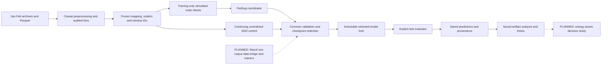
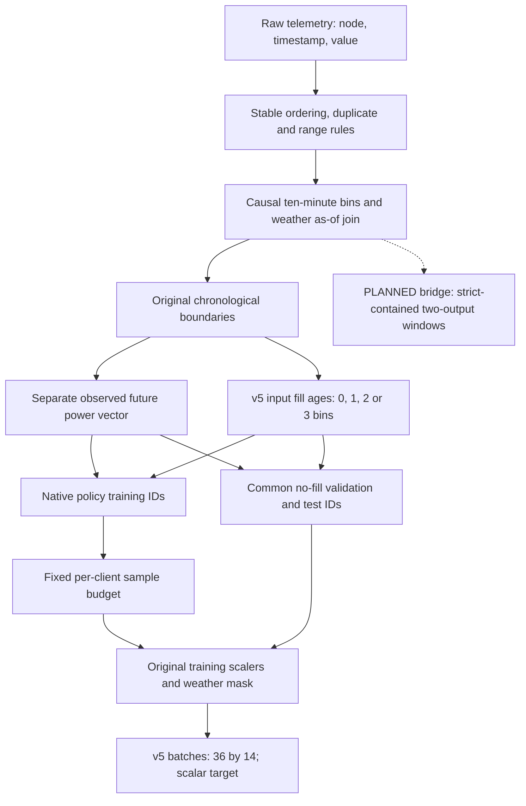
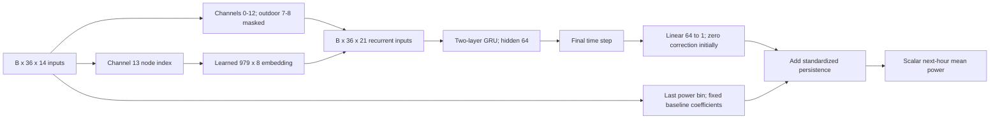
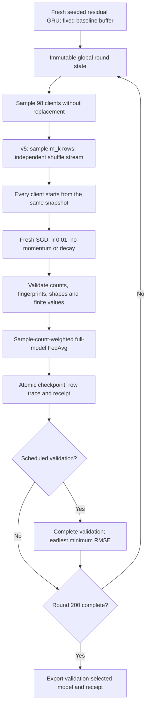

# System and model architecture

Documentation review: 11 November 2026. See [index](INDEX.md) and [evidence and verification](DOCUMENTATION_AUDIT.md).

[IMPLEMENTED] Python CLIs and file ledgers run on one Linux server; FL clients are simulated in a centrally accessible process. [PARTIALLY IMPLEMENTED] Phase 2 provides NumPy contracts/design, not real-data training.

## System

## Responsibilities and dependencies

| Layer | Actual files / interfaces | Responsibility |
| --- | --- | --- |
| Original acquisition | `src/download.py`, `pipeline.execute` | Archive cache, selective extraction, stage receipts |
| Preparation | `src/preprocess.py`, `multinode.prepare_multinode` | Metrics, causal bins, per-node windows/scalers |
| Frozen data / v1 | `experiment_data.FrozenData/weather_view`, `experiments.py`, `experiment_models.py` | One-hour contract and neural/boosted comparison |
| FL state | `federated_train.GlobalModelState/aggregate_fedavg` | Immutable snapshots and weighted checked updates |
| Historical round/control | `federated_rounds.py`, `federated_io.py`, `centralized_sgd.py`, `centralized_io.py` | One-hour FedAvg/central schedule replay and commits |
| Coverage/cohorts | `history_data_v4.py`, `history_coverage_v4.py`, v5 `build_training_cohorts.py` | Gap-safe eligibility, ages, observed targets and IDs |
| v5 local data | `training_data.CohortContext/SplitData/TrainingRegistry/LocalData` | Frozen inputs and restricted worker batches |
| v5 plans | `sampling.round_plan/verify_budget_totals` | Fixed processed counts, RNG domains and row accounting |
| v5 orchestration | `run_policy_experiments.run_one/verify_run`, `training_io` | Single/matrix execution, resume, atomic receipts/exports |
| v5 test | `evaluate_policy_models_v2` → restored original evaluator | Manifest discovery, lock, protected scoring |
| Reports | Saved `results_analysis/scripts/` and thesis packages | Saved-artifact reconciliation/export, not fitting |
| Isolated acquisition | `tools/march_isolated_v3.py` → wrapper v3/helper v2 | Separately authorized transfer lifecycle |
| Future contracts | `src/phase2_multioutput/{contracts,evaluation,protocol,readiness}.py` | Synthetic definitions and blocked real-data gate |

Original abbreviated modules are under `src/`; v5 modules are under `src/v5_missing_data/`. Original template configs cannot substitute for the locked v5 plan.

## Data flow

v5 batches retained bins/IDs rather than rebuilding raw data or dense six-hour datasets at every fit. Worker copies carry training tensors/identities, not coordinator paths; this is an API guard, not OS isolation.

## Actual v5 residual GRU

The embedding is learned state, not eight additional stored feature channels. Temperature is an input, **not a trained second output** in v5. Phase 1.3 has a synthetic two-output shape check; Phase 2 declares a non-residual Linear 64→2 model with real adapters [PLANNED].

## Federated lifecycle

v5 saves an immutable manifest/config/source snapshot, commits round 0 and consecutive rounds. Each receipt binds previous receipt, manifest, state and sampled-row hashes. Interrupted `.pending-*` work remains. Resume validates environment, chain, plans, counts and selected state, without changing method/policy/kind/cap. Orchestration ensures expected participation; generic aggregation alone is not the complete scheduler.

Evaluator v2 opens test examples only through explicit evaluate after the lock exists. Its verify checks lock/model bindings, while the original evaluator's completed-output branch checks output inventory/hashes. See [API](API.md).

## Failure and scalability

Source/configuration mismatch, invalid targets/nonfinite updates, wrong rows and occupied destinations stop the stage. No automatic participant replacement or expected-hash update is allowed. Application-level immutability is not independent attestation. Historical v1 partial fits have no generic automatic resume; v5 supports explicit committed-round resume.

Memory-mapped/retained-bin access bounds batch materialization. Longer history grows recurrent activation/work but can reduce eligible windows. XGBoost lag width is13H+1; March memory/runtime are unmeasured. A serialized simulator does not demonstrate networked deployment scaling. [Storage](Database.md) and [Integration](Integration.md) define persistence/server boundaries.
