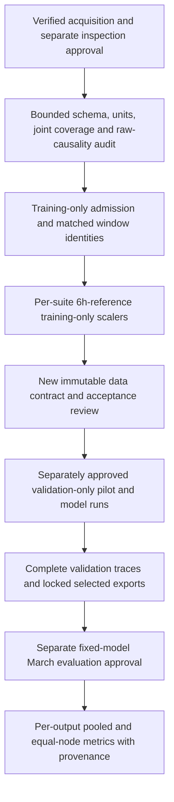

# Phase 2.0 — Frozen March retrospective experiment protocol v1

This is an immutable **design/configuration freeze**, not a frozen March dataset, accepted client cohort, model result or permission to execute experiments. March coverage, sensor/schema compatibility, joint targets, eligibility, counts, scalers and archive verification remain UNKNOWN. The user confirmed retaining the original train/validation cuts and a March test period, and retaining full operational inputs with weather-enabled/masked comparisons on identical windows. Numerical optimizer/budget templates are declared engineering settings, awaiting coverage acceptance and a separately approved validation-only pilot. Any later change creates a new version; existing receipts/hashes are never rewritten.

## Research scope

Forecast next-hour mean node IT power (W) and the documented node-inlet temperature metric (degC). The literal 979-name historical mapping defines candidate compute-node clients at **one facility**, not independent data centers; March eligibility is not 979 by assumption. Matching node strings does not prove hardware continuity. Historical mapping admission depended on later-period availability; that retrospective selection bias remains a limitation.

Use January–February for development with exact original train/validation endpoints. Exclude the previously observed February test interval from fitting, normalization, checkpoint selection and final test reporting in this protocol. March is an intended later retrospective holdout, subject to verification of previous scoring/exposure; it is not prospectively collected operational data or automatically untouched confirmatory data.

| Interval | Inclusive lower UTC | Exclusive upper UTC |
| --- | --- | --- |
| Train | 2022-01-01 00:00:00 | 2022-02-11 07:10:00 |
| Validation | 2022-02-11 07:10:00 | 2022-02-20 03:30:00 |
| Excluded old test/gap | 2022-02-20 03:30:00 | 2022-03-01 00:00:00 |
| Intended March test | 2022-03-01 00:00:00 | 2022-04-01 00:00:00 |

No March observation enters fitting or validation selection. Coverage is reviewed before fitting, never using forecast errors. Changing a cut requires a versioned protocol and disclosure, not an in-place edit.

## Observation and window definitions

The canonical fourteen feature slots and units are imported from `src/phase1_3/schema.py`: power_kw, cpu_user, cpu_system, cpu_idle, cpu_wio, memory_used_fraction, inlet_temperature_mean_c, outdoor_temperature_c, outdoor_humidity_percent, hour_sin, hour_cos, week_sin, week_cos, node_index. The source is IPMI total_power/ambient, Ganglia CPU/memory, provider weather and the existing UTC calendar transformation. Memory is 1-binned(mem_free)/binned(mem_total). Ambient and outdoor temperature are different measurements. Historical author documentation supports ambient as node-inlet temperature; March plugin/units must still be verified. Sensor position details, calibration, accuracy and clock synchronization remain unestablished.

Bins are 600 s on the UTC grid. Origins are hourly on the epoch-compatible grid, with half-open history [t-H*600s,t) and future [t,t+3600s). Primary H=36; history comparisons use H=6,36,144. Saved x is [N,H,14]; two targets are [N,2]. Each target is the float64 arithmetic mean of all six valid original future bins, with input power kW converted to W before target scaling. No target imputation, interpolation, backfill or future feature observation is allowed. Hourly target intervals do not overlap within a node; histories overlap and facility-time dependence remains.

Both the entire history and target interval must lie in the assigned split. Histories cannot borrow earlier-split bins. The target upper endpoint may equal the split upper edge. A March-contained H=36 window cannot originate before March1 06:00 UTC; H=144 cannot originate before March2 00:00. These are mathematical boundary examples, **not availability counts**. The non-hourly February cut remains exact; origins are still hourly rather than reanchored at 07:10.

Reproduce the documented cleaning and causal within-bin sample hold (<=300 s, >=50% temporal bin coverage); this is not forward-filling ten-minute gaps. Keep original-valid masks. Sensor contributions and weather as-of candidates must be clipped/reset at split boundaries, including weather joined strictly before bin right edge with maximum age1800s. This additional explicit raw-contributor reset must be verified by a future raw adapter; historical bins do not already prove it. Preserve stable last-occurrence duplicate handling and physical QC. A covered target bin is not a continuously observed ten-minute trace.

## Cohorts and normalization

Training-only eligibility: at least24 accepted training origins on at least7 distinct UTC origin dates. Seven dates means seven dates with accepted windows, not seven complete days. Compute eligibility **before** scaler fitting; no validation/test completeness criterion admits a client. Keep the literal mapping positions and report unmapped/new March IDs rather than silently reindex them. Sampling98 requires at least98 eligible training clients; otherwise stop without replacement/substitution or reducing participation.

Primary6h: all methods share the same ordered full-feature/weather-enabled-valid train, validation and test cohorts within the training-eligible candidate population. Weather-masked variants change only standardized channels7/8 to zero on copies. They preserve all slots, node identities, calendar/workload channels, observed targets and scalers. They do not recover windows missing weather. The previously proposed reduced-operational-input design is **not primary and is not silently substituted**.

History study: independently intersect eligible node/origin target identities for all three histories in each split. Build common-training admission from the training intersection, then use those admitted clients for evaluation intersections. Compare exact six target timestamps/values, not identity/count alone. Keep canonical mapping order then increasing origin. Report native coverage separately with losses, dates, zero-coverage nodes and reconciled exclusions. Native populations cannot be the sole basis for attributing error differences to history. If24h intersection is empty/inadequate, block the history study and review a new design; do not assume longer is better or silently merge gaps. The primary6h study remains a distinct conditional study.

Fit one new window-pooled training-only scaler per suite using its accepted **6h reference training windows**, after eligibility. Fit all13 numerical channels including weather; categorical13 has mean0/std1. Use float64/ddof0; floor near-constant input std<1e-12 to1. Each physical target has its own scale; constant target std<1e-12 requires review rather than an invented scale. Reuse this suite's same input/target scalers for all methods, masks and history lengths. Thus the longer-history study does not also change normalization. Different suite cohorts require separately fitted scalers and must not be merged. No scalers are fitted in Phase2.0.

## Declared comparison matrix

| Study | History steps | Methods | Seeds | Prospective fits |
| --- | --- | --- | --- | --- |
| Primary model/weather comparison |36| centralized GRU enabled; centralized GRU masked control; LSTM enabled; XGBoost enabled; FedAvg-GRU enabled; FedAvg-GRU masked |42,43,44|18|
| Matched history comparison |6,36,144| centralized GRU enabled; FedAvg-GRU enabled |42,43,44|18|

Total36 **planned experiment identities**, plus4 seedless persistence references (primary6h and each history-suite history). These are not launched fits. Each XGBoost identity contains two scalar boosters; the matrix has33 neural fits and6 prospective scalar booster models. The cross-suite6h cases cannot be deduplicated unless future cohort/scaler/provenance equality is established; no duplicate run is scheduled automatically.

The masked central GRU is an explicit extra control: weather-enabled central vs masked FedAvg alone would confound algorithm and feature representation. The minimal history study concentrates on the matched GRU/FedAvg question; LSTM/XGBoost history sweeps would require a new matrix. Neural templates use SGD0.01, momentum/decay0, batch512, partial batches retained, 200 schedule blocks/rounds and one pass per selected client. LSTM shares the exposure schedule but has different cell parameters. XGBoost uses the full accepted training cohort and500 boosting rounds; this is not compute- or optimizer-step-matched to SGD. No architecture is instantiated here.

## Reuse and implementation boundary

Reuse `src/phase1_3/schema.py` definitions/frozen-array helper and `config.utc_ns`; these modules do not initialize models. Current `phase1_3.split`, `windowing`, `validation`, `scaling` and `model` hardcode36 and/or masked weather and synthetic-only guards. The historical `experiment_models.lag_features` expects6 steps/one output; its neural model and evaluator are residual power-only. `federated_train.GlobalModelState` requires the old baseline_coefficients buffer, incompatible with the proposed non-residual two-output head. Do not point new configurations at old runners.

New pure contracts and evaluator arithmetic cover6/36/144, observed joint targets, raw-contributor bounds, mapping, split containment, shared IDs/scalers and validation-only selection. There is **no real raw decoder, cohort materializer, scaler fitter, trainable two-output GRU/LSTM/XGBoost adapter, training loop or final test-inference CLI in this release**. No actual data or test selection lock is created. Future integration must be additive and separately tested; an old single-output model cannot be relabeled as a new two-output model.

## Readiness, commands and stop conditions

`python -B -m src.phase2_multioutput.readiness --stage protocol` verifies the immutable design and historical dependency hashes, protocol and matrix. `--stage data` intentionally exits2 with blockers in this design-only release; optional future bounded JSON evidence is content-hashed but is explicitly not semantic replay or execution authorization. Archives, active partials, tensor files and checkpoints are never opened by that evidence gate. This prevents metadata booleans being presented as proof that real windows are valid.

No supported training/extraction command exists yet. After verified acquisition and separate inspection approval, implement/review the bounded March coverage bridge described in `output/phase1_7/future_coverage_protocol.md`, with the explicit split-reset and full-weather changes above. Its exact execution CLI must be supplied after implementation; inventing a command now would misrepresent readiness. Then separately freeze eligible cohorts/scalers, implement/test model/state/resume adapters, and authorize a validation-only pilot before any full fits. Future run paths are declared in matrix.json and remain absent. Never overwrite a partial/completed output or change an expected hash to force acceptance.

Stop on provenance/hash/unit/schema/UTC ambiguity, identity/target mismatch, missing active features, target fill, cross-node/gapped/cross-split intervals, inadequate train clients or held-out coverage, nonfinite values, unsupported history, invalid scalers or unavailable model adapters. Historical strict preflight remains FAILED and historical numerical reproducibility UNKNOWN; this design never repairs/bypasses them. A separately reviewed new-scope provenance acceptance remains mandatory before real data work.

No coverage counts, performance improvements, training runtime or GPU-memory measurements are inferred for March. Do not claim physical multi-data-center federation, secure aggregation/DP/OS isolation, energy/cooling/carbon savings, PUE/SLA improvement or temperature-control success. Shared conditions, overlapping histories, seeds on one dataset, observed development periods and sensor uncertainty limit future conclusions.
