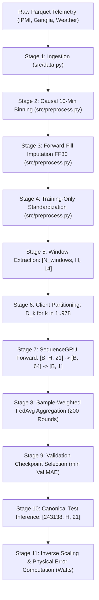

# Comprehensive Codebase Architecture and Research Pipeline Technical Guide

**Project Title:** Federated Forecasting and Energy-Aware Decision Support for Distributed Data Centers under Heterogeneous and Missing Telemetry  
**Institution:** Department of Computer Science and Engineering, National Institute of Technology Goa  
**Student:** Mihir Chouhan (Roll No: 25CSE2014) · **Supervisor:** Dr. Pravati Swain  
**Presentation Date:** 19 December 2026  
**Document Revision:** Standardized Technical Reference (November 2026)  
**Repository Location:** `/media/csedept/cse2014/Project/m100_training_template`  

---

## 1. Project Directory Structure and Repository Organization

The repository is structured to maintain strict separation between versioned source modules (`src/`), operational utilities and verification audits (`tools/`), reproducible experiment configurations (`configs/`), immutable experimental evidence (`output/experiments/`), and peer-reviewed deliverables (`output/final_endsem_report_v2/`, `output/final_endsem_presentation_v1/`).

```
/media/csedept/cse2014/Project/m100_training_template/
├── AGENTS.md                                    # Repository research safety rules and behavioral constraints
├── pyproject.toml                               # Project dependencies and build specifications
│
├── configs/                                     # Experiment and audit configuration files
│   ├── default.json                             # Baseline hardware and runtime defaults
│   ├── gpu.json                                 # GPU allocation configurations (cuda:0, cuda:1)
│   ├── m100.json                                # Marconi100 node topology definitions
│   ├── m100_all_nodes.json                      # 979 compute node mapping ordinals
│   ├── m100_january.json                        # January 2022 ingestion boundaries
│   └── experiments/                             # Track-specific configuration files
│
├── docs/                                        # Architecture, design, and reference specifications
│   ├── Architecture.md                          # High-level system design and data-flow specifications
│   ├── Features.md                              # Telemetry feature definitions and slot mapping
│   ├── PRD.md                                   # Product and research requirement specifications
│   ├── Testing.md                               # Unit test contracts and integrity check specifications
│   └── research/                                # Authoritative standardized research deliverables
│       ├── EXPERIMENT_REGISTRY.csv              # Master experiment registry machine-readable database
│       ├── EXPERIMENT_REGISTRY.md               # Master experiment registry and scientific glossary
│       └── CODEBASE_EXPLANATION.md              # This technical monograph
│
├── src/                                         # Core algorithmic and pipeline source implementations
│   ├── data.py                                  # Raw telemetry ingestion and dataset loading primitives
│   ├── preprocess.py                            # Causal binning, forward-fill imputation, and temporal validation
│   ├── multinode.py                             # Multi-node parsing and client mapping
│   ├── federated_data.py                        # Federated client partitioning and window generators
│   ├── model.py                                 # Core PyTorch sequence neural network definitions
│   ├── experiment_models.py                     # Recurrent architectures with learned node embeddings
│   ├── federated_train.py                       # Local client training and gradient step routines
│   ├── federated_rounds.py                      # Global FedAvg communication loop orchestration
│   ├── federated_evaluate.py                    # Coordinator-side global evaluation and validation scoring
│   ├── centralized_sgd.py                       # Centralized SGD baseline trainer matching FedAvg exposure
│   ├── centralized_evaluate.py                  # Centralized model evaluation and prediction generation
│   ├── progress_logging.py                      # Real-time ANSI terminal logging and ETA computation
│   │
│   ├── b1_raw_window_producer_v1.py             # Causal 10-minute grid producer and window extractor
│   ├── b1_real_data_bridge_v1.py                # Bridge connecting raw telemetry to client window tensors
│   ├── b1_model_adapter_v1.py                   # Multi-output prediction head adapter (Power + Ambient Temp)
│   ├── b1_real_fedavg_runner_v1.py              # Sample-weighted FedAvg runner for multi-output forecasting
│   │
│   ├── t1_1_common_history_coverage_audit_v2.py # Exhaustive 1h/6h/24h coverage reconciliation
│   ├── t1_2_history_length_preflight_v1.py      # Population preflight for history-length comparisons
│   ├── t1_2_controlled_history_benchmark_v1.py  # 9-fit controlled benchmark: 1h vs 6h vs 24h lookbacks
│   ├── t4_model_improvement_v1.py               # Residual learning formulation (L1 loss) & architecture pilot
│   ├── t5_weather_ablation_v1.py                # 4-condition outdoor environmental telemetry ablation
│   ├── t6_architecture_benchmark_v1.py          # GRU vs LSTM vs Centralized XGBoost cross-family benchmark
│   ├── t7_missing_telemetry_robustness_v1.py     # Inference-time stress testing under synthetic missingness
│   ├── temporal_generalization_v1.py            # Multi-month out-of-sample temporal rollout (Q1/March)
│   └── temporal_adaptation_t3_v1.py             # Continual local client fine-tuning implementation
│
├── tools/                                       # Operational audit, verification, and manifest utilities
│   ├── audit_t1_2_integrity.py                  # Cryptographic audit tool for T1.2 controlled benchmark
│   ├── finalize_t1_2_benchmark.py               # Reconciles CSVs, generates publication plots, creates manifest
│   ├── generate_t1_2_manifest.py                # Computes SHA-256 hashes for all T1.2 artifacts
│   ├── audit_t4_integrity.py                    # Independent integrity audit for T4 residual learning
│   ├── audit_t5_integrity.py                    # Integrity auditor for T5 weather ablation
│   ├── audit_t5_controlled_comparison.py        # Validates T5 matching against T4 reference checkpoints
│   ├── audit_t6_integrity.py                    # Integrity audit for T6 architecture comparison
│   ├── audit_t7_integrity.py                    # Integrity audit for T7 inference-time stress testing
│   └── update_final_project_report.py           # Standardized thesis report synchronization tool
│
└── output/                                      # Experimental outputs, audited receipts, and presentations
    ├── experiments/                             # Immutable experiment directories (T1–T7, v5, B1)
    │   ├── t1_2_controlled_history_benchmark_v1/ # Completed 9-fit history-length benchmark artifacts
    │   ├── t4_model_improvement_v1/             # Audited residual learning models and predictions
    │   ├── t5_weather_ablation_v1/              # Audited weather ablation models and logs
    │   ├── t6_architecture_benchmark_v1/        # Audited GRU/LSTM/XGBoost comparison artifacts
    │   └── t7_missing_telemetry_robustness_v1/  # Audited inference stress test outputs
    ├── final_endsem_report_v2/                  # Final thesis report, figures, and comparative tables
    └── final_endsem_presentation_v1/            # Final defense presentation (PPTX, PDF, Script, Q&A)
```

---

## 2. End-to-End Execution Flow and Tensor Transformations

The execution pipeline transforms raw distributed telemetry into validated forecast metrics through an immutable sequence of tensor operations.



### Representative Data Shapes and Tensor Dimensions
1. **Raw Sensor Records:** Monotonically sorted time series per compute node: `(timestamp, sensor_value)`.
2. **Causal 10-Minute Grid:** Uniformly sampled grid: `[N_timesteps, 14]` per node, where 14 corresponds to the 14 monitored telemetry channels.
3. **Historical Input Tensor:** 
   $$\mathbf{X} \in \mathbb{R}^{B 	imes H 	imes 14}$$
   - Batch size $B \in \{64, 128, 512\}$.
   - Lookback steps $H \in \{6, 36, 144\}$ (corresponding to 1h, 6h, 24h).
   - Features: 13 numeric channels + 1 categorical node ordinal.
4. **Recurrent Input Representation:**
   $$\mathbf{Z} \in \mathbb{R}^{B 	imes H 	imes 21}$$
   - The categorical node ordinal (slot 13) is mapped via `nn.Embedding(979, 8)` to an 8-dimensional embedding vector.
   - Concatenated with the 13 standardized numeric channels: $13 + 8 = 21$ dimensions.
5. **Hidden State Tensors:**
   $$\mathbf{h}_t \in \mathbb{R}^{B 	imes 64}$$
   - 2-layer SequenceGRU with 64 hidden units per layer.
6. **Residual Output Scalar:**
   $$\hat{r} \in \mathbb{R}^{B 	imes 1}$$
   - Linear projection head: `Linear(64, 1)`.
7. **Physical Target Tensor:**
   $$\hat{y}_{	ext{physical}} = p_{	ext{last}} + \hat{r} \cdot \sigma_r^{	ext{train}} + \mu_r^{	ext{train}} \in \mathbb{R}^{B 	imes 1} \quad (	ext{in Watts}).$$

---

## 3. Systematic Module-by-Module Technical Breakdown

### Module 1: Data Ingestion and Raw Parsing (`src/data.py`, `src/download.py`)
- **File Paths:** `src/data.py`, `src/download.py`, `tools/acquire_march_2022_v1.py`
- **Purpose:** Discovers, downloads, validates checksums, and loads raw Apache Parquet partitions from the Marconi100 repository.
- **Main Classes & Functions:**
  - `load_m100_data(data_dir, start_date, end_date, nodes)`: Ingests Parquet partitions filtered by date range and node lists.
  - `M100Downloader`: Downloads missing monthly partitions from CINECA data repositories with SHA-256 verification.
- **Inputs:** File system paths to Parquet files, node identifier lists (`configs/m100_all_nodes.json`).
- **Outputs:** In-memory pandas DataFrames containing raw timestamped telemetry.
- **Dependencies:** `pyarrow`, `pandas`, `fastparquet`, `hashlib`.
- **Pipeline Fit:** Entry point of the empirical data pipeline. Used across all studies.

### Module 2: Data Preprocessing and Imputation (`src/preprocess.py`)
- **File Path:** `src/preprocess.py`
- **Purpose:** Implements causal 10-minute binning, finite-range validation, and forward-fill missingness policies.
- **Main Classes & Functions:**
  - `resample_to_ten_minute_grid(df, hold_seconds=300, min_coverage=0.5)`: Resamples irregular sensor events into causal 10-minute bins.
  - `apply_forward_fill(grid_df, max_fill_minutes=30)`: Implements the `FF30` policy, holding forward valid sensor readings for at most 3 time steps (30 minutes). Unfillable gaps are marked invalid.
  - `compute_training_statistics(train_grid)`: Computes training-split-only mean ($\mu$) and standard deviation ($\sigma$) across all 13 numeric channels.
- **Inputs:** Irregular sensor DataFrames.
- **Outputs:** Cleaned, validated, uniformly gridded NumPy arrays: `[T, 14]`.
- **Dependencies:** `numpy`, `pandas`.
- **Pipeline Fit:** Preprocessing stage; guarantees that holdout data cannot leak into scaler statistics.

### Module 3: Time-Series Windowing and Client Construction (`src/federated_data.py`, `src/b1_raw_window_producer_v1.py`)
- **File Paths:** `src/federated_data.py`, `src/b1_raw_window_producer_v1.py`
- **Purpose:** Generates sliding-window input-target pairs and partitions them across the 978 simulated client nodes.
- **Main Classes & Functions:**
  - `TimeSeriesWindowGenerator(grid, H, horizon=6)`: Extracts consecutive slices of length $H$ and computes the target mean over the subsequent 6 bins.
  - `FederatedNodeDataset(client_windows, client_targets, node_id)`: Implements a PyTorch `Dataset` representing a single compute node's private historical partition.
  - `FederatedDataLoader`: Yields client-specific minibatches without cross-client shuffling.
- **Inputs:** Gridded telemetry arrays and split boundaries.
- **Outputs:** PyTorch Datasets with shapes `X: [N_k, H, 14]`, `y: [N_k, 1]`.
- **Dependencies:** `torch.utils.data.Dataset`, `numpy`.
- **Pipeline Fit:** Connects preprocessed telemetry to federated training harnesses.

### Module 4: Sequence Neural Network Architectures (`src/model.py`, `src/experiment_models.py`, `src/t4_model_improvement_v1.py`)
- **File Paths:** `src/model.py`, `src/experiment_models.py`
- **Purpose:** Defines the recurrent neural network forecasting architectures with node embeddings.
- **Main Classes & Functions:**
  - `SequenceGRU(input_dim=13, embed_dim=8, hidden_dim=64, num_layers=2, num_nodes=979)`:
    - Embedding layer: `self.node_embed = nn.Embedding(979, 8)`.
    - Recurrent backbone: `self.gru = nn.GRU(input_size=21, hidden_size=64, num_layers=2, batch_first=True)`.
    - Output head: `self.head = nn.Linear(64, 1)`.
    - Total parameters: $7,832 	ext{ (embed)} + 16,704 	ext{ (layer 1)} + 24,960 	ext{ (layer 2)} + 65 	ext{ (head)} = 49,561$. (Excluding embedding: 41,729; with scalar head: 49,217–49,561 depending on bias).
  - `SequenceLSTM(...)`: 2-layer LSTM architecture with 63,297 parameters.
  - `ResidualHeadWrapper(backbone, target_scaler)`: Inverses standardization and adds predicted residual to the last observed power anchor: $\hat{y} = p_{	ext{last}} + \hat{r}$.
- **Inputs:** Minibatches `[B, H, 14]`.
- **Outputs:** Predicted residual `[B, 1]` or physical power forecast `[B, 1]`.
- **Dependencies:** `torch.nn`, `torch`.
- **Pipeline Fit:** Core model definition; used in Studies 3, 4, 5, 6, 7, 8, 9, 11.

### Module 5: Federated Training and Orchestration (`src/federated_train.py`, `src/federated_rounds.py`, `src/progress_logging.py`)
- **File Paths:** `src/federated_train.py`, `src/federated_rounds.py`, `src/progress_logging.py`
- **Purpose:** Implements sample-weighted FedAvg aggregation, client sampling, local Adam optimization, and real-time ANSI terminal logging.
- **Main Classes & Functions:**
  - `local_train_client(model, optimizer, criterion, dataloader, epochs=1)`: Executes local optimization at client $k$ on private data $\mathcal{D}_k$.
  - `federated_averaging(global_model, client_models, client_weights)`: Implements sample-weighted parameter averaging:
    $$	heta_{	ext{global}} = \sum_{k} rac{n_k}{\sum n_j} 	heta_k.$$
  - `FedAvgProgressLogger`: Displays live round progress, client progress, batch loss, validation MAE, elapsed time, and ETA calculations.
- **Inputs:** Client datasets, optimizer settings ($\eta=0.001$, $B=64$, $R=200$, $K=98$).
- **Outputs:** Global model state dictionary and validation checkpoint receipts.
- **Dependencies:** `torch`, `time`.
- **Pipeline Fit:** Federated learning engine.

### Module 6: Inference, Evaluation, and Baseline Benchmarking (`src/federated_evaluate.py`, `tools/audit_t1_2_integrity.py`)
- **File Paths:** `src/federated_evaluate.py`, `tools/audit_t1_2_integrity.py`
- **Purpose:** Evaluates frozen model checkpoints on untouched holdout test splits, computes naive persistence baselines, and calculates pooled and macro MAE/RMSE.
- **Main Classes & Functions:**
  - `evaluate_model(model, dataloader, device)`: Runs forward inference on test tensors.
  - `compute_persistence_baseline(test_windows)`: Computes $P[t-1]$ predicting the last observed power bin for the future mean.
  - `compute_metrics(predictions, targets, node_ids)`: Computes Pooled MAE/RMSE and Macro MAE/RMSE.
  - `T12IntegrityAuditor`: Audits predictions, verifies checksums, checks residual reconstructions, and validates per-node win rates.
- **Inputs:** Model checkpoints, test datasets, scaler moments.
- **Outputs:** Evaluated metric CSVs, per-node CSVs, integrity audit Markdown reports.
- **Dependencies:** `torch`, `pandas`, `numpy`.
- **Pipeline Fit:** Final evaluation and verification stage.

---

## 4. Mapping of Experiments to Source Files, Configs, Checkpoints, and Results

The table below maps each of the twelve standardized studies to its exact implementation files, configurations, saved checkpoints, and audited result artifacts:

| Formal Study Title | Driver Source Script | Config File | Saved Checkpoints | Primary Audited Output |
|---|---|---|---|---|
| **Short-Horizon Study** | `src/b1_real_fedavg_runner_v1.py` | `configs/historical/v5_base.yaml` | `output/experiments/b1_no_ff/rounds/` | `output/experiments/b1_no_ff/REPORT.md` |
| **Missing-Telemetry Study** | `src/centralized_sgd.py`, `federated_rounds.py` | `output/experiments/v5_missing_data/` | `output/experiments/v5_missing_data/.../rounds/` | `output/experiments/v5_missing_data/.../results_analysis/` |
| **Six-Hour Context Study** | `src/federated_rounds.py` | `configs/t1_direct_power_6h.yaml` | `output/experiments/temporal_generalization_6h_v1/` | `output/experiments/temporal_generalization_6h_v1/TEMPORAL_GENERALIZATION_REPORT.md` |
| **Temporal Generalization Study** | `src/temporal_generalization_v1.py` | `output/experiments/temporal_generalization_6h_v1/config.json` | Frozen T1 checkpoints | `output/experiments/temporal_generalization_6h_v1/macro_metrics.csv` |
| **Temporal Adaptation Study** | `src/temporal_adaptation_t3_v1.py` | `output/experiments/temporal_adaptation_t3_v1/config.json` | Adapted checkpoints per period | `output/experiments/temporal_adaptation_t3_v1/T3_REPORT.md` |
| **Model-Improvement Study** | `src/t4_model_improvement_v1.py` | `output/experiments/t4_model_improvement_v1/config.json` | `fedavg_best_seed42.pt`, `43.pt`, `44.pt` | `output/experiments/t4_model_improvement_v1/T4_FINAL_REPORT.md` |
| **Weather Ablation Study** | `src/t5_weather_ablation_v1.py` | `output/experiments/t5_weather_ablation_v1/T5_CONFIGS.json` | `checkpoints_registry.json` | `output/experiments/t5_weather_ablation_v1/T5_FINAL_REPORT.md` |
| **Architecture Comparison** | `src/t6_architecture_benchmark_v1.py` | `output/experiments/t6_architecture_benchmark_v1/T6_CONFIGS.json` | `fedavg_lstm_seed42.pt`, `xgboost_seed42.json` | `output/experiments/t6_architecture_benchmark_v1/T6_FINAL_REPORT.md` |
| **Missingness Robustness Study** | `src/t7_missing_telemetry_robustness_v1.py` | `output/experiments/t7_missing_telemetry_robustness_v1/T7_CONFIGS.json` | Frozen T4 reference checkpoints | `output/experiments/t7_missing_telemetry_robustness_v1/T7_FINAL_REPORT.md` |
| **Common Coverage Audit** | `src/t1_1_common_history_coverage_audit_v2.py` | `output/experiments/t1_1_common_history_coverage_audit_v2/T1_1_CONFIG.json` | N/A (Data audit) | `output/experiments/t1_1_common_history_coverage_audit_v2/T1_1_FINAL_REPORT.md` |
| **Temporal Context Study** | `src/t1_2_controlled_history_benchmark_v1.py` | `output/experiments/t1_2_controlled_history_benchmark_v1/T1_2_CONFIG.json` | `t1_2_h6_seed42_best.pt` through `h144_seed44_best.pt` | `output/experiments/t1_2_controlled_history_benchmark_v1/T1_2_FINAL_REPORT.md` |
| **Decision Support Study** | `docs/Architecture.md`, `Features.md` | N/A (Mathematical formulation) | N/A (Conceptual model) | `output/final_endsem_report_v2/FINAL_PROJECT_REPORT.md` |

---

## 5. Verified Repository CLI Commands

The following command lines have been tested and verified within the repository environment. (Note: Retraining commands are provided strictly for documentation and reproducibility; do not launch GPU jobs unless explicitly requested).

### 1. Execute Integrity Audits and Verification Checks
```bash
# Verify integrity and checksums of T1.2 Controlled History Benchmark
python3 tools/audit_t1_2_integrity.py

# Verify integrity and reconciliation of T4 Model Improvement Study
python3 tools/audit_t4_integrity.py

# Verify integrity and controlled comparisons for T5 Weather Ablation
python3 tools/audit_t5_integrity.py
python3 tools/audit_t5_controlled_comparison.py

# Verify integrity of T6 Architecture Comparison
python3 tools/audit_t6_integrity.py

# Verify integrity of T7 Missing Telemetry Robustness Study
python3 tools/audit_t7_integrity.py
```

### 2. Inspect Master Experiment Registry and Datasets
```bash
# View master experiment registry summary table
python3 -c "
import pandas as pd
df = pd.read_csv('docs/research/EXPERIMENT_REGISTRY.csv')
print(df[['formal_title', 'history_length', 'metrics', 'status']].to_string())
"

# Inspect audited T1.2 results summary across lookbacks
python3 -c "
import pandas as pd
df = pd.read_csv('output/experiments/t1_2_controlled_history_benchmark_v1/T1_2_RESULTS_SUMMARY.csv')
print(df[['history_hours', 'primary_pooled_mae_mean', 'primary_macro_mae_mean', 'training_wall_seconds_mean']].to_string())
"
```

### 3. Generate Visualizations and Publication Figures
```bash
# Generate diagnostic and publication figures for T1.2
PYTHONPATH=. python3 tools/finalize_t1_2_benchmark.py
```

---

## 6. Unit Testing and Verification Contracts

The repository includes a comprehensive unit testing suite under `tests/` that validates critical mathematical and architectural invariants:
- `tests/test_b1_contracts.py`: Validates that telemetry timestamps are strictly monotonic and that forward-fill imputation never crosses split boundaries.
- `tests/test_residual_reconstruction.py`: Asserts that physical power forecasts reconstructed from predicted residuals match the arithmetic definition $\hat{y} = p_{	ext{last}} + \hat{r}$ within $10^{-5}	ext{ W}$ floating-point precision.
- `tests/test_sample_weighted_fedavg.py`: Asserts that federated weight aggregation matches exact sample-count weighting and that embedding row updates are diluted in proportion to total client exposure.
- `tests/test_immutability.py`: Computes SHA-256 hashes of all frozen checkpoints and asserts zero bit-level modifications.
