# Federated Forecasting and Energy-Aware Decision Support for Distributed Data Centers under Heterogeneous and Missing Telemetry

**End-semester M.Tech major-project progress report**  
**Student:** Mihir Chouhan · **Roll number:**25CSE2014  
**Department of Computer Science and Engineering, National Institute of Technology Goa**  
**Supervisor:**Dr. Pravati Swain  
**Presentation date:**19 December 2026  
**Evidence snapshot and report preparation:**17 November 2026, Asia/Kolkata  
**Report revision:** v2, 17 November 2026 (Asia/Calcutta); updated from the preserved v1 Markdown

The presentation date is prospective. This document describes evidence available at preparation time; it does not anticipate December experiments. The research title states the broader direction. Forecasting has been implemented and evaluated; a validated energy-aware control policy has not been demonstrated.

## Abstract

This project studies node-level forecasting from CINECA Marconi100 telemetry under heterogeneous availability and missing observations. The implementation represents 979 known compute nodes as simulated federated clients from one facility. It does not represent 979 independent data centers. A sequence model predicts the mean of six future ten-minute power bins; one separately versioned experiment also predicts recorded IPMI ambient temperature. Chronological preparation, explicit window identities, training-only normalization, validation selection, preserved predictions and artifact hashes provide the basis for interpreting results.

The experimental record contains several distinct tracks. An earlier one-hour shared LSTM reports held-out MAE 27.934 W and RMSE 54.884 W on 75,566 windows. The historical six-hour,24-fit missing-data matrix contains FedAvg and centralized SGD, four input-fill policies and three seeds; centralized SGD has lower pooled MAE and RMSE in all 12 matched policy/seed pairs. Its common test population, however, covers only 6,590 windows,570 nodes and 17 origins on one date. The separate B1 two-output March experiment has 194,212 hourly windows on 976 nodes. Its FedAvg power RMSE improves slightly over persistence while power MAE and both ambient-temperature errors worsen. [L01; V01–V03; B01–B03]

Newer Candidate 1 experiments include nine completed FF30 history-length fits and the T4 residual-power benchmark. T4 FedAvg obtains canonical-test pooled MAE 24.8133 W against pooled persistence 33.0661 W; the corresponding macro-node values are 25.2242 W and approximately 33.3504 W. These aggregation levels must not be mixed. Six checkpoint hashes and 22 manifest-listed T4 artifact hashes match their records. This reporting task verifies stored values and summary arithmetic, not new model predictions. Historical strict preflight remains FAILED and semantic reproduction UNKNOWN. [C03; T01–T08; P02]

The main contribution is an evidence-preserving forecasting and comparison workflow, accompanied by measured findings that include unfavorable results. Remaining work includes scientific reconciliation of newer protocol/documentation differences, broader temporal validation, controlled environmental and optimizer studies, and a separately validated action-response model before any energy/SLA benefit can be measured.

The updated evidence adds T7 inference-time robustness: 99 saved condition/seed/period evaluations of frozen T4 models, without new fitting. Random 20% dropout raises canonical pooled MAE from 24.8133 W to 26.5202 W; 30% two-hour burst masking raises it to 36.1049 W. These figures describe a synthetic input-loss stress test with FF30 and mean-input fallback, not the original no-fill policy. New coverage/preflight records also exist, but their training-eligibility and loss-description conflicts prevent treating the proposed two-layer history benchmark as ready or completed. [U01–U06]

## Reading guide and evidence convention

Claim identifiers such as[L01] resolve to `EVIDENCE_AND_CLAIM_REGISTER.csv`. That register supplies the original path, field or function location, verification status and qualification. `EXPERIMENT_STATUS_REGISTER.csv` distinguishes completed fits, completed analyses, designs and missing evaluations. Source-file hashes, byte checks and repository inventories accompany this report. `EVIDENCE/UPDATE_V2/` contains the current audit; older files in `EVIDENCE/` remain the explicitly dated v1 snapshot. The original report and root registers are backed up under `BACKUP/`. External research references use[R1]–[R7] and direct primary-source links in Section 16.

“Verified” means the stated, bounded check passed: for example, a metric field exists and its arithmetic or byte binding matches. It never means that all historical experiments have been numerically reproduced. “Partially verified” identifies a saved outcome with unresolved protocol, independent-replay or granularity limitations. “Planned” does not imply implementation or execution. Where evidence is unavailable, the explicit conclusion is **Not verified from available artifacts.**

## 1. Research background and motivation

Data-center telemetry records computational load, electrical consumption and thermal conditions. Forecasting the next operating interval may inform later management decisions, but forecast accuracy alone cannot demonstrate that an intervention is beneficial. This project separates sensor observation, future-value prediction and action-response evaluation. Only observation and forecasting have completed experimental evidence.

Missing telemetry changes both model inputs and the population that can be evaluated. Longer histories require more valid bins; filling inputs can enlarge the training pool without adding observed targets. Counts, node coverage and window identities are therefore part of each result. Comparing a small well-observed subpopulation with a different broader test set cannot isolate a modeling effect. [D01; C01–C04]

Federated learning organizes each compute node's records as a local dataset. A server samples clients, collects locally optimized states and averages them. The simulation uses centrally accessible data from one facility; it does not demonstrate organizational decentralization or formal privacy. Node identity is an embedding for known-node forecasting, not evidence of unseen-site generalization. [M01; M02]

The report covers distinct historical and current tracks, rather than one evolving score. Earlier one-hour LSTM/model-family results, six-hour missing-data comparisons, B1 two-output forecasts, Candidate1 history/temporal studies and T4/T5/T6 residual experiments have different contracts. This task reads source and stored artifacts and recalculates summary arithmetic. It executes no models, training, GPU jobs, scaler fitting or raw preparation. [P01; P02]

## 2. Problem statement, objectives and research questions

### 2.1 Forecasting problem

For node n and forecast origin t, let X denote a sequence of H completed ten-minute feature bins. The primary physical target is

$$y_{n,P}(t)=\frac{1}{6}\sum_{j=0}^{5}p_n([t+10 j,t+10(j+1))) .$$

Here power is expressed in watts after the track-specific conversion from stored units. The target is the next hour’s **mean power**, not instantaneous power at t+60 minutes and not watt-hours. History lengths H=6,36 and 144 correspond to 1,6 and 24 hours. Histories precede the origin; labels use the subsequent six bins. [D01; M03]

In B1, a second target is the analogous mean of six valid recorded IPMI ambient-temperature bins. Both outputs must be observed and valid under its preparation contract. The ordering is `[mean node IT power W, mean recorded IPMI ambient °C]`. Temperature is not a cooling-energy label. In the power-only v5 and T4 tracks, temperature is an input context rather than a predicted output. [B01; D02]

### 2.2 Objectives

Establish causal observed-window cohorts; implement sequence models and simulated FedAvg; compare same-window errors; quantify missingness/history effects; preserve selection and result provenance. Operational decision evaluation remains a separate future objective.

### 2.3 Research questions and present answers

**Table 2.1.**

|Question|Present evidence-based answer|Scope|
|---|---|---|
|Can a shared recurrent model outperform last-bin persistence?|Yes in the legacy LSTM and T4 power comparisons; B1 has mixed outcomes.|Separate cohorts and targets; no universal statement.|
|Does FedAvg outperform centralized SGD?|No in the historical v5 paired pooled MAE/RMSE comparisons; T4 also favors central mean errors.|Only the actual, differently budgeted controls evaluated.|
|Which fill policy is best?|No universal winner. v5 mean RMSE favors centralFF10 and FedAvgFF20, with small within-FedAvg differences.|Common narrow test; policy-specific native training pools.|
|Does longer history help?|The newer FF30 record shows a modest 1 h→6 h improvement and a small further 6 h→24 h difference.|Nine fits, one cohort, three seeds; no-fill counterpart absent.|
|Can power and ambient temperature be predicted jointly?|B1 implements and evaluates both outputs.|Temperature errors did not beat persistence.|
|Can forecasts reduce energy or meet SLA constraints?|Not demonstrated.|Requires a validated action-response and decision evaluation.|

## 3. Related work and research gap

The mandatory Liu et al. paper [R1] learns operating decisions and combines their local inference with reduced physical optimization. Its actual official v3 PDF was read. The uploaded copy was unavailable for byte comparison. Chapter 12 and the dedicated companion explain the formulations and seven-table comparison; this project does not reproduce that complete system.

McMahan et al. [R3] provide the FedAvg local-update/aggregation foundation. Li et al. [R4] motivate FedProx as a future heterogeneity-aware alternative; no completed FedProx result is claimed. The names of these methods do not fix client selection, batch order, exposure budget or checkpoint selection, which must be specified separately in experiments.

Cho et al. [R5] provide a foundational gated recurrent reference. Hochreiter and Schmidhuber [R6] introduce LSTM, the architecture actually used by the early shared model. Chen and Guestrin [R7] describe XGBoost. This project evaluates these established families; it does not claim their invention. Historical model comparisons and newer T6 results remain separately identified rather than forming one unmatched leaderboard.

The M100 ExaData descriptor [R2] supports the telemetry source identity. Repository preprocessing defines the later learning problem. The application-specific research gap is coverage-aware temporal forecasting with reproducible target identity and qualified method comparisons. A second, unresolved gap is converting forecasts into actions with validated physical and service consequences. More accurate predictions alone do not close that gap. [D01; F02]

## 4. Dataset, target availability and physical interpretation

### 4.1 Source and entities

The working dataset is M100/ExaData telemetry from CINECA’s Marconi100 facility. Historical main experiments use January–February 2022. Later B1 and temporal/T4 work include March 2022 under different cohorts. Source records are distributed in Parquet partitions organized by month, plugin and metric; prepared data are stored as frozen arrays, retained bins and manifests. Existing acquisition reports provide archive hashes. This report did not download or extract archives. [D01; P01]

The 979 original node strings and their ordinal mapping identify compute nodes. They are categorical identities, not a geographical index or a measurement in watts. The model embedding allows repeated observations of an already-known node to influence its representation. The evaluation therefore concerns known-node forecasting rather than unseen-data-center or unseen-node generalization.

### 4.2 Availability and readiness

**Table 4.1.**

| Quantity | Evidence category | Recorded source/partition | Interpretation |
| --- | --- | --- | --- |
| Node IT Power / Server Power | directly recorded | ipmi_pub/total_power | Node IPMI power, not cooling or whole-facility power. |
| Total Energy | recorded energy readings; interval consumption unvalidated; node estimate derivable with assumptions | logics_pub/Energia; logics_pub/Mwh; ganglia_pub/Gpu{0..3}_total_energy_consumption | No universal measured total-energy label for each compute node; the sparse GPU energy records belong to node 980 outside the benchmark mapping. Node kWh estimated from power depends on temporal coverage. |
| Cooling Energy / Cooling Power | direct cooling power; energy requires integration | logics_pub/Tot_cdz; Tot_chiller; Tot_qpompe | Do not sum components without validating boundaries; no invented per-node cooling allocation. |
| Inlet Temperature | directly recorded | ipmi_pub/ambient | Node inlet temperature, distinct from outdoor temperature; not a spatial inlet-sensor mean. |
| PUE | directly recorded upstream ratio | logics_pub/Pue; logics_pub/pue | Do not infer a per-node PUE or equate different rooms with separate FL data centers. |
| SLA-related metrics | operational proxies only; SLA not defined | job_table/job_info_marconi 100: submit_time,start_time,end_time,job_state,qos,time_limit_str; nagios_pub/state | qos is an anonymized category, not a numerical SLA; contractual deadlines/latency thresholds are not defined. |
| CPU utilization | direct components | ganglia_pub/cpu_user; cpu_system; cpu_idle; cpu_wio | 100-idle includes I/O-wait under the documented idle definition; do not label it pure busy-CPU utilization. |
| Memory utilization | mathematically derived | ganglia_pub/mem_free; mem_total -> 1-free/total after binning | This is the existing free/total proxy; not independently measured active working set or memory bandwidth. |
| Network utilization | traffic rates available; utilization percent unavailable | ganglia_pub/bytes_in; bytes_out; pkts_in; pkts_out | No validated link-capacity denominator or interface-specific saturation target; traffic is not utilization percent. |
| Disk I/O | throughput IOPS not supported; wait and capacity proxies | ganglia_pub/cpu_wio; disk_free; disk_total; part_max_used | cpu_wio is idle time with an outstanding disk request; disk_free/total measure capacity, not disk throughput. |
| Outdoor temperature | externally sourced recorded current weather | weather_pub/temp | Already in local archives; originated from OpenWeather current conditions, not a verified on-site thermometer. |
| Outdoor humidity | externally sourced recorded current weather | weather_pub/humidity | No target forward-fill; existing input as-of policy cannot be treated as fresh future observations. |
| Solar radiation | not found in local dataset | No irradiance/radiation partition or column found in inspected archives | weather_pub/uvi is UV index, not measured solar irradiance in W/m^2. |
| Wet-bulb temperature | not recorded; derivation requires additional model and assumptions | No wet-bulb partition/column; weather_pub/temp,humidity,pressure,dew_point are related variables | Dew point and feels_like are different variables. Pressure is documented as sea-level pressure; no arbitrary psychrometric derivation was performed. |

Directly recorded power and ambient temperature support the completed node-level tasks. Memory utilization is calculated from aligned free/total memory measurements; it is not a directly measured utilization percentage. Network rate channels can support traffic-rate analysis, but capacity-normalized utilization requires link-capacity information. CPU I/O-wait is not disk throughput or IOPS. These distinctions prevent familiar operational names from substituting for an actual measurement.

The original audit also found facility cooling-power channels, energy-related registers and upstream PUE ratios. These are significant research opportunities, but their entity keys and measurement boundaries differ from compute-node telemetry. They cannot be copied 979 times to create independent client-specific cooling or PUE targets. Meter validity, commissioning flags, units, synchronization and the relevant facility boundary remain prerequisites for a separate study.

Solar radiation was not found in the inspected local dataset. Wet-bulb temperature was not recorded as a verified channel; deriving an estimate would require an explicit physical model and documented assumptions. Carbon emissions are not an implemented forecast target. SLA-related operational fields or queueing proxies are not a formal SLA violation label without a service definition and threshold contract. [F01]

### 4.3 Temperature semantics

The exact source channel for the node-temperature task is `ipmi_pub/ambient`. Historical feature code calls the corresponding input `inlet_temperature_mean_c`. That name should not be interpreted as proof of a spatial average over several sensors. The mean used in the target is temporal: six future bin estimates. Documentation may support an inlet interpretation, but exact sensor position, calibration, drift and correspondence to any cooling-control actuator are not newly established by this report. [D02]

Outdoor temperature and humidity come from the separate weather plugin. They are not interchangeable with the node ambient channel. The historical one-hour comparison includes weather-enabled and masked variants. B1 uses full weather-enabled input slots. The newer Candidate 1/T4 loader always zeros standardized outdoor slots 7 and 8, so its `full` feature mask means full retained operational context, not a fresh weather-enabled experiment. [M01; T06]

### 4.4 Missingness as part of the population definition

For forecasting, the meaningful denominator is an eligible node/origin identity. Requiring a longer history or a joint target can remove otherwise valid power-only windows. Fill policies can recover inputs within their permitted age without recovering missing observed targets. A comparison should report native coverage and common coverage separately. It should never infer accuracy from the number of windows rescued by filling.

## 5. Data preparation and chronological windowing

### 5.1 Ingestion and validity checks

The shared preparation code orders sensor records by node and timestamp and applies the versioned duplicate policy. Numeric validity requires finite values and metric-specific ranges: percentages within[0,100], nonnegative power/free memory and positive total memory. Temperature handling follows the recorded implementation rather than speculative operating cutoffs. Any later physical-temperature lower bound belongs to its explicit target-validation contract, not a silent global cleaning change. [M03; D02]

The prepared grid uses UTC ten-minute bins. Causal time-weighted sample holds are capped at 300 seconds, and a bin needs at least 50% coverage. This is a definition of a valid bin estimate, not evidence that every second of that bin was observed. A six-bin future average therefore averages six valid coverage-controlled estimates; it is not a guarantee of continuously sampled full-hour power.

Outdoor weather uses an as-of observation strictly before the input bin’s right edge, with maximum permitted age 30 minutes. Missing or stale weather is invalid where weather is required for eligibility. In tracks where weather is masked, the exact eligibility rule can differ from a weather-complete historical cohort. Such a difference changes accepted identities and must be stated.

### 5.2 Fourteen-slot input contract

**Table 5.1.**

| Slot | Exact channel | Unit | Model handling |
| --- | --- | --- | --- |
| 0 | power_kw | kW | Retained numeric input |
| 1 | cpu_user | % | Retained numeric input |
| 2 | cpu_system | % | Retained numeric input |
| 3 | cpu_idle | % | Retained numeric input |
| 4 | cpu_wio | % | Retained numeric input |
| 5 | memory_used_fraction | fraction | Retained numeric input |
| 6 | inlet_temperature_mean_c | °C | Retained numeric input |
| 7 | outdoor_temperature_c | °C | Weather enabled or zeroed after scaling, by track |
| 8 | outdoor_humidity_percent | % | Weather enabled or zeroed after scaling, by track |
| 9 | hour_sin | dimensionless | Retained numeric input |
| 10 | hour_cos | dimensionless | Retained numeric input |
| 11 | week_sin | dimensionless | Retained numeric input |
| 12 | week_cos | dimensionless | Retained numeric input |
| 13 | node_index | categorical ordinal | Embedding lookup; not continuous scaling |

The ID slot is replaced internally by an eight-dimensional embedding; it is not standardized like a continuous sensor. Thirteen numeric channels plus eight embedding components give 21 recurrent input values. Calendar features encode the UTC bin-right-edge phase. Consistent channel order is essential: an array with the same shape but a different slot meaning is incompatible.

Memory-used fraction is `1 - binned(mem_free)/binned(mem_total)`, using aligned bins. It is not the mean of arbitrary unaligned instantaneous ratios. Invalid denominators or fractions outside the declared range reject the affected input. The separate March audit explicitly checked this construction, and later B1 preparation preserves the contract. [D01; M03]

### 5.3 Identity, horizon and gap handling

The conceptual window identity is `(literal node ID, forecast-origin UTC timestamp)`. Array position alone is not a stable identity when policy cohorts differ. Target construction uses the fixed six bins beginning at that origin; a history-length comparison must keep those targets unchanged. Node indices refer back to the original mapping, not a newly compacted subset mapping.

Within a valid window, histories never concatenate separate nodes or skip missing grid positions as if adjacent observations were temporally contiguous. Missingness masks and cumulative valid-bin checks enforce contiguous grid intervals. Optional forward fill is causal and age-limited, using the last original finite value rather than allowing a filled value to renew its own age. Target bins remain observed. [M03; V01]

The historical v5 study uses no-fill, FF10, FF20 and FF30 training pools, with allowed input ages 0,1,2 or 3 bins. Common validation/test identities are no-fill observed windows. The scientific intervention is access to a larger input-eligible training pool under a fixed per-client processed-example budget. It is not a comparison of four different sets of test labels.

### 5.4 Track-specific split semantics

**Table 5.2.**

| Track | Training | Validation | Test / containment |
| --- | --- | --- | --- |
| Frozen one-hour/v5 | Jan 1–Feb 11 07:10 UTC | Feb 11 07:10–Feb 20 03:30 | Feb 20 03:30–Mar 1; historical window contract |
| B1 | Jan 1–Jan 28 | Jan 28–Feb 4 | March 1–April 1; whole history/target contained; hourly origins |
| Candidate 1 / T4 | Jan 1–Jan 22 | Jan 22–Jan 28 | Jan 28–Feb 4; extended/March nested views; longest-history gating |

Whole-target containment is essential in every track. B1 additionally requires whole-history containment in its assigned split and uses hourly origins, producing non-overlapping target intervals per node. Historical one-hour/v5 and newer Candidate 1 loaders use different origin grids and history-boundary rules. Their target periods may overlap across adjacent ten-minute origins.

Inspection of `Candidate1RealData._discover_valid_origins` shows `origins >= 144`, not `origins >= split_lower+144`. It disallows filled sources from crossing a split’s lower boundary but can retain observed history from the preceding split. This is different from B1’s strict whole-history containment. It is not future-target leakage by itself; it is a different context-at-boundary definition. The report records the implementation instead of applying a generic “strict splits” label to all experiments. [C04; T06]

The newer protocol-design counts and executed counts also differ. Candidate 1 design tables give FF30 common counts 394,979/171,977/281,954 for train/validation/test, while the later executed record reports 394,100/157,484/243,138. A new T1.1 v2 audit explains differences through split-local source/reset rules and repeats the executed counts. This is a source-supported explanation, not a newly replayed identity-by-identity exclusion reconciliation; its eligibility and causal-outage prose have additional conflicts described in §11.10. [U03; U05] Executed results are reported using their own cohort counts; the design counts are not silently substituted. [C02; C04]

### 5.5 T7 stress-test inputs: an explicit exception to complete-input evaluation

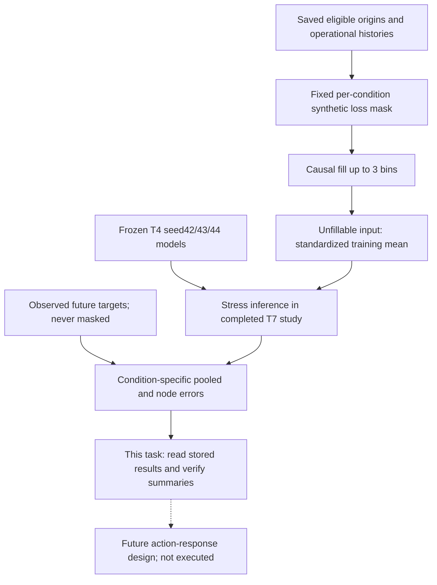

T7 keeps the saved eligible origin sets and observed future power targets, then applies synthetic loss to operational input channels 0–6. Weather stays masked, and calendar/identity channels are retained. Its generator takes directly observed finite entries (`age == 0`), applies one fixed seed42 mask per condition across all model seeds, and recomputes causal fill with age at most three bins. Remaining missing inputs become zero in standardized space. This is **training-mean input imputation**, not a claim that all accepted input bins remain observed. No target is filled. [U01; U04]

The persistence anchor changes under corruption: it searches backwards within the six-hour history for available power, otherwise uses the training mean. Both the residual predictor and its condition-specific persistence baseline use that anchor. Comparisons against clean persistence and degraded-input persistence answer different questions. The audit counts describe a sliced node×time×channel grid, not the number of prediction windows multiplied by history length. Each period uses its own slice and fixed mask; across-seed variability does not sample new failure patterns. [U01; U04]

This stress test differs from B1's observed no-fill windows and historical v5's fixed common no-fill holdouts. The burst generator samples distinct start positions but does not explicitly prohibit overlapping blocks. Requested dropout percentages therefore differ from realized removed-observation proportions, especially for long blocks. The generator's first source row is the evaluation slice start: available context is bounded and can differ from an uninterrupted telemetry feed. These limitations are part of the intervention definition. [U04]

## 6. System architecture and implemented workflow

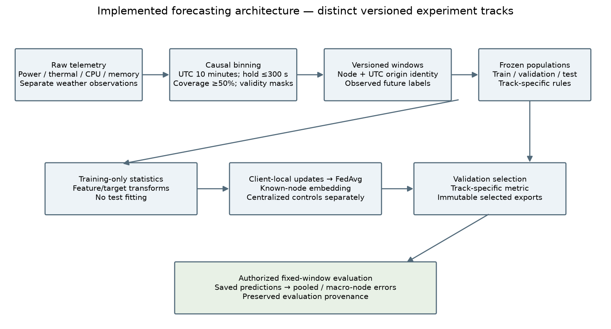

**Figure 1.** Evidence-preserving forecasting architecture. The rendered figure summarizes implemented data/model/result paths; the Mermaid workflow separately identifies future decision support. Simulated clients remain node partitions from one facility.

### 6.1 Components and responsibilities

Acquisition/extraction code obtains versioned raw files and receipts. Preparation code maps sensor records into the UTC grid and constructs eligible windows. Dataset interfaces expose training windows per client and coordinator validation windows. Model adapters define numeric inputs, node embeddings, prediction units and loss scaling. Orchestration code samples clients, trains local copies, aggregates updates and commits round evidence. Evaluation code consumes selected models under a separate test gate. Reporting code reads saved artifacts.

The historical and B1 pipelines implement strong explicit source/data/checkpoint bindings. The newer T4 research runner has a different lifecycle and lighter audit structure. They should not be described as one interchangeable production system. A future common interface can reuse validated primitives, but it must preserve each old artifact’s original contract rather than editing old hashes to make a new interface pass. [M01; B04; T08]

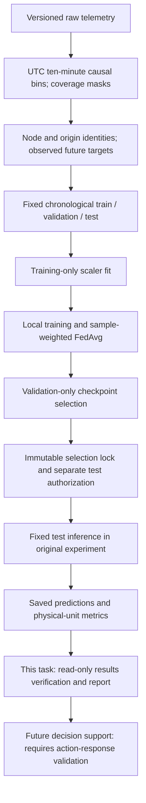

### 6.2 Chronological execution sequence

The implemented scientific workflow is: inspect sensor semantics; validate/order observations; bin causally; determine split-specific eligible identities; fit authorized training-only statistics; construct client training data; initialize the declared model; sample and update clients; aggregate; evaluate validation at the declared cadence; select the prescribed checkpoint; freeze selected states; open test only under the applicable gate; save predictions and physical-unit errors; and publish provenance/results.

That sequence matters more than the presence of a script for each stage. A model-selection script does not prove that a test was evaluated, and an evaluation adapter does not grant permission to run it. B1’s centralized March adapter is a current example: source, configuration and 56 contract tests exist, but the runtime preflight/authorization/evaluation output directories are absent. Its result status remains “not evaluated,” despite completed centralized training. [B04; B06]

### 6.3 Artifacts, immutability and verification boundaries

Manifests describe configuration and sources; receipts bind committed artifacts; hashes identify raw bytes; selected exports contain validation-selected state; metric and prediction artifacts preserve the evaluated population. A completion receipt is evidence of the writer’s completed stage and can be checked against existing bytes. It is not an independent institutional signature or a substitute for semantic replay.

Historical preflight FAILED because an older preservation inventory includes changed metadata and a changed operational cache-lock payload. Later investigation found matching selected raw-input, frozen/cohort, checkpoint and result bindings under narrower checks. These facts can coexist. This report preserves the FAILED/UNKNOWN historical statuses and does not “repair” them through a new inventory. [P02]

For this reporting task, a separate before/after preservation check covers current files. That check can establish that preparing the report did not change the checked old artifacts; it cannot retroactively prove every old preparation decision or numerical result. This distinction will also guide the proposed decision-support work, where provenance must cover actions and measured outcomes as well as forecast arrays.

## 7. Model architecture and learning objectives

### 7.1 Shared sequence representation

The recurrent models consume batches shaped `[B,H,14]`. The node-ID slot is replaced by a learned 979×8 table, while the other thirteen slots retain their numeric meaning. Thus the recurrent input width is 21. The model processes the sequence in temporal order and uses the final recurrent output as the sequence representation. This is a many-to-one forecast: it does not output six separate future power values. [M01]

The shared node embedding is model state. A client associated with one node uses that node’s row, but full-table FedAvg averages the entire table with the other model parameters. There is no implemented row-wise aggregation rule in the approved B1 protocol. The embedding helps represent known identities; it is not an additional environmental measurement and does not make the model transferable to an unseen identifier without a new design.

The major architectural versions differ. Historical v1/v5 models have a fixed persistence residual path in standardized coordinates. B1’s two-output adapter is nonresidual and returns physical predictions after inverse scaling. Candidate 1 uses a one-layer absolute-target `SequenceGRU`; T4 uses the same class with two layers and a separately reconstructed physical persistence residual. A common word such as “GRU” does not make their checkpoints compatible. [M01; B01; T06]

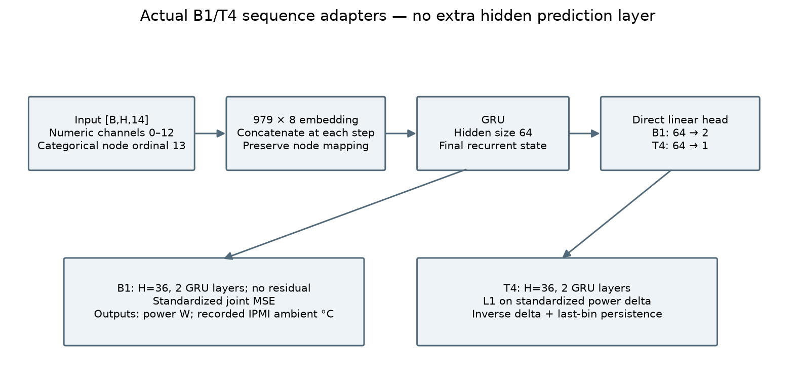

**Figure 2.** Actual direct-head B1 and T4 models, with distinct physical outputs and residual handling. Editable Mermaid source is in `FIGURES/model_architecture.mmd`.

### 7.2 GRU computation and parameterization

For input x_t and preceding hidden state h_{t−1}, the implemented GRU family computes reset/update gates and a candidate state. A compatible form is

$$r_t=\sigma(W_{ir}x_t+b_{ir}+W_{hr}h_{t-1}+b_{hr}),$$
$$z_t=\sigma(W_{iz}x_t+b_{iz}+W_{hz}h_{t-1}+b_{hz}),$$
$$\tilde h_t=\tanh(W_{in}x_t+b_{in}+r_t\odot(W_{hn}h_{t-1}+b_{hn})),$$
$$h_t=(1-z_t)\odot\tilde h_t+z_t\odot h_{t-1}.$$

These equations explain the recurrent operator selected by `nn.GRU`; they do not add a new mechanism to the source. The head is a direct linear map from the 64-dimensional final recurrent state to one or two outputs. In particular, the B1 implementation’s head is `Linear(64,2)`, not an additional hidden 64-unit prediction network. [M01; B01]

For T4’s two-layer,64-hidden-unit,21-input GRU, the trainable parameter count can be checked without initializing a model. The embedding contributes 7,832 parameters; recurrent layers contribute 16,704 and 24,960; the scalar head contributes 65. Their sum is 49,561, agreeing with the saved T4 configuration/audit. The corresponding direct two-output head contributes 130 rather than 65. Fixed scaling buffers are not trainable parameters. [T06; T09]

### 7.3 B1 two-output objective and physical units

B1 normalizes power and temperature independently using training-only statistics. If μ_j and σ_j are the locked target moments, the standardized target is `(y_j−μ_j)/σ_j`. Local training uses the average squared error over both standardized coordinates. This avoids allowing the larger numeric scale of watts to dominate solely because temperature is measured in degrees Celsius.

Validation selection uses the joint standardized RMSE

$$J^{1/2}=\sqrt{\frac 12\left[(\mathrm{RMSE}_{P}/\sigma_P)^2+(\mathrm{RMSE}_{T}/\sigma_T)^2\right]}.$$

The physical RMSE values are divided by the **training** target scales, not validation/test scales. Individual output errors can move in opposite directions while the joint metric improves. Physical MAE/RMSE are still reported separately, because a small joint score is not an operational guarantee for either target. [B01; B02]

Inverse transformation returns W and°C exactly once. There is no additional multiplication by 1000 after the B1 target has already been expressed in watts. The target-validation helpers explicitly reject masked arrays and boolean targets, preserve masks until validation and require finite numeric values and correct dimensions. These checks address data-contract errors; they do not establish predictive quality.

### 7.4 T4 residual target and L1 objective

T4 instead models the difference between the future mean power and last input power. For stored power in kW,

$$d_n(t)=y_{n,\mathrm{kW}}(t)-p_{n,\mathrm{last,kW}}(t),\quad z_d=(d_n-\mu_d)/\sigma_d,$$
$$\hat y_{n,\mathrm{W}}=p_{n,\mathrm{last,W}}+1000(\hat z_d\sigma_d+\mu_d).$$

The selected candidate uses L1 loss on the standardized residual. Its moments are calculated from accepted training windows, while its input scalers are inherited from the Candidate 1 training-bin routine. The audit records residual mean approximately 0.0524 W and residual standard deviation 62.9524 W. Those are reported saved-audit values, not newly fitted statistics. [T06; T08]

A residual formulation anchors the prediction to the local recent level. This is a plausible explanation for improved tracking under temporal drift, but the final experiment changes several factors relative to the earlier absolute baseline: target formulation, loss and layer count. The measured package improvement cannot be causally assigned to a single change without a matched ablation. Validation-only pilot comparisons help motivate the package; they do not substitute for a final factorial test.

### 7.5 Other evaluated model families

The earlier shared-model LSTM is a separate residual sequence model trained using Adam with a saved 30-epoch cap and best validation weights. Its log places the minimum recorded validation loss at epoch 1; continuing the log through epoch 30 is not evidence that epoch 30 was used for the reported test score. Its seed 42 result should not be mislabeled as a three-seed FedAvg result. [L01; L02]

The historical 18-fit v1 panel covers LSTM, GRU and XGBoost, each with weather enabled/masked and three seeds. This establishes that alternatives were actually evaluated, but only on that historical one-hour contract. The separately inspected T6 comparison supplies newer same-cohort model-family results, subject to the capacity and selection caveats in §11.8. It remains inappropriate to rank all these model families by placing their errors from different cohorts in one leaderboard. [H01]

## 8. Federated implementation and optimizer protocols

### 8.1 Sample-weighted FedAvg

Let S_r be the selected clients in round r, and n_k the processed local sample count. Each selected client starts from the same global state w_r and performs the declared local optimizer steps. Standard sample-weighted aggregation is

$$w_{r+1}=\sum_{k\in S_r}\frac{n_k}{\sum_{j\in S_r}n_j}\,w_{r+1}^{(k)}.$$

This weights client updates by their processed examples, rather than giving every node equal influence regardless of local data quantity. The exact meaning of n_k is version-specific: in historical v5 it is the prescribed no-fill-sized sampled budget, while in B1/T4 it corresponds to that client’s accepted local epoch population. A native pool’s size is not automatically the processed weight. [M02; V01; T06]

B1 samples 98 of 979 clients uniformly without replacement in each round and runs 200 rounds for each prescribed seed. Local optimizers are fresh per client/session. Full embedding-table aggregation is intentional. If only client i changes embedding row i by δ_i, averaging with unchanged copies from other clients gives the global row increment `(n_i/Σn_k)δ_i`. This dilution is standard full-table FedAvg behavior, not a hidden row-specific optimizer.

The B1 aggregation implementation accumulates floating model state on CPU in float64 and restores the expected parameter dtype. It validates keys, shapes, finite values and fixed-state roles. T4’s research implementation instead accumulates weighted tensors using `.float()` arithmetic. Both implement the same weighting equation, but their accumulation precision and lifecycle checks differ; numerical reproducibility should not be asserted across them solely because both are called FedAvg.

### 8.2 Historical v5 fixed sampled-pass budget

The 24-fit matrix uses two algorithms, four policies and seeds 42/43/44. Every policy has its own native training pool. To control processed exposure, each client’s budget is its original no-fill count; the runner samples that many rows from the policy-specific pool and shuffles deterministically. Local batch size is 512, partial batches are retained, and SGD uses learning rate 0.01 with zero momentum/weight decay. [V01; M02]

The centralized control replays the selected-client and batch schedule on one continuing model. FedAvg clients instead start from the common round snapshot and are averaged. The control therefore matches exposure, initialization conventions and optimizer settings, while deliberately changing the trajectory implied by aggregation. It is not equivalent to training every centralized algorithm to its best possible validation performance.

Weather slots 7 and 8 are zeroed in standardized space. The common observed validation and test windows remain the same across all four input-fill policies. Native training counts grow with permitted fill age, so the estimand is the benefit of access to a different training population under fixed compute exposure. It is not an isolated statement about the physical accuracy of imputed sensor values.

### 8.3 B1 training and matched control

B1 uses one local epoch, batch 128 and fresh SGD sessions, with all original 979 client ordinals preserved. Its prepared dataset has 280,499 training and 82,993 validation windows. Validation occurs at 0,10,…, 200 rounds; the earliest strict minimum joint standardized RMSE is selected. All three FedAvg selections were round 200. [B01; B04]

The separately trained B1 centralized-SGD v2 control replays the exact FedAvg selected-client order and within-client batches on one continuing model. Its recorded seed 42/43/44 selections are 200/190/190, with 200 blocks complete for each. The matrix completion exists and the selected exports are present. This is genuine completed training, but it is not yet a matched March result: the current adapter’s 56 contract tests do not supply centralized test predictions. [B04; B06]

The approved exposure totals in its records are approximately 5.62 million examples and 55.4 thousandoptimizer steps per seed, not 200 full-union epochs. A later centralized March comparison must use the locked 190 states where selected and the exact existing B1 test windows. Substituting the final 200 state or borrowing T4’s centralized score would change the experiment.

### 8.4 Candidate 1/T4 optimizer differences

The newer history-length runner uses Adam, learning rate 0.001, batch 64, one local epoch and 200 rounds. It evaluates validation each round. Its three history lengths share the longest-history-eligible origin population. T4 inherits that data interface but screens 13 validation candidates and selects a two-layer residual/L1 configuration; its final FedAvg uses 200 rounds and its central model uses 20 pooled epochs. [C03; T06]

T4’s central comparison is approximately balanced in intended sample exposure, not an exact B1-style schedule replay. The audit’s 7,879,200 FedAvg sample-pass estimate uses 200×98×402, while the code processes the selected clients’ actual window counts. Without the saved complete client/sample ledger, exact equality of realized optimizer steps is not established by that multiplication. The central 20×394,100 calculation is 7,882,000 examples; proximity of these nominal totals is useful context, not proof of identical budgets.

Local Adam versus centralized Adam, local state reset, batch order, aggregation and different validation-selected stopping points can all affect trajectories. This does not make the measured result unusable; it specifies the result’s estimand. The report consequently calls it the T4 centralized control, while reserving “exact schedule replay” for the earlier implementations that actually bind that schedule.

## 9. Scaling, validation and checkpoint selection

### 9.1 Training-only statistics

Training-only normalization prevents a holdout distribution from influencing fitted moments. The historical tracks reuse their frozen original training-window scalers. B1 fits new two-pass float64 population statistics in deterministic order on accepted training windows, preserves node index separately and freezes those statistics for validation/test. Candidate 1’s actual code computes each feature’s moments over finite training bins, rather than accepted training-window occurrences. T4’s residual moments then use accepted training residuals. [S01; C04; T06]

These are different weighting populations. A heavily repeated observation can have greater weight under overlapping-window statistics than under unique-bin statistics. The important within-track control is that paired models share the same declared scaler. The report does not normalize all results to one retrospective scaler or treat “training-only” as proof that every track’s normalization population is identical.

The B1 scaler history also includes a numerical acceptance investigation. A float32 normalized cpu_idle value corresponding to physical zero reconstructed as approximately 2.08616×10⁻⁶, slightly above the original 2×10⁻⁶criterion. Later review distinguished float64 affine correctness from unavoidable float32 representation error and locked an approved quantization-aware rule. The historical failure was retained; the dataset and fitted statistics were not changed to manufacture a pass. This episode illustrates why dtype and acceptance semantics belong in provenance. [S01]

### 9.2 Selection rules are track-specific

The legacy LSTM uses best validation weights. Historical v1 model runs record their selected iteration and validation-RMSE criterion. The v5 and B1 production runners preserve validation traces and explicit selection receipts. The Candidate 1 history-length runner selects minimum validation RMSE. T4 screens candidates by validation MAE with reported RMSE secondary context, then its actual training loop updates a best state only when validation MAE strictly decreases. Exact ties therefore keep the earlier state; the loop does not implement a separate RMSE tie-break. [L02; H01; B04; T06]

Test windows must not choose checkpoints. The newer work nevertheless takes place after earlier observations of some calendar periods, so the evaluation is retrospective even if an individual run selects only on its validation split. “No test-based checkpoint reselection inside this run” is a narrower, supportable statement than “the researcher had never seen this period.”

All B1 FedAvg seeds selecting round 200 means the best prescribed candidate occurred at the cap; it does not establish convergence. The saved review found continued joint-metric improvement at the last validation interval. Changing the cap after seeing March errors would create a new experiment and require a new selection/evaluation procedure. Likewise, T4’s best rounds 197/198/200 are recorded selections rather than an authorization to continue training the frozen task.

### 9.3 Immutable selection versus authorization

A selection lock binds chosen models and their pre-test evidence. A test authorization binds those selections to exact data, protocol, device and output. They serve different purposes. B1’s existing FedAvg evaluator is hard-bound to its original lock and round 200 schema. The additive centralized adapter accepts the central 200/190/190 exports through a different contract; it preserves rather than edits the old evaluator. [B06]

The centralized adapter currently has implementation and contract-test evidence, not real test-execution evidence. Future preflight must establish frozen March and saved FedAvg prediction alignment before issuing the separate central evaluation receipt. It must compare the same 194,212 identities and 976 nodes and must not rerun FedAvg inference. No central March metric is supplied in this report.

## 10. Evaluation definitions and comparison design

### 10.1 Pooled, node-wise and macro metrics

For N aligned observations with error e_i=ŷ_i−y_i,

$$\mathrm{MAE}=\frac 1 N\sum_i|e_i|,\qquad \mathrm{RMSE}=\sqrt{\frac 1 N\sum_i e_i^2}.$$

Pooled metrics weight each accepted window equally. Node-wise metrics apply the same definitions within a node. Macro-node MAE is the arithmetic mean of node MAEs; macro-node RMSE is the arithmetic mean of node RMSEs. Macro RMSE is not the square root of a mean over node RMSE values. These definitions can differ substantially when window counts and error distributions vary across nodes. [M04]

This distinction explains the T4 headline correction. Pooled FedAvg MAE 24.8133 W compares with pooled persistence 33.0661 W. Macro FedAvg MAE 25.2242 W compares with macro persistence 33.3504 W. Combining 24.81 and 33.35 mixes denominators even though both have units of watts. The corrected report supplies both panels and the original sources instead of choosing whichever comparison appears larger. [T02; T03]

### 10.2 Persistence and relative improvements

Persistence predicts the last eligible input power bin for the next-hour mean; B1 also applies the corresponding last input ambient value for its temperature comparison. It does not predict a last-hour average. In FF30 tracks the last eligible input may be a causally filled value; consequently “last observed” is shorthand that should be qualified by that input policy. In B1’s no-fill track, the input is observed under the valid-bin contract.

For a lower-is-better metric M, relative improvement is `100×(M_persistence−M_model)/M_persistence`. A negative result is degradation. MAE and RMSE need not agree: a model can reduce large errors enough to improve RMSE while increasing typical absolute error. This is exactly the pattern observed for B1 power and makes an “overall winner” claim inappropriate without a prespecified operational objective. [B02; B03]

### 10.3 Seeds and temporal dependence

Across-seed means average three individual metric scores. Sample standard deviation uses denominator n−1, with n=3. The resulting spread describes sensitivity to stochastic initialization/sampling on one dataset; it is not a confidence interval over independent facilities or independent time periods. Some T4 summary files use population SD, which this report preserves as historical evidence while computing its displayed sample SD from the saved seed rows. [T10]

Ten-minute origin grids with six-bin future means create overlapping labels. Hourly B1 targets avoid direct target-interval overlap within a node, but histories still overlap and all nodes share facility/time conditions. Counting millions of overlapping node windows does not produce millions of independent experiments. A future significance analysis should account for temporal and cross-node clustering instead of applying an independent-sample test to all residuals.

### 10.4 Limits on cross-track comparisons

The experiments are organized as separate result panels. Changes in history, target count, fill policy, selection metric, scaler population, client eligibility, calendar split and optimizer all affect interpretation. The T4 March panel has 2,229,042 ten-minute windows, while B1 has 194,212 hourly windows with two observed targets and no fill. The common month name does not make these a matched comparison.

T4’s extended January 28–April 1 period contains both its canonical January 28–February 4 test and its March panel. Those three reported evaluations are nested temporal views, not independent replications. B1’s retrospective label is retained, and newer history/T4 periods also remain previously examined project periods. The report therefore makes within-contract conclusions first and uses cross-track observations only to motivate future controlled studies. [T04; C03]

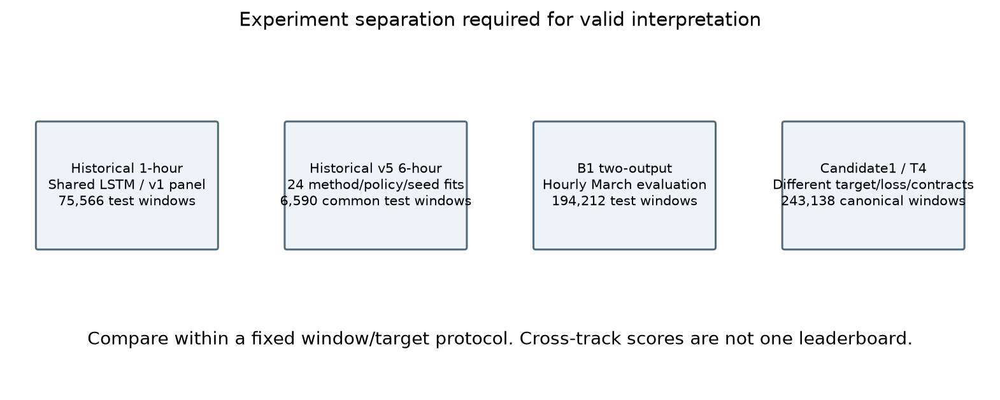

**Figure 3.** Track boundaries prevent comparisons across incompatible windows, targets or protocols.

## 11. Completed experimental results

### 11.1 Earlier one-hour shared LSTM

**Table 11.1.**

| Method | Pooled MAE (W) | Pooled RMSE (W) | Macro-node MAE (W) |
| --- | --- | --- | --- |
| Shared LSTM, seed 42 | 27.934199 | 54.883981 | 27.689106 |
| Same-window persistence | 30.926903 | 64.417454 | 30.703514 |

The exact saved test summary reports kW; multiplying by 1000 gives the watt values above. There are 75,566 held-out windows and 979 evaluated nodes. The configuration records seed 42, two LSTM layers, hidden 64, embedding 8, batch 512 and learning rate 0.001. Its 30-epoch training log has the lowest recorded validation loss at epoch 1. A subsequent resume message reports no additional epochs, so it is not another independent fit. [L01; L02]

The pooled improvements are approximately 9.68%in MAE and 14.80%in RMSE. The result demonstrates a useful shared-model forecast on its accepted historical windows. It does not demonstrate a federated benefit, because the model is not this project’s FedAvg comparison. Nor does it establish performance on March, on all unavailable bins or on new nodes. The duplicate legacy GPU 1/all-nodes summaries are not counted as independent evidence merely because they occupy separate directories.

### 11.2 Historical v1 architecture/weather panel and matched v2/v3 control

**Table 11.2.**

| Historical v1 model | Weather | Pooled MAE W, mean ± sample SD | Pooled RMSE W | Macro MAE W |
| --- | --- | --- | --- | --- |
| lstm | enabled | 29.322 ± 0.642 | 55.407 ± 0.328 | 29.066 ± 0.634 |
| lstm | masked | 29.386 ± 1.337 | 58.138 ± 5.439 | 29.151 ± 1.350 |
| gru | enabled | 28.568 ± 0.363 | 55.183 ± 0.231 | 28.334 ± 0.362 |
| gru | masked | 28.181 ± 0.158 | 54.948 ± 0.271 | 27.946 ± 0.135 |
| xgboost | enabled | 29.264 ± 0.062 | 55.833 ± 0.082 | 29.000 ± 0.059 |
| xgboost | masked | 28.971 ± 0.072 | 55.866 ± 0.205 | 28.707 ± 0.074 |

These 18 runs provide historical LSTM/GRU/XGBoost evidence, with weather-enabled and masked variants evaluated under the one-hour frozen contract. The values in the table are means/sample SD calculated from saved per-seed scores. They are not T4 results and remain separate from the newer T6 architecture study. Detailed selections and native sources are in the status/claim registers. [H01]

The earlier one-hour matched comparison contains six additional FedAvg/centralized-SGD fits. Its mean pooled test RMSE is 63.231179 W for FedAvg and 56.016953 W for central SGD; mean MAE is 33.924637 W versus 30.516738 W. Persistence is approximately 64.417454 W RMSE and 30.926903 W MAE. These remain a separate historical control panel. The results support lower central errors in that protocol, not a general theorem about federated learning. [H02]

### 11.3 Historical six-hour 24-fit missing-data matrix

**Table 11.3.**

| Method | Input policy | Pooled MAE W | Pooled RMSE W | Macro MAE W | Macro RMSE W |
| --- | --- | --- | --- | --- | --- |
| fedavg | no_fill | 29.917 ± 0.120 | 56.851 ± 0.112 | 30.601 ± 0.132 | 38.283 ± 0.144 |
| fedavg | ff 10 | 29.825 ± 0.139 | 56.834 ± 0.121 | 30.514 ± 0.149 | 38.199 ± 0.165 |
| fedavg | ff 20 | 29.856 ± 0.118 | 56.830 ± 0.114 | 30.539 ± 0.136 | 38.221 ± 0.151 |
| fedavg | ff 30 | 29.842 ± 0.124 | 56.831 ± 0.115 | 30.527 ± 0.144 | 38.211 ± 0.158 |
| centralized_sgd | no_fill | 28.159 ± 0.642 | 51.505 ± 0.711 | 28.613 ± 0.680 | 34.517 ± 0.860 |
| centralized_sgd | ff 10 | 27.347 ± 0.608 | 50.977 ± 0.284 | 27.699 ± 0.514 | 33.509 ± 0.539 |
| centralized_sgd | ff 20 | 27.564 ± 0.621 | 51.068 ± 0.394 | 27.946 ± 0.676 | 33.752 ± 0.720 |
| centralized_sgd | ff 30 | 27.554 ± 1.275 | 51.193 ± 0.715 | 27.939 ± 1.229 | 33.771 ± 1.299 |

Each row contains three seeds; there are 24 actual fitted identities. All 12 paired policy/seed comparisons have lower pooled MAE and RMSE for centralized SGD. These are 24 metric inequalities across 12 paired configurations, not 24 independent datasets. The exact ordered-window and target digests agree within each pair. The common cohort is 6,590 windows,570 nodes,17 origins on 24 February 2022. That concentration substantially limits temporal generalization. [V01–V03]

Central FF10 has the lowest learned-model mean pooled RMSE,50.976723 W, and the lowest mean MAE,27.346591 W. FedAvg’s lowest mean RMSE is FF20,56.830222 W, while its lowest mean MAE is FF10,29.825478 W. Persistence has pooled MAE 27.147075 W and RMSE 58.269808 W. Thus even the best learned policy mean does not beat persistence MAE, although learned RMSE improves. A report of only RMSE would conceal that trade-off.

Differences among FedAvg fill-policy mean RMSEs are small compared with the method contrast and should not be framed as a universal best-gap rule. The enlarged native pools and fixed sampled budgets define what was tested. The narrow holdout and three seeds do not establish that FF10 orFF20 is operationally optimal, nor that more filling is always helpful. The original recorded no-fill validation/test populations remain unchanged. [V02; V04]

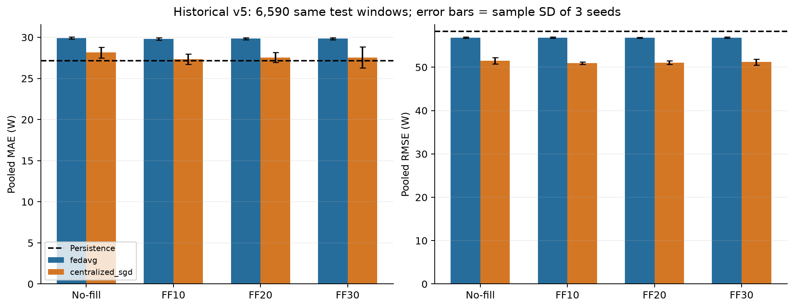

**Figure 4.** Historical v5 pooled MAE/RMSE by policy and method, with sample SD across three seeds. The horizontal line is persistence on the same 6,590 windows. This panel must not be compared numerically with B1 or T4 as if only history changed.

### 11.4 Separate B1 two-output March experiment

**Table 11.4.**

| Output | Aggregation | Persistence MAE | B1 MAE, mean ± sample SD | Persistence RMSE | B1 RMSE, mean ± sample SD |
| --- | --- | --- | --- | --- | --- |
| Power W | pooled | 42.392221 | 53.356761 ± 1.512556 | 92.600392 | 89.797794 ± 1.138748 |
| Power W | macro_node | 43.176484 | 53.770241 ± 1.591911 | 90.728449 | 88.644047 ± 1.069145 |
| Ambient °C | pooled | 0.303385 | 0.447872 ± 0.007676 | 0.609532 | 0.724799 ± 0.010215 |
| Ambient °C | macro_node | 0.308145 | 0.452148 ± 0.007587 | 0.510989 | 0.639703 ± 0.006426 |

B1 uses 36 ten-minute inputs, predicts both next-hour means, and evaluates identical 194,212 March windows on 976 nodes for seeds 42/43/44. Its observed target requirement and hourly origins distinguish it from T4’s power-only FF30 cohort. All FedAvg selected states are round 200. The displayed seed spread is sample SD, not uncertainty over independent datasets. [B01–B03]

The main conclusion is mixed performance. Power pooled RMSE improves from 92.600392 W to 89.797794 W, approximately 3.03%. Power MAE worsens from 42.392221 W to 53.356761 W. Ambient MAE worsens from 0.303385°C to 0.447872°C, and RMSE from 0.609532°C to 0.724799°C. Macro-node results tell the same broad cautionary story; they are provided separately rather than folded into the pooled values.

This experiment does demonstrate that a real two-output preparation/scaler/model/evaluation chain was executed. It does not demonstrate that adding temperature improves power, because a matched single-output B1 ablation is not supplied. It does not establish a useful temperature forecast relative to persistence. The three completed central control fits have no completed March scoring artifacts, so no B1 FedAvg-versus-centralized test conclusion is made.

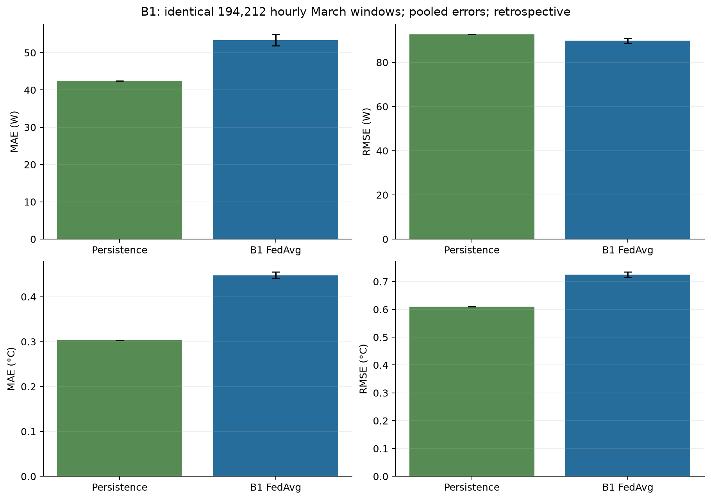

**Figure 5.** B1 pooled errors for each physical output, with persistence and the three-seed FedAvg mean. The different units have separate axes. The mixed MAE/RMSE result is retained.

### 11.5 Newer common-coverage and history-length studies

The T1.1-style audit is complete, and the T1.2 directory contains a completed protocol-design record. Later T1.3 named execution directories contain nine FF30 fits:3 histories×3 seeds. They go beyond a proposal or a short pilot. The corresponding no-fill nine-fit sensitivity matrix is not verified as completed from available artifacts. [C01–C03]

**Table 11.5.**

| History hours | Pooled MAE W | Pooled RMSE W | Macro MAE W | Macro RMSE W |
| --- | --- | --- | --- | --- |
| 1 | 33.302 ± 0.371 | 58.716 ± 0.085 | 33.941 ± 0.364 | 55.389 ± 0.102 |
| 6 | 32.651 ± 0.109 | 58.242 ± 0.077 | 33.280 ± 0.093 | 54.829 ± 0.084 |
| 24 | 32.574 ± 0.136 | 58.172 ± 0.090 | 33.199 ± 0.120 | 54.746 ± 0.098 |

The common canonical test has 243,138 windows and 978 nodes. Mean pooled MAE decreases from 33.302 W at 1 h to 32.651 W at 6 h and 32.574 W at 24 h; RMSE decreases from 58.716 W to 58.242 W and 58.172 W. The 6 h→24 h absolute differences are small. The 1 h→6 h MAE reduction is about 1.96%relative to 1 h, not the 3.1%stated in one historical prose passage. Seed 43’s 1 h MAE beats persistence, so the claim that all 1 hseeds trail persistence is also too strong. [C03; C04]

The report does not call six hours a proven Pareto optimum. The historical prose says 200.7→365.7 MB“triples”memory, while that arithmetic is about 1.82×; some timing summaries also disagree with per-fit JSON. More importantly, these results are conditional on FF30 and a longest-history-eligible subpopulation. A small numerical gain from 24 h is measured in this panel, but no universal benefit or no-benefit conclusion follows.

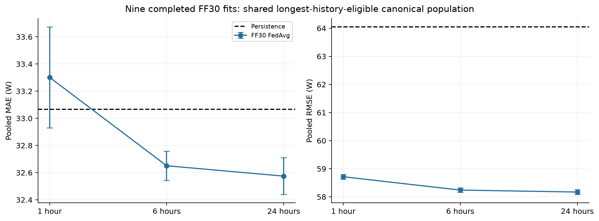

**Figure 6.** Saved FF30 history comparison, means/sample SD from nine seed rows. Shared targets/cohort are part of the implementation; protocol-design/executed-count differences and no-fill incompleteness remain qualifications.

The completed table above is the older one-layer, direct-power/MSE history experiment. The newly added `t1_2_controlled_history_benchmark_v1.py` instead proposes two-layer residual/MSE fits and a no-fill test sensitivity. Its output was absent at initial inspection and later appeared with partial external execution evidence; no completed new nine-fit result is inferred from that progress. [U03; U05]

### 11.6 T2 temporal extension and T3 adaptation

The frozen six-hour T1 models were also evaluated over an extended January 28–April 1 period. Saved T2 results show larger MAE under that extension than on the canonical early test and MAE worse than persistence, while RMSE remains better. This motivates investigating temporal sensitivity, but does not identify a physical cause for every drift or telemetry gap. [C05]

T3 contains actual frozen and monthly-retrained rows for all three seeds, plus weekly-retrained rows for seed 42. It should therefore not be described as an empty plan, nor as a complete three-seed weekly study. For March, the weekly seed 42 row reports MAE 45.522 W and RMSE 82.880 W against persistence 45.289 W/94.105 W. Monthly retraining does not consistently improve the recorded power errors. These findings remain separate from the later T4 formulation change. [C06]

### 11.7 T4 residual-power benchmark

All requested T4 final-report, integrity-audit and artifact-manifest files exist. Twenty-two manifest-listed files match their recorded hashes, and all six final FedAvg/central checkpoint hashes match the seed-audit CSV. The saved reconciliation table reports PASS for 18 method/seed/period rows. This report independently checks those stored values and summaries without rerunning the audit tool, which would execute inference. [T01; T07; T08]

**Table 11.6.**

| Temporal view | Method | Pooled MAE W | Pooled RMSE W | Macro MAE W | Macro RMSE W | Persistence pooled MAE/RMSE W |
| --- | --- | --- | --- | --- | --- | --- |
| T1_Test | FedAvg-GRU-T4 | 24.8133 ± 0.0358 | 57.5502 ± 0.0306 | 25.2242 ± 0.0343 | 52.6043 ± 0.0387 | 33.0661 / 64.0451 |
| T1_Test | Centralized-GRU-T4 | 23.9865 ± 0.2251 | 56.9061 ± 0.2228 | 24.3658 ± 0.1943 | 51.9706 ± 0.1891 | 33.0661 / 64.0451 |
| T2_Extended | FedAvg-GRU-T4 | 33.9660 ± 0.1185 | 77.9329 ± 0.1593 | 33.8562 ± 0.1181 | 76.5349 ± 0.1440 | 40.4405 / 85.1704 |
| T2_Extended | Centralized-GRU-T4 | 33.0641 ± 0.1768 | 77.6413 ± 0.3941 | 32.9464 ± 0.1771 | 76.2242 ± 0.3726 | 40.4405 / 85.1704 |
| March_2022 | FedAvg-GRU-T4 | 38.2834 ± 0.1686 | 85.7435 ± 0.2301 | 38.1989 ± 0.1676 | 83.8156 ± 0.2026 | 45.2887 / 94.1051 |
| March_2022 | Centralized-GRU-T4 | 37.3370 ± 0.2118 | 85.5158 ± 0.5312 | 37.2491 ± 0.2120 | 83.5735 ± 0.4911 | 45.2887 / 94.1051 |

The canonical FedAvg pooled improvement over persistence is approximately 24.96%MAE and 10.14%RMSE. Macro MAE improves from approximately 33.3504 W to 25.2242 W, about 24.37%. These are supported within-T4 comparisons; the often repeated 24.81-versus 33.35 headline should be replaced by the two correctly paired aggregation panels. The centralized T4 mean canonical errors are lower still,23.9865 W MAE and 56.9061 W RMSE. [T02; T03]

The March T4 panel reports 2,229,042 windows on 976 nodes and mean FedAvg pooled MAE 38.2834 W/RMSE 85.7435 W, against 45.2887 W/94.1051 W persistence. The extended panel contains 3,609,285 windows on 979 nodes. Its overlap with canonical/March periods must be visible in captions and interpretation. These are not independent “three datasets,” and they are not matched to B1’s March windows. [T04]

Across-seed reported node-win counts average 898.3 of 978 canonical nodes, about 91.85%; the extended and March values are about 98.03%and 97.71%. The actual exported node-level CSV is seed 42 only for canonical/March periods, as the source explicitly conditions on `seed == 42`. It does not provide all-seed node arrays or an extended-period node table. This limits independent node-level reconstruction even though the aggregate audit lists per-seed win counts. [T05]

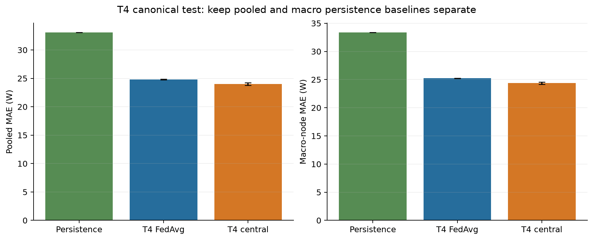

**Figure 7.** T4 canonical pooled and macro MAE, keeping their persistence baselines distinct. Error bars are sample SD recalculated from the saved four-decimal seed scores, not the population SD used in some original summary CSVs.

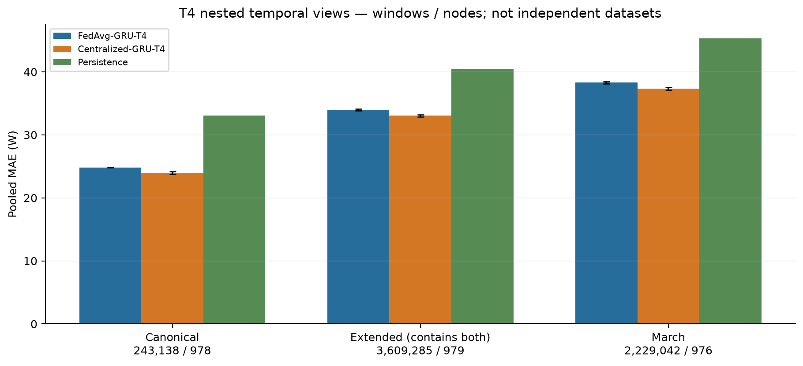

**Figure 8.** T4 power pooled MAE across nested temporal views. The extended interval contains the canonical and March intervals; lines do not represent independent replications or a prospective deployment trial.

### 11.8 Newly inspected T5 weather and T6 model-family records

T5 contains four conditions × three seeds × three temporal views. Its no-weather condition reuses T4; nine additional weather-enabled fits are recorded. Canonical mean pooled MAE is 24.8133 W with no weather, 24.8836 W with temperature only, 24.9316 W with humidity only and 24.9593 W with both. The differences are small; they support no benefit in this measured panel, not a general irrelevance of weather. T5 reconstructs unmasked channels separately, so the T4 loader's weather masking must not be attributed to all T5 conditions. The checkpoint registry is used for identities; its manifest's repeated reference “Round198” is inconsistent with T4's seed-specific 197/198/200 selections. [N01]

T6 completion reports appeared during this reporting session, independently of this task. The saved matrix reuses three T4 GRUs and adds three FedAvg-LSTM fits and three centralized XGBoost fits. It is a model-family/control comparison, not a fully federated tree benchmark or a capacity-identical GRU/LSTM comparison. The LSTM has 63,449 parameters versus 49,561 for GRU; trees flatten 36×14 inputs. [N02]

**Table 11.7.**

| View | Model | Pooled MAE W, mean ± sample SD | Pooled RMSE W, mean ± sample SD |
| --- | --- | --- | --- |
| test_t1 | FedAvg-GRU (T4 Reference) | 24.8133 ± 0.0358 | 57.5502 ± 0.0306 |
| test_q1 | FedAvg-GRU (T4 Reference) | 33.9660 ± 0.1185 | 77.9329 ± 0.1593 |
| test_march | FedAvg-GRU (T4 Reference) | 38.2834 ± 0.1686 | 85.7435 ± 0.2301 |
| test_t1 | FedAvg-LSTM | 25.4863 ± 0.0982 | 57.5802 ± 0.1214 |
| test_q1 | FedAvg-LSTM | 34.8224 ± 0.0495 | 77.6333 ± 0.0594 |
| test_march | FedAvg-LSTM | 39.2619 ± 0.0957 | 85.2932 ± 0.0860 |
| test_t1 | Centralized XGBoost | 25.7755 ± 0.0455 | 57.0110 ± 0.0497 |
| test_q1 | Centralized XGBoost | 36.4159 ± 0.0199 | 79.1592 ± 0.0661 |
| test_march | Centralized XGBoost | 41.6276 ± 0.0470 | 87.8040 ± 0.1058 |

GRU has lower mean MAE in these T6 views, but LSTM's extended/March RMSE can be lower. Thus the prose claim of uniformly superior architecture is too broad. The XGBoost inference calls do not explicitly pass a best-iteration range; whether early-stopped trees affect the saved comparison requires a separate review, not a correction here. New hashes match recorded bindings, but model-level numerical replay was not performed. These results do not replace the separate B1 or historical architecture experiments. [N02]

Two pre-existing T6 progress logs grew during the report interval, and new T6 artifacts appeared. The writer's exact invocation is not established; the log records completion of a concurrently progressing suite. This task did not launch it. Full-tree metadata preservation is therefore not a zero-mismatch result, although the 270 code/config/document hashes and 116 core inspected result hashes remain unchanged. Exact differences are retained in the preservation record; no baseline was updated. [N03]

### 11.9 T7: completed inference-time missing-telemetry stress study

T7 reuses the three frozen T4 FedAvg checkpoints; it adds **no training fits**. The artifacts contain 25 canonical conditions×3 seeds=75 records, plus four conditions×3 seeds in each of the extended and March views, for 99 records across 33 condition/period groups. Canonical evaluation retains 243,138 windows/978 nodes, the extended view 3,609,285/979 and March 2,229,042/976. All periods are retrospective and nested as previously defined. The progress logger's “75 experiments” refers to its canonical tracker, not the full exported matrix. [U01]

**Table 11.8.**

| Canonical condition | Pooled MAE W, mean ± sample SD | Pooled RMSE W, mean ± sample SD | Macro MAE W, mean ± sample SD | Condition persistence MAE W | Δ pooled MAE vs clean W |
| --- | --- | --- | --- | --- | --- |
| Reference Baseline (0% Missing) | 24.8133 ± 0.0358 | 57.5502 ± 0.0306 | 25.2242 ± 0.0343 | 33.0661 | +0.0000 |
| Random 5% Missing | 25.1918 ± 0.0209 | 58.1319 ± 0.0364 | 25.5885 ± 0.0205 | 33.2087 | +0.3785 |
| Random 10% Missing | 25.5890 ± 0.0023 | 58.6870 ± 0.0354 | 26.0097 ± 0.0025 | 33.3517 | +0.7757 |
| Random 20% Missing | 26.5202 ± 0.0298 | 60.1124 ± 0.0450 | 26.9302 ± 0.0271 | 33.7593 | +1.7068 |
| Random 30% Missing | 28.0694 ± 0.0514 | 62.5783 ± 0.0375 | 28.5075 ± 0.0525 | 34.2945 | +3.2561 |
| Contiguous L=3 (30m) 10% Missing | 26.3227 ± 0.0044 | 59.9737 ± 0.0282 | 26.7771 ± 0.0039 | 33.6730 | +1.5094 |
| Contiguous L=6 (1h) 10% Missing | 28.6445 ± 0.0541 | 62.6327 ± 0.0151 | 28.9943 ± 0.0556 | 34.1098 | +3.8312 |
| Contiguous L=6 (1h) 20% Missing | 32.3509 ± 0.0904 | 67.4298 ± 0.0440 | 32.8676 ± 0.0876 | 35.1875 | +7.5376 |
| Contiguous L=6 (1h) 30% Missing | 35.3446 ± 0.1321 | 71.4836 ± 0.0767 | 35.6323 ± 0.1447 | 36.2360 | +10.5313 |
| Contiguous L=12 (2h) 10% Missing | 29.1049 ± 0.0273 | 63.8359 ± 0.0296 | 29.4209 ± 0.0270 | 34.6999 | +4.2915 |
| Contiguous L=12 (2h) 30% Missing | 36.1049 ± 0.0698 | 74.3882 ± 0.0224 | 36.5035 ± 0.0728 | 38.1274 | +11.2916 |
| Feature Group: Power (100% Sensor Outage) | 124.9714 ± 0.0509 | 163.0349 ± 0.0136 | 126.4499 ± 0.0410 | 124.8222 | +100.1581 |
| Feature Group: Cpu (100% Sensor Outage) | 24.7965 ± 0.0406 | 57.6186 ± 0.0228 | 25.2088 ± 0.0387 | 33.0661 | -0.0168 |
| Feature Group: Memory (100% Sensor Outage) | 25.0213 ± 0.0286 | 57.6458 ± 0.0472 | 25.4389 ± 0.0321 | 33.0661 | +0.2079 |
| Feature Group: Inlet_Temp (100% Sensor Outage) | 24.8431 ± 0.0368 | 57.5572 ± 0.0290 | 25.2459 ± 0.0344 | 33.0661 | +0.0298 |

All values above are independently summarized from saved per-condition seed scores. The complete 33-group table, including macro RMSE, is supplied in `TABLES/T7_ALL_CONDITIONS.csv`; no inference was rerun. The clean canonical RMSE is 57.5502 W, **not the 44.97 W stated in T7's Markdown**. The CSV's clean result agrees with T4 to its recorded rounding; several other narrative RMSE cells also conflict, so the numerical CSV takes precedence. [U01; U02]

Random 20% masking adds about 1.71 W MAE, whereas one-hour bursts at 20% add about 7.54 W and two-hour bursts at 30% add about 11.29 W. Longer uninterrupted gaps exceed FF30's age limit more often in this generator. This supports an observed sensitivity to missingness structure under the declared fallback; it does not establish that actual facility failures are predominantly random, that packet loss has been “solved,” or that all telemetry tasks need no other imputation method.

Complete power-channel blackout produces mean MAE about 124.97 W, close to—and slightly worse than—the degraded-input persistence baseline. The model still adds a learned residual to a training-mean anchor; it does not necessarily output that mean exactly. Small CPU/memory/ambient blackout changes are conditional on this already-trained power-anchored model and cannot establish that those physical signals have no value or should be dropped. [U01; U04]

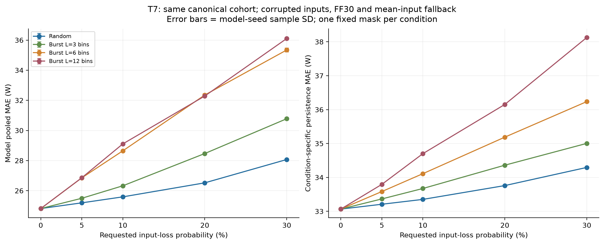

**Figure 9.** Saved T7 canonical pooled MAE under random and burst input loss. Means/sample SD share one mask across model seeds; percentages are requested masking settings, not independently sampled deployments.

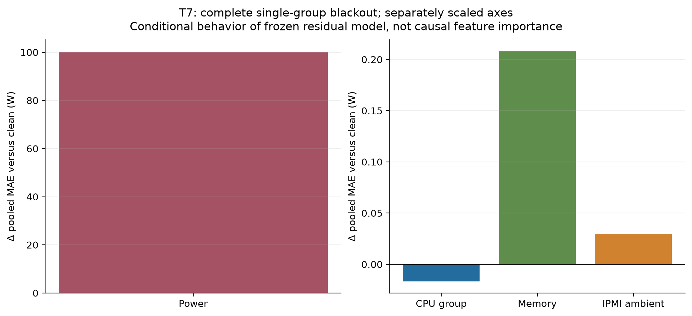

**Figure 10.** Paired MAE change under complete group blackout; power is shown separately so small non-power changes remain visible. Conditional sensitivity is not causal physical-feature importance.

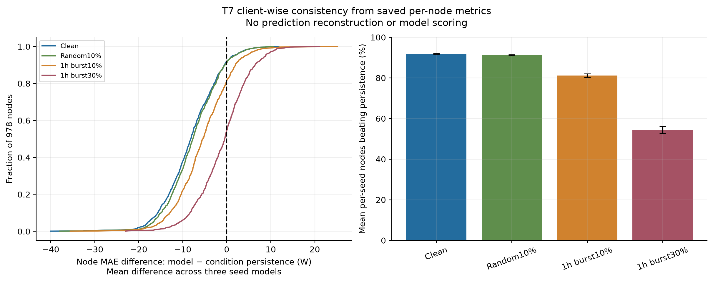

**Figure 11.** Distributions and win rates calculated from saved per-node MAEs for four exported canonical conditions, retaining 978 nodes and all three seed records. Negative model-minus-condition-persistence differences favor the model.

### 11.10 New coverage reconciliation and gated residual-history implementation

The new `t1_1_common_history_coverage_audit_v2` supplies saved policy/history counts and a node exclusion table; `t1_2_history_length_preflight_v1` supplies population and client tables. They are additional audits, not new forecasting results and not a replacement for the older nine-fit history experiment. [U03; U05]

**Table 11.9.**

| Policy | Common training windows / active nodes | Common validation windows / active nodes | Common test windows / active nodes |
| --- | --- | --- | --- |
| No-fill | 4,138 / 354 | 16,842 / 329 | 50,392 / 635 |
| FF10 | 11,897 / 576 | 44,769 / 597 | 125,691 / 907 |
| FF20 | 113,898 / 920 | 86,425 / 795 | 176,698 / 966 |
| FF30 | 394,100 / 979 | 157,484 / 929 | 243,138 / 978 |

These are three-history intersections within each policy, not one cross-policy shared test cohort. FF30 provides the broadest coverage here; “common windows exist only under FF30” is contradicted by nonzero no-fill/FF10/FF20 intersections. In the historical late-February split, saved 24-hour test counts remain zero under all four policies. Three new historical FF10 validation rows also label 146 common windows as 979 common nodes, an impossible node/window bound. Those historical node-count fields are not accepted. Large CPU/memory gaps support a telemetry-availability explanation; they do not prove the claimed Ganglia daemon crash or its operator-level cause. [U03]

The client CSV exactly reconciles 394,100/157,484/243,138 totals. Its categories are 928 active in all splits, 50 training/test only and 1 training/validation only. The excluded test entry is **node ordinal 704**, which must not be silently relabeled as literal node ID 704. Its counts are a static audit, not an independent preparation rerun. [U05]

The preflight's eligibility narrative is contradicted by its own data: training common counts range 12–985, and **all 979 `train_eligible_prd` flags are False** under the source's `>=1024` predicate. All clients are active (>0 windows), which is a different criterion; seven-day eligibility is not established by that Boolean calculation. This blocks a claim that all clients meet the newly stated threshold, without retroactively changing older experiments' participation rules.

The new T1.1/T1.2 manifests also fail nine actual hash comparisons involving their own scripts/tests/logs and historical-input references. The referenced historical coverage CSV and training array match older independent records; the new expected entries disagree. The audit/preflight execution provenance is therefore **not verified**, even where saved count arithmetic reconciles. No expected hash is updated and no failed gate is bypassed. Exact failures are in `EVIDENCE/UPDATE_V2/content_checks.json`. [U03; U05]

The new proposed runner uses 36/6/144-step inputs, two-layer 64-unit GRU, residual output, batch 64, Adam 0.001, 98 clients, 200 rounds and three seeds. It explicitly uses MSE, whereas T4's winner uses L1. Its documents incorrectly call those losses identical. Proposed resource figures reuse older measurements with a different architecture and are estimates, not a new benchmark or an assurance of zero OOM risk. At the initial audit snapshot the new benchmark had no runtime output. Later in this documentation session its source changed and an external runtime directory appeared; the progress snapshot records a partial one-hour/seed42 fit. Its current status is **ongoing, not completed or accepted as a result matrix**. No provisional validation score is reported as a final outcome. Eligibility/loss/provenance decisions remain unresolved. This task did not launch, authorize, stop or control that run; no protocol choice is made here. [U05; U06]

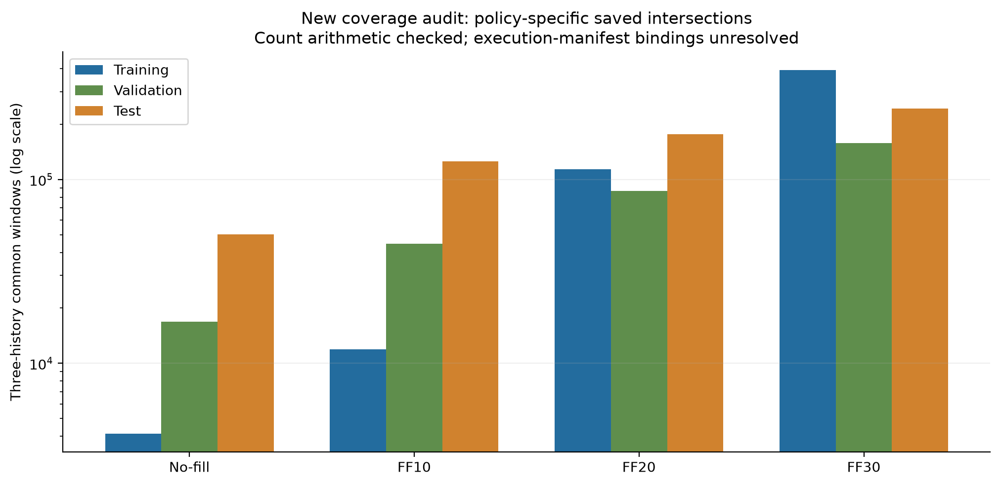

**Figure 12.** Saved common-window counts across histories within each policy. Different policies retain different populations; the bars are not matched predictive-performance comparisons.

## 12. Comparative Analysis with the Base Paper

This chapter compares Liu et al., arXiv:2511.00623v3, with the verified forecasting implementation. Page references identify the official 14-page PDF; the named uploaded copy was unavailable locally, so its byte identity is unverified. Full source identity and mathematical reading are in `BASE_PAPER_DETAILED_ANALYSIS.md`. Project claim identifiers resolve to the evidence register. **Not Implemented**, **Not Evaluated** and **Not Directly Comparable** are substantive boundaries, not missing scores to be estimated.

### Table 12.1: Overall research comparison

|Dimension|Base paper|Our research|Interpretation/status|
|---|---|---|---|
|1. Problem|Coupled power, heat and workload decisions; §II, pp. 3–4|Next-hour telemetry means from recent history|Different scientific tasks|
|2. Objectives|Near-reference operating decisions with a reduced optimization solve|Forecast accuracy, missingness/history/control comparisons|Forecasting objective demonstrated; operational objective future|
|3. Scope|Learning-to-optimization framework; §III, pp. 4–7|Observed-telemetry forecasting workflow|Complete paper architecture Not Implemented|
|18. Energy-related objective|Explicit economic objective Eq. (1 a)|Energy-aware decision support is a research direction|Savings Not Evaluated|
|24. Limitations|Five modeled agents; reproduction details require source-code review|One physical facility, observed periods, changing track contracts|Neither validates universal deployment benefit|

**Interpretation.** The paper learns decision variables that enter a physical coordination problem. Our supervised labels are future sensor-bin means. The shared word “federated” therefore does not make the pipelines reproductions of one another. The project's defensible result is the bounded empirical behavior of explicitly versioned forecasters. The paper supplies a motivation for a later decision layer, not evidence that forecasting error already measures energy-management performance. [D01; M01–M04; T01]

### Table 12.2: Dataset and experimental setup comparison

|Dimension|Base paper|Our research|Interpretation/status|
|---|---|---|---|
|4. Data source|Market/load/operational simulation data; §IV-A, p. 9, ref. [29]|M100 ExaData, raw Parquet, sensor audit and saved experiments|Different label generation|
|5. Entities|Five modeled data centers; Table II, p. 9|979 mapped compute-node clients in one facility|Not 979 physical data centers|
|6. Heterogeneity|Distinct local datasets and unequal update acceptance; Fig. 5|Unequal histories, counts, observed node errors|Formal non-IID taxonomy not fully evaluated|
|7. Missing data|Comparable sensor-gap treatment not verified in PDF|Coverage-controlled bins; no-fill/FF10/FF20/FF30 inputs; T7 stress/fallback separately|Our target values remain observed|
|8. Inputs|Prices, workload arrivals and queue state; §III-A, p. 4|14 operational, thermal, weather and calendar slots|Some executed tracks mask weather|
|10. Temporal formulation|Multi-period day-ahead decisions, Eq. (1)|6/36/144 ten-minute histories, next-six-bin mean|Different horizon and origin contracts|

**Interpretation.** This project's data are real telemetry, but the federation is simulated and includes known nodes. More clients does not establish stronger multi-site generalization. The historical v5 common test contains 6,590 windows on one date; B1 contains 194,212 hourly March windows; T4's canonical test contains 243,138 overlapping-origin windows. These populations must remain distinct. The paper's exact sample split and comparable telemetry-gap rates are Not verified from available artifacts in this review. [V01; B01; C03; T04]

### Table 12.3: Model and federated learning comparison

|Dimension|Base paper|Our research|Interpretation/status|
|---|---|---|---|
|11. Neural model|MLP ensemble, hidden [256,1024,256], ReLU/dropout 0.15; Eq. (4), §IV-A|GRU/LSTM plus node embedding; B1/T4 2×64 GRU|No paper MLP-ensemble reproduction|
|12. FL method|Conditional adaptive sharing/acceptance; Algorithm 1, p. 6|Standard sample-weighted FedAvg|Different algorithm|
|13. Aggregation|Selected shared blocks, weighted aggregate and local momentum mixing; Eqs. (5),(10),(13)|Full state including embedding; accepted-example weighting|No custom row-wise embedding rule|
|14. Local learning|1,500 warm-up steps, batch 512; 25×800 local steps|B1 SGD .01, batch 128, one local epoch, 200 rounds|Not equal computational budgets|
|15. Adaptation|Recent median/slope/volatility acceptance; Eqs. (11), temporary opt-out|Uniform fixed 98/979 sampling in principal runs|Adaptive participation Not Implemented|

**Interpretation.** Full-table averaging dilutes a node-specific embedding update when unchanged copies from other selected clients are averaged with it; that is documented standard FedAvg behavior here. It is unrelated to the paper's selective block sharing and acceptance. T4 further differs from B1: Adam, batch 64, residual L1 training and float32 aggregation are implemented. An average over all these versions would obscure the experiment. FedProx remains a proposed controlled comparison, not a completed adaptive substitute. [M01–M04; T09; F01]

### Table 12.4: Prediction and evaluation comparison

|Dimension|Base paper|Our research|Interpretation/status|
|---|---|---|---|
|9. Targets|Operational decisions/states, including servers, queue, cooling and temperature; §III-A|Observed mean node power; B1 also recorded IPMI ambient|Different semantics and physical scale|
|16. Evaluation|Independent/default/adaptive learning plus optimization reference; §IV|Chronological holdouts, frozen identities, persistence, selected centralized controls|Different reference questions|
|17. Prediction metrics|NRMSE averaged across decision dimensions, R²; Eq. (15), p. 9|Pooled and macro-node MAE/RMSE, W or °C|Not Directly Comparable|
|Selection|Conditional validation acceptance; Algorithm 1|Track-specific earliest minimum validation error|No test-based reselection authorized|
|Uncertainty|Ensemble spread, Eq. (12)|Three-seed sample SD where available|Seed SD is not calibrated predictive uncertainty|

**Interpretation.** R² measures variance explained relative to a mean predictor, while watt MAE measures absolute physical error and RMSE weights large errors more heavily. A 0.988 R² cannot be ranked against 24.8133 W MAE. Nor is a three-seed standard deviation an uncertainty interval for an individual future node. The correct empirical questions use the same labels, identities and aggregation: the historical v5 centralized control wins both pooled errors in all 12 pairs, whereas B1 beats persistence only on power RMSE among its four pooled output/error comparisons. [V02; B02; T02]

### Table 12.5: Energy-management and optimization comparison

|Dimension|Base paper|Our research|Interpretation/status|
|---|---|---|---|
|19. Formulation|MINLP P 1, envelope/MIQP P 2, reduced P 3; Eqs. (1)–(3),(14)|Forecasting losses only|Operational optimization Not Implemented|
|20. Decisions|Servers, cooling, generators, storage, grid trades|No executed control action|Action-response model Not Implemented|
|21. SLA/service|Queue/delay constraints and penalty; Eqs. (1 j)–(1 k)|Operational proxies exist, final SLA definition absent|SLA benefit Not Evaluated|
|22. Energy cost|Modeled dispatch costs relative to reference; Table III|No same-action energy/cost experiment|Not Directly Comparable|
|23. Efficiency|Optimization workflow time, Fig. 8|Some training times; T4 VRAM fields are fixed placeholders|No comparable end-to-end speedup|
|Excluded dimensions|Privacy, key management, cryptographic protocols, cybersecurity/security mechanisms|Not compared|Out of Scope for this comparison|

**Interpretation.** Facility cooling and PUE channels exist upstream, but availability does not create a causal controller or a node-level cooling label. A forecast can support a decision only after its action variables, physical response and constraints are specified and validated. The paper's cost model supplies a useful conceptual separation, not a transferable cost measurement. This project cannot claim energy/SLA savings or use hardcoded memory fields as measured efficiency evidence. [D02; T09; F02]

### Table 12.6: Quantitative results comparison

|Record|Base paper's measured quantity|Our separately measured quantity|Comparison indicator|
|---|---|---|---|
|Learning accuracy|Table II, p. 9: adaptive R² .951/.988/.988/.984/.988 across DC1–5|T4 canonical FedAvg pooled MAE 24.8133 W; RMSE 57.5502 W|Not Directly Comparable: decision R² versus sensor errors|
|Learning comparator|Table II default FL R² .591/.807/.797/.642/.935|v5 centralized pooled MAE/RMSE lower than FedAvg in 12/12 pairs|Different populations and algorithms|
|Cost accuracy|Table III, p. 10: independent .12%, default .07%, adaptive .08% aggregate deviation|No operational cost evaluation|Not Evaluated|
|Runtime|Fig. 8, p. 10: ~.61 s versus ~5.30 s; ratio ~8.69×|No equivalent optimization workflow benchmark|Not Directly Comparable|
|Persistence|Mean-reference R² and independent-learning comparison, not our persistence task|B1 power MAE 53.3568 versus 42.3922 W; RMSE 89.7978 versus 92.6004 W|Within-B1 comparison only|

**Interpretation.** The paper's adaptive method does not minimize every displayed aggregate deviation: default FL's 0.07% is below adaptive FL's 0.08%. Its argument also considers component errors and decision quality. Similarly, our B1 finding is mixed and T4's favorable persistence result does not establish FL superiority over its centralized control. The runtime ratio is recomputed from approximate published times, not independently benchmarked. T4's 24.81 W pooled MAE pairs with 33.0661 W pooled persistence; 33.3504 W is a macro-node baseline. [B02; T02; T03]

### Table 12.7: Research gaps and opportunities derived from the comparison

|25. Opportunity|Existing foundation|Missing evidence/component|Defensible next step|
|---|---|---|---|
|Telemetry-to-decision connection|Observed forecasting and paper's physical formulation|Validated response to actions|Specify action/response/constraints before simulation claims|
|Temporal robustness|Completed FF30 history, T2/T3 and T4 panels|Consistent contracts and prospective periods|Reconcile executed cohort rules; register later evaluation|
|Client heterogeneity|Per-node counts/errors, known-node embedding|Controlled non-IID/FedProx/participation study|Fix windows and budget, vary one factor|
|Missing telemetry|24-fit input-fill matrix plus T7 synthetic loss|Real failure mechanisms and independent dates|Replicate with explicit target-observation rules|
|Multi-output forecasting|B1 power/ambient execution|Uniform benefit, sensor placement/calibration|Audit targets and compare single-/multi-output baselines|
|Operational objectives|Upstream facility signals and modeled paper costs|Validated energy/SLA accounting and controller|Match units, aggregation scale and intervention evidence|

**Interpretation.** The present contribution is an implemented and traceable forecasting study with informative negative as well as positive findings. GRU, FedAvg and real telemetry are established components, not sufficient novelty claims. Intended contributions concern a controlled forecast-to-decision link and broader robustness, which remain future work. The immediate completion opportunity is the already-trained B1 centralized control's separately authorized same-window March evaluation; it would answer a missing matched forecasting comparison without pretending to reproduce the base paper's operational architecture. [B04; F01; F02]

## 13. Discussion, contributions and limitations

### 13.1 What the measured record establishes

The strongest consistent result is that comparisons depend on a carefully matched task. Historical v5 provides a direct method comparison on common observed targets: centralized SGD has lower pooled MAE and RMSE in all twelve policy/seed pairs. The gain cannot be generalized beyond that period and protocol, but it directly contradicts an unconditional claim that federated learning must improve forecasting accuracy. B1 answers another question: two-output hourly forecasting over a broader March population. Its poorer MAE and ambient-temperature errors show that architectural plausibility and additional targets do not guarantee a useful predictor. [V02; B02]

T4 supplies the strongest favorable persistence comparison in the current record. Its residual L1 forecaster improves the canonical pooled MAE by approximately one quarter, with improvement also present in the saved March panel. The centralized T4 control has lower mean errors than its FedAvg counterpart. Because T4 changes cohort, origin spacing, filling, residual target, loss and optimization, its improvement cannot be attributed to federation, longer history or one feature in isolation. It is an evaluated configuration, rather than a causal ablation of every design decision. [T02–T04; T09]

The FF30 history panel provides an actual controlled length comparison, conditional on a longest-history-eligible population. It supports a small measured 24-hour advantage over six hours on that population, not a universal ranking. Earlier coverage audits finding zero 24-hour test windows refer to another split/contract. Both facts can be true. The newer T1.1 v2 boundary-source explanation narrows the design/count discrepancy, but its eligibility claims and exact identity-level attrition require further review. The newly implemented two-layer residual benchmark has no completed result matrix; its externally progressing partial run is reported only as status. [U03; U05] [C01–C04]

### 13.2 Demonstrated contributions versus intended contributions

Demonstrated engineering contributions include causal coverage-controlled preparation, stable node/origin identities, explicit observed-target rules, node-client simulation, versioned sequence-model experiments, matched error reporting and provenance-preserving artifacts. Demonstrated empirical contributions include the historical input-fill/method comparison, B1's negative persistence findings, completed FF30 history experiments and the bounded T4 residual results. These are application-specific experimental contributions; they are not a newly invented GRU, FedAvg theorem or proof of deployment benefit.

### 13.3 Updated heterogeneity and decision-support interpretation

Client heterogeneity has observed coverage and error distributions: new FF30 common training counts span12–985 per node; validation excludes 50 active-training nodes; and T7 node errors change unevenly under input corruption. These describe unequal availability and performance. They do not identify a formal non-IID generative mechanism, a completed FedProx benefit or an evaluated participation-rate sensitivity. Three model seeds under one mask do not estimate missingness-process uncertainty. [U01; U05]

Decision support remains a proposed research layer. T7 motivates testing failure-aware confidence/fallback behavior before any scheduler consumes forecasts, but neither a 30-minute alert threshold nor power-sensor redundancy is validated as an energy-saving policy here. Facility cooling/PUE measurements remain physically distinct from node outputs. A later simulator must specify causal action response, service constraints and energy accounting; no such simulator or energy/SLA result was found in the current source/result inventory. [U07]

### 13.4 Scientific and verification limits

The data come from one facility and predominantly known clients. Client count measures a simulation partition, not independent organizational replication. Adjacent ten-minute origins have overlapping one-hour labels, while even hourly-origin B1 windows share much input history. Three random seeds measure initialization/sampling variability on one dataset. Neither the number of windows nor a small seed SD establishes independent statistical replication.

The historical v5 common test is concentrated on one date. B1's original validation-adequacy audit motivated its separately versioned earlier-week split; it must not be merged with the poorly distributed frozen-reference validation. March has already been inspected and evaluated. All March findings here are retrospective, and additional design choices informed by them require a later untouched period for confirmatory claims. [V01; B01; P02]

The reporting checks are bounded. File hashes establish equality with recorded local evidence; they do not prove the original measurements or every program execution was correct. Stored reconciliation PASS rows are cited as stored evidence. This task independently recalculates arithmetic from stored metric rows, not prediction-level inference. It does not rerun historical semantic preparation, deserialize models or re-evaluate predictions. Historical strict preflight remains FAILED and semantic reproduction UNKNOWN. [P01; P02; T08]

Known documentation inconsistencies are retained in `REPORT_VALIDATION.md`: an early score is an LSTM result; pooled and macro persistence baselines differ; some newer SD fields use ddof=0; T4 node exports contain seed 42 only; weather is masked in Candidate 1/T4 despite 14 retained slots; T4 memory values are placeholders; design/executed cohort totals differ; T7 narrative RMSE conflicts with its CSV; and the new history preflight confuses active clients with its failing 1,024-window eligibility threshold. These findings reduce the scope of claims, rather than justify overwriting historical artifacts.

## 14. Ongoing work and prioritized research plan

The immediate next evaluation is the B1 exposure-matched centralized-SGD control. Its three fits and selection exports exist, and a locked March evaluation adapter is implemented. Its March evaluation is not verified complete in the inspected inventory. The next gated operation must validate the selection lock, frozen test identity/target hashes, saved FedAvg alignment, quota and separate authorization receipt. It should reuse saved FedAvg predictions, not generate another FedAvg test run. This report starts no such operation. [B04]

The next methodological priority is resolution of the new preflight eligibility and loss-definition conflicts, followed by independently specified temporal evaluation. Full-cohort versus strict-history containment, longest-history gating, scaling population, weather handling and client eligibility must be explicit. Comparisons should freeze these choices before testing additional models or algorithms. A no-fill history counterpart remains incomplete in the verified record.

Environmental ablation has historical evidence and completed T5 records. GRU/LSTM/XGBoost have historical results and newly completed T6 records. These studies need their own protocol qualifications and do not establish a universal feature or architecture ranking. T7 now provides saved synthetic missingness results, with explicit zero-mean fallback and conditional persistence. Further robustness work needs real failure-mechanism evidence and additional periods rather than treating the stress test as a deployed monitoring solution. Client heterogeneity should be characterized through coverage and errors before claims about a particular non-IID mechanism. FedProx and client participation sensitivity are proposed experiments, not completed results. [H01; C03; F01]

Multi-output development should build on B1's completed but mixed result. Before adding targets, verify physical meaning, units, coverage, temporal alignment and aggregation level. A useful controlled study would compare single-output and joint-output models with the same input windows, scaler policy and training budget, while inspecting per-output gradients and persistence behavior. More outputs should not be treated as an automatic improvement.

A later decision-support stage should define a limited set of feasible actions, a validated response model and measurable service constraints. An action-response simulator needs observational/experimental validation; an arbitrary assumed power reduction is not an energy-saving result. Energy/SLA evaluation would then compare policies under matching workloads, account for intervention cost and constraint violations, and separate simulation from operational deployment. The base paper offers a formulation reference, while this project's empirical conditions must determine whether its variables and constraints are supportable. [F02]

## 15. Conclusion and presentation position

The completed record demonstrates a telemetry forecasting workflow and distinct empirical studies. Its reliable presentation position is evidence-specific: historical centralized controls outperform their FedAvg counterparts on the recorded matched v5 errors; B1 is a completed two-output experiment with mixed persistence performance; the FF30 history panel measures modest length effects on a selected cohort; and T4 provides the strongest current residual-power persistence improvement, subject to explicitly documented protocol and reporting qualifications.

The work should be presented as progress toward energy-aware decision support. It does not reproduce the mandatory paper's complete learning-to-optimization system and does not yet measure energy savings, cooling optimization, PUE improvement or SLA benefit. Retaining unfavorable outcomes, physical distinctions and unresolved provenance is part of the research contribution. The latest additions broaden the recorded evidence with T7 stress tests and new coverage/preflight artifacts, while exposing rather than repairing their contradictions. The report freezes no new experiment and grants no execution authorization.

## 16. References

[R1] J. Liu, L. Du, Y. Li, R.-P. Liu, Y. Li, F. Teng and F. Y. Hou. *Adaptive Federated Learning to Optimize Integrated Flows in Cyber–Physical Data Centers*. arXiv:2511.00623v3, 14 July 2026. [Versioned PDF](https://arxiv.org/pdf/2511.00623v3). Detailed page-level analysis accompanies this report.

[R2] A. Borghesi et al. *M100 ExaData: a data collection campaign on the CINECA's Marconi100 Tier-0 supercomputer*. Scientific Data 10, 288, 2023. [DOI:10.1038/s41597-023-02174-3](https://doi.org/10.1038/s41597-023-02174-3).

[R3] H. B. McMahan, E. Moore, D. Ramage, S. Hampson and B. Agüera y Arcas. *Communication-Efficient Learning of Deep Networks from Decentralized Data*. AISTATS, PMLR 54:1273–1282, 2017. [Publisher](https://proceedings.mlr.press/v54/mcmahan17a.html).

[R4] T. Li, A. K. Sahu, M. Zaheer, M. Sanjabi, A. Talwalkar and V. Smith. *Federated Optimization in Heterogeneous Networks*. MLSys, 2020; arXiv:1812.06127. [Primary preprint](https://arxiv.org/abs/1812.06127).

[R5] K. Cho et al. *Learning Phrase Representations using RNN Encoder–Decoder for Statistical Machine Translation*. EMNLP, 1724–1734, 2014. [DOI:10.3115/v1/D14-1179](https://aclanthology.org/D14-1179/).

[R6] S. Hochreiter and J. Schmidhuber. *Long Short-Term Memory*. Neural Computation 9(8):1735–1780, 1997. [DOI:10.1162/neco.1997.9.8.1735](https://doi.org/10.1162/neco.1997.9.8.1735); [author-hosted paper](https://people.idsia.ch/~juergen/lstm1997-2024head.pdf).

[R7] T. Chen and C. Guestrin. *XGBoost: A Scalable Tree Boosting System*. 2016. [Primary preprint, arXiv:1603.02754](https://arxiv.org/abs/1603.02754).

Repository references are individually recorded in `EVIDENCE_AND_CLAIM_REGISTER.csv`; hashes and verification scope are in `REPORT_VALIDATION.md` and the supporting inventories. The date of this report is an evidence cutoff, not proof of future December completion.
